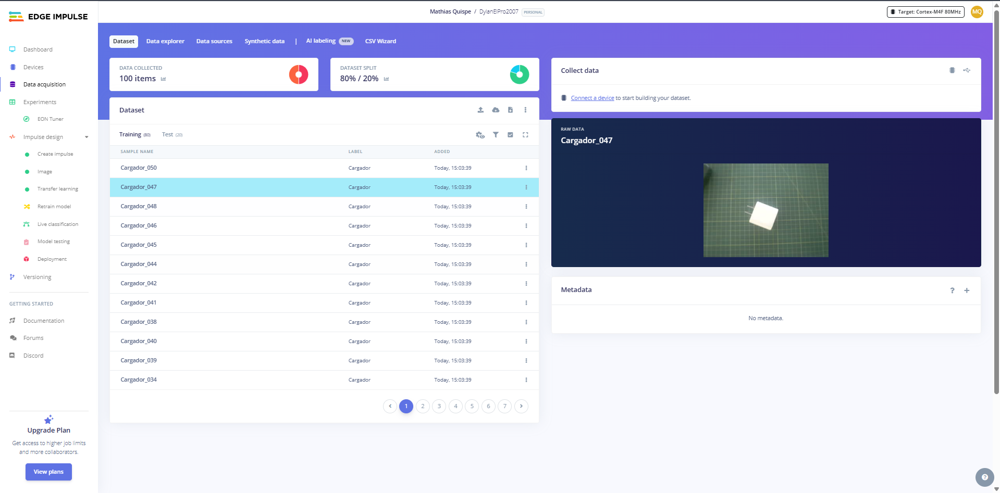
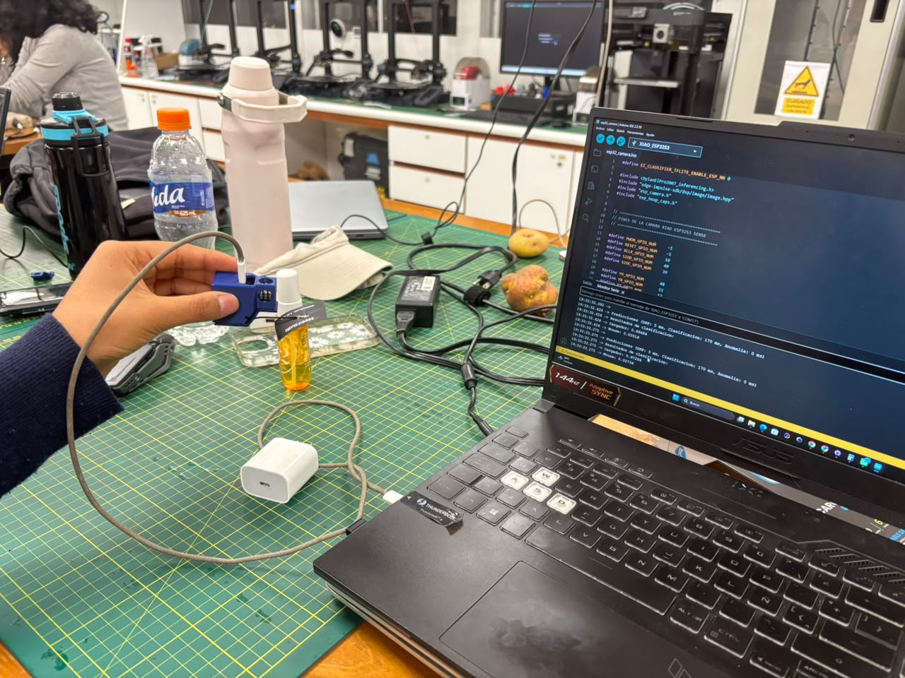
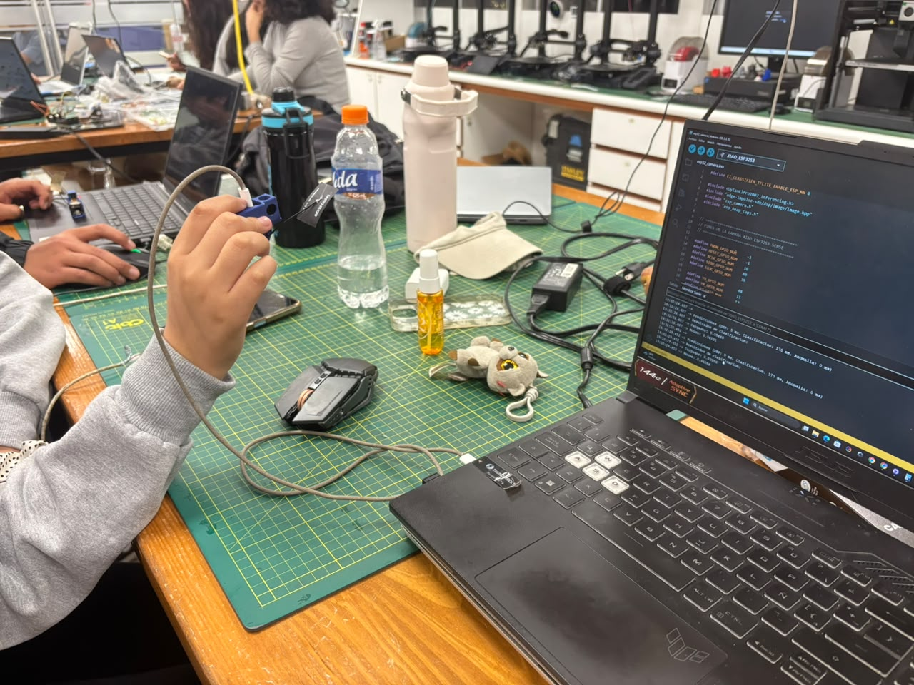
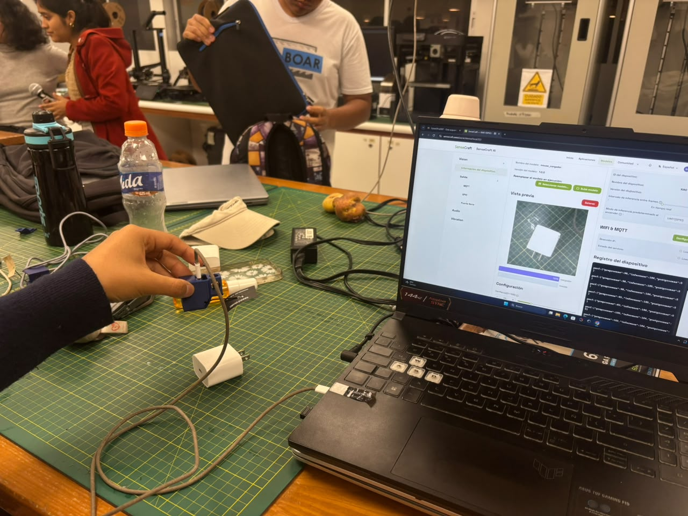
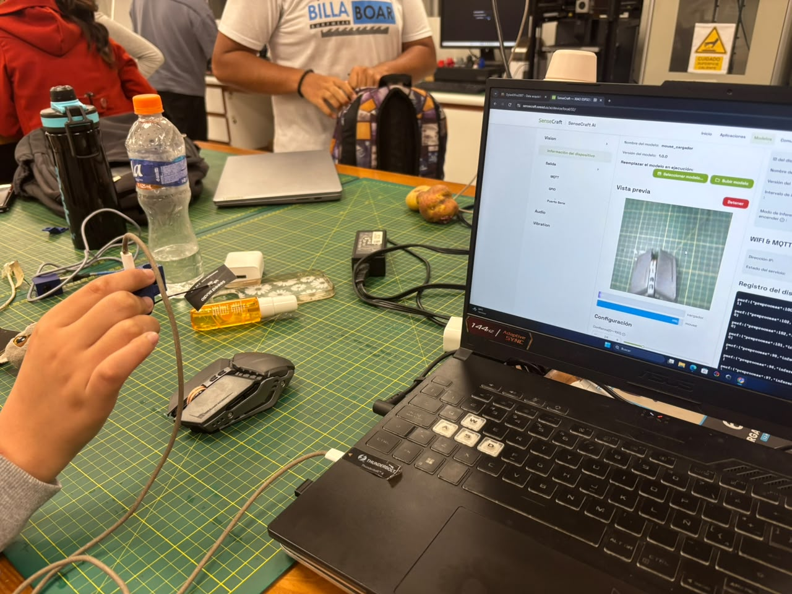

# Clasificación de cargador y mouse con TinyML

**Proyecto Integrador · Taller de TinyML · Universidad Peruana Cayetano Heredia (UPCH)**

Este proyecto implementa un clasificador de imágenes capaz de distinguir entre dos objetos de uso cotidiano: un **cargador** y un **mouse**. El modelo se entrena en Edge Impulse mediante Transfer Learning, se evalúa con métricas estadísticas y luego se despliega en la cámara **XIAO ESP32S3 Sense**, donde se comprueba su comportamiento con objetos reales a través de Arduino IDE y SenseCraft AI.

## Contenido

1. [Resumen del proyecto](#1-resumen-del-proyecto)
2. [Proyecto y conjunto de datos](#2-proyecto-y-conjunto-de-datos)
3. [Diseño y entrenamiento del modelo](#3-diseño-y-entrenamiento-del-modelo)
4. [Evaluación estadística](#4-evaluación-estadística)
5. [Pruebas de clasificación en Edge Impulse](#5-pruebas-de-clasificación-en-edge-impulse)
6. [Despliegue en Arduino IDE](#6-despliegue-en-arduino-ide)
7. [Pruebas en SenseCraft AI](#7-pruebas-en-sensecraft-ai)
8. [Análisis y limitaciones](#8-análisis-y-limitaciones)
9. [Estructura del repositorio](#9-estructura-del-repositorio)
10. [Referencias](#10-referencias)

---

## 1. Resumen del proyecto

| Aspecto | Detalle |
|---|---|
| Objetivo | Clasificar imágenes en dos clases: Cargador y Mouse |
| Plataforma de entrenamiento | Edge Impulse |
| Técnica | Transfer Learning con MobileNetV2 |
| Dataset | 100 imágenes JPG (50 por clase) |
| Entrada del modelo | Imágenes de 96 x 96 píxeles en RGB |
| Modelo desplegado | Cuantizado a int8 |
| Hardware | XIAO ESP32S3 Sense (cámara integrada) |
| Herramientas de prueba | Arduino IDE (monitor serie) y SenseCraft AI |

El flujo de trabajo siguió cinco etapas: preparación de los datos, diseño del impulse, entrenamiento, evaluación en la plataforma y pruebas con objetos físicos en el dispositivo.

---

## 2. Proyecto y conjunto de datos

### 2.1. Proyecto en Edge Impulse

*Figura 1. Panel principal del proyecto creado en Edge Impulse.*

La captura muestra el proyecto de clasificación de imágenes donde se gestionan los datos, el diseño del impulse, el entrenamiento y la evaluación. Es el punto de partida de todo el trabajo: desde esta plataforma se genera luego el modelo que se exporta al dispositivo.

### 2.2. Dataset y distribución de los datos

*Figura 2. Dataset cargado en Edge Impulse, con las imágenes etiquetadas y su división entre entrenamiento y prueba.*

La figura documenta el conjunto de datos utilizado. Se reunieron **100 imágenes JPG**, repartidas en **50 de Cargador** y **50 de Mouse**, por lo que el dataset está balanceado: ninguna clase tiene más ejemplos que la otra, lo que evita que el modelo se incline por la clase más numerosa.

Edge Impulse dividió los datos en **80 imágenes para entrenamiento (80 %)** y **20 imágenes para prueba (20 %)**. Los datos de entrenamiento sirven para que el modelo aprenda las características visuales de cada objeto, mientras que los de prueba se reservan para medir su desempeño con imágenes que no usó al aprender.

| Clase | Imágenes totales | Porcentaje |
|---|---|---|
| Cargador | 50 | 50 % |
| Mouse | 50 | 50 % |
| **Total** | **100** | **100 %** |

---

## 3. Diseño y entrenamiento del modelo

### 3.1. Diseño del impulse

*Figura 3. Diseño del impulse: bloque de entrada de imagen, bloque de procesamiento y bloque de aprendizaje.*

El impulse define el recorrido de los datos dentro del sistema. Las imágenes ingresan con un tamaño de **96 x 96 píxeles** en formato **RGB**, pasan por un bloque de procesamiento que extrae las características de la imagen y llegan a un bloque de clasificación basado en **Transfer Learning**, con salida de dos clases. Reducir las imágenes a 96 x 96 píxeles disminuye la memoria y el tiempo de cómputo necesarios, algo fundamental en un microcontrolador.

### 3.2. Procesamiento de las imágenes

*Figura 4. Bloque de procesamiento de imágenes y generación de características.*

Esta captura corresponde a la etapa en la que Edge Impulse transforma las imágenes originales en las características que recibirá el modelo. Aquí se revisa que las imágenes se estén interpretando en color (RGB) y con la resolución configurada, antes de pasar al entrenamiento.

### 3.3. Parámetros de entrenamiento

El entrenamiento se realizó con **Transfer Learning (MobileNetV2)**, una red preentrenada que ya reconoce patrones visuales generales y que se adapta aquí a las dos clases del proyecto. Esto permite obtener buenos resultados con un dataset pequeño.

| Parámetro | Valor |
|---|---|
| Arquitectura base | MobileNetV2 |
| Ciclos de entrenamiento (epochs) | 30 |
| Tasa de aprendizaje | 0.0005 |
| Tamaño de entrada | 96 x 96, RGB |

---

## 4. Evaluación estadística

### 4.1. Validación durante el entrenamiento

*Figura 5. Resultados del entrenamiento y la validación: accuracy, loss y matriz de confusión.*

La captura muestra el resultado del entrenamiento sobre el conjunto de validación: un **accuracy del 100 %** y un **loss de 0.01**. El accuracy indica la proporción de imágenes clasificadas correctamente, y el loss mide qué tan lejos están las predicciones del valor esperado; un valor tan bajo señala que el modelo ajustó bien los datos. La matriz de confusión que acompaña la figura permite verificar que ninguna imagen de una clase fue asignada a la otra.

### 4.2. Evaluación con el conjunto de prueba

*Figura 6. Evaluación del modelo con las imágenes de prueba.*

Con las 20 imágenes reservadas para prueba, el modelo obtuvo un **accuracy del 100 %** y valores de **1.00** en precisión, recall y F1 score promedio ponderados.

| Métrica | Resultado | Qué significa |
|---|---|---|
| Accuracy | 100 % | Todas las imágenes de prueba se clasificaron correctamente |
| Precisión ponderada | 1.00 | Cuando el modelo predice una clase, acierta |
| Recall ponderado | 1.00 | El modelo encuentra todos los ejemplos reales de cada clase |
| F1 score ponderado | 1.00 | Equilibrio perfecto entre precisión y recall |

Estos resultados corresponden a los conjuntos evaluados en la plataforma. Con un conjunto de prueba de solo 20 imágenes, un 100 % no garantiza el mismo desempeño con cualquier cargador o mouse en cualquier condición, por lo que se complementa con las pruebas físicas descritas a continuación.

---

## 5. Pruebas de clasificación en Edge Impulse

Antes de pasar al dispositivo, se verificó el modelo con imágenes individuales dentro de la plataforma.

### 5.1. Clasificación de un cargador

*Figura 7. Clasificación de una imagen de cargador en Edge Impulse.*

La figura muestra el resultado de clasificar una imagen de cargador. El modelo asigna una puntuación de **1.00 a la clase Cargador**, es decir, la identifica con total seguridad en esa muestra y sin competencia de la otra clase.

### 5.2. Clasificación de un mouse

*Figura 8. Clasificación de una imagen de mouse en Edge Impulse.*

De manera análoga, para una imagen de mouse el modelo asigna una puntuación de **1.00 a la clase Mouse**. Con ambas pruebas se confirma que el modelo reconoce correctamente cada objeto antes de llevarlo al hardware.

---

## 6. Despliegue en Arduino IDE

### 6.1. Exportación del modelo

*Figura 9. Exportación del modelo cuantizado como biblioteca de Arduino.*

Se exportó el modelo **cuantizado en int8** como una biblioteca para Arduino IDE. La cuantización representa los parámetros del modelo con enteros de 8 bits, lo que reduce el tamaño y el consumo de memoria y lo hace apto para el microcontrolador de la XIAO ESP32S3 Sense. La biblioteca generada permite ejecutar la inferencia directamente en la placa.

### 6.2. Prueba con cargador

*Figura 10. Salida del monitor serie al presentar un cargador a la cámara.*

*Figura 11. Fotografía de la prueba física con el cargador frente a la cámara XIAO ESP32S3 Sense.*

La Figura 10 muestra las predicciones que el dispositivo imprime en el monitor serie, con la puntuación asignada a cada clase. La Figura 11 documenta el objeto real utilizado, de modo que se pueda contrastar lo que se presentó a la cámara con la predicción obtenida. En esta prueba, la clase con mayor puntuación es **Cargador**, coincidiendo con el objeto mostrado.

### 6.3. Prueba con mouse

*Figura 12. Salida del monitor serie al presentar un mouse a la cámara.*

*Figura 13. Fotografía de la prueba física con el mouse frente a la cámara XIAO ESP32S3 Sense.*

Igual que en la prueba anterior, la Figura 12 presenta la salida del monitor serie y la Figura 13 el objeto utilizado. La clase con mayor puntuación es **Mouse**, lo que concuerda con el objeto presentado.

Las puntuaciones del monitor serie son valores de salida del modelo para una entrada concreta; no equivalen necesariamente a probabilidades calibradas ni deben leerse como el accuracy global del sistema.

---

## 7. Pruebas en SenseCraft AI

El modelo en formato TensorFlow Lite se importó en SenseCraft AI para comprobar la clasificación en tiempo real con la cámara.

### 7.1. Cargador

*Figura 14. Resultado de la clasificación del cargador en la interfaz de SenseCraft AI.*

*Figura 15. Fotografía del cargador utilizado durante la prueba en SenseCraft AI.*

La interfaz muestra el porcentaje asignado a cada clase mientras la cámara observa el objeto. Con el cargador frente a la cámara, el valor más alto corresponde a la clase **Cargador**.

### 7.2. Mouse

*Figura 16. Resultado de la clasificación del mouse en la interfaz de SenseCraft AI.*

*Figura 17. Fotografía del mouse utilizado durante la prueba en SenseCraft AI.*

Con el mouse frente a la cámara, el valor más alto corresponde a la clase **Mouse**, coherente con el objeto físico mostrado en la Figura 17.

---

## 8. Análisis y limitaciones

**Coherencia entre pruebas.** Los resultados son consistentes en las tres etapas: la evaluación en Edge Impulse, el monitor serie de Arduino IDE y la interfaz de SenseCraft AI identifican correctamente la clase del objeto presentado.

**Diferencias entre plataformas.** Los porcentajes que muestran el monitor serie y SenseCraft AI pueden diferir para un mismo objeto. Esto es esperable, ya que dependen del procesamiento de la imagen, la implementación y las condiciones de cada prueba, y no indica que una plataforma sea mejor que otra.

**Alcance de los resultados.** El dataset es pequeño (100 imágenes) y el conjunto de prueba contiene solo 20. Un accuracy del 100 % describe esos datos concretos y no garantiza el mismo resultado con otros modelos de cargador o mouse, fondos distintos o diferente iluminación. Las pruebas físicas son ejemplos individuales y no permiten calcular la exactitud global del dispositivo.

**Mejoras propuestas.**

- Ampliar el dataset con más variedad de cargadores y mouse.
- Variar ángulos, fondos e iluminación durante la captura.
- Realizar más pruebas físicas y registrar tanto aciertos como errores.
- Añadir una clase adicional de fondo u objetos ajenos para evaluar el comportamiento ante entradas desconocidas.

---

## 9. Estructura del repositorio

| Elemento | Descripción |
|---|---|
| `Imagenes/` | Capturas de pantalla y fotografías de las pruebas |
| `Data.zip` | Dataset original de 100 imágenes, agrupadas en `Cargador_images_50.zip` y `Mouse_images_50.zip` |
| `Modelo.zip` | Contiene `Modelo_Arduino.zip` (biblioteca para Arduino IDE) y `Modelo_SenseCraft.tflite` (modelo para SenseCraft AI) |

---

## 10. Referencias

[1] UPCH, *Guía TinyML con Edge Impulse*, material de laboratorio, 2026.

