# TinyML con Edge Impulse — Cargador y Mouse

En esta práctica desarrollamos un modelo de clasificación de imágenes para reconocer **cargadores** y **mouse**. Lo entrenamos en Edge Impulse y realizamos pruebas con Arduino IDE y SenseCraft usando la cámara XIAO ESP32S3 Sense.

## 1. Proyecto y dataset

Creamos nuestro proyecto en Edge Impulse y trabajamos con imágenes etiquetadas en dos clases: **Cargador** y **Mouse**.

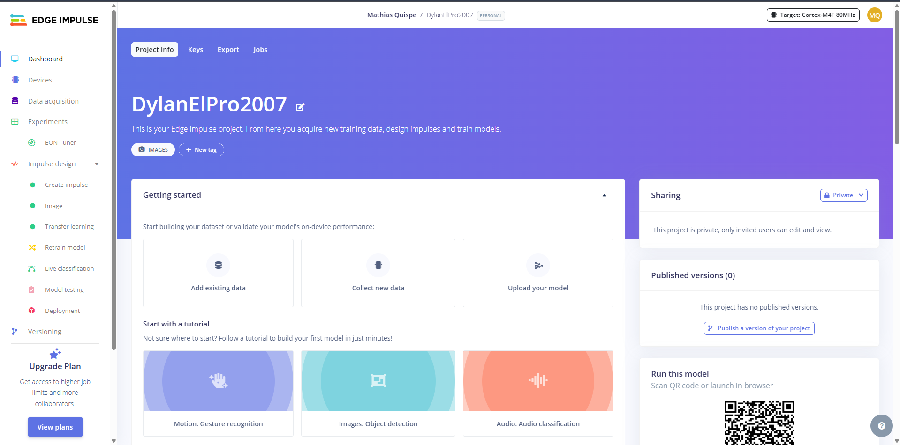

**Dataset:** Reunimos **100 imágenes JPG**, distribuidas en dos clases (50 de **Cargador** y 50 de **Mouse**). Se incluyen en `Data.zip`, con un ZIP y una carpeta etiquetada por cada clase.

## 2. Configuración y entrenamiento

Configuramos imágenes de **96 × 96 píxeles**, en formato **RGB**, y usamos **Transfer Learning (MobileNetV2)**. Entrenamos durante **30 ciclos**, con una tasa de aprendizaje de **0.0005**.

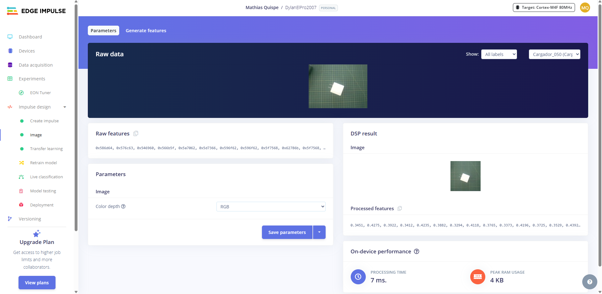

## 3. Pruebas estadísticas

**Prueba 1 — Validación del entrenamiento:** alcanzamos **100 % de accuracy** y **0.01 de loss** en el conjunto de validación mostrado por Edge Impulse.

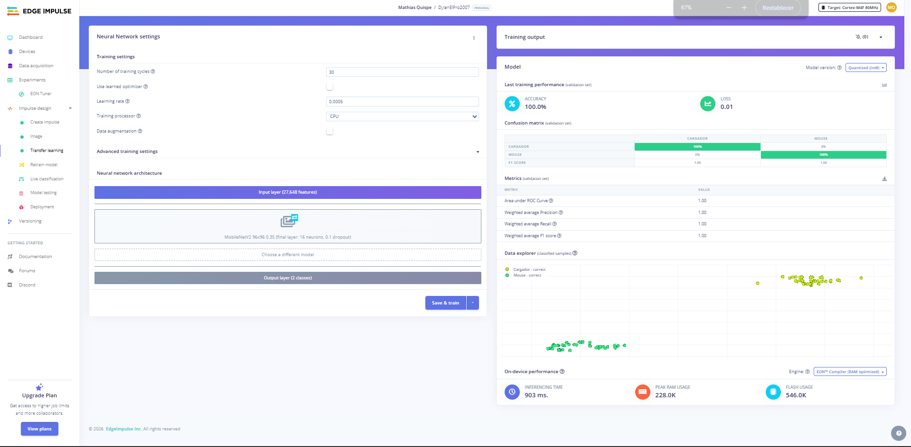

**Prueba 2 — Evaluación del modelo:** en las imágenes de prueba obtuvimos **100 % de accuracy** y valores de **1.00** para precisión, recall y F1 promedio ponderados.

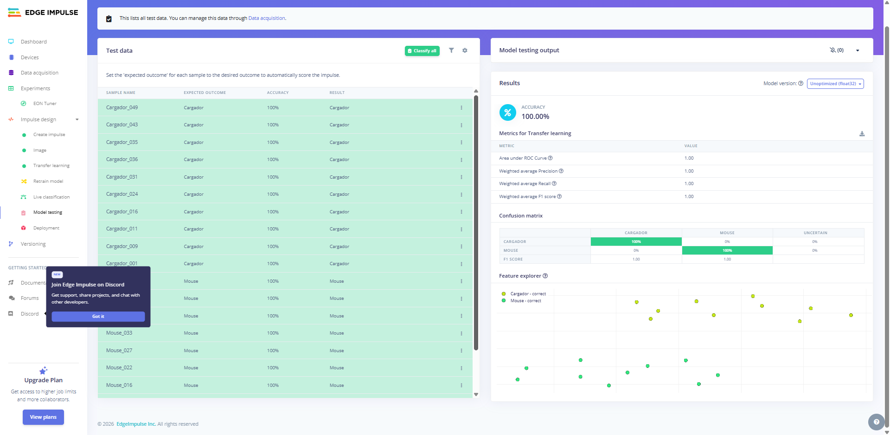

Estos resultados corresponden a los conjuntos evaluados en la plataforma.

## 4. Pruebas en Edge Impulse y Arduino IDE

Primero verificamos imágenes por separado: el modelo reconoció un **cargador** y un **mouse** con puntuaciones de **1.00** para su clase correspondiente.

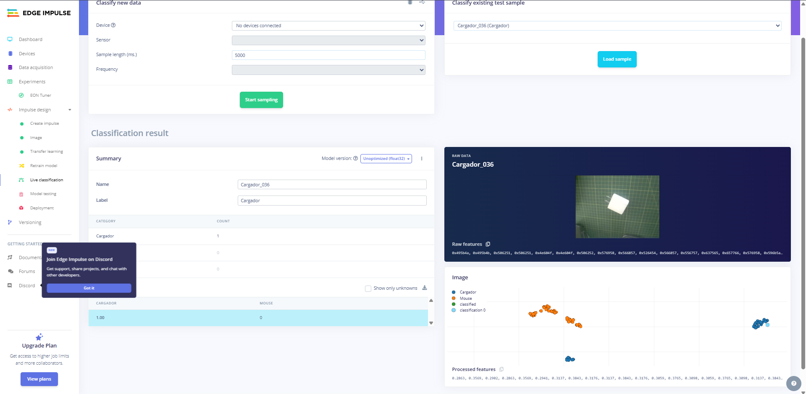

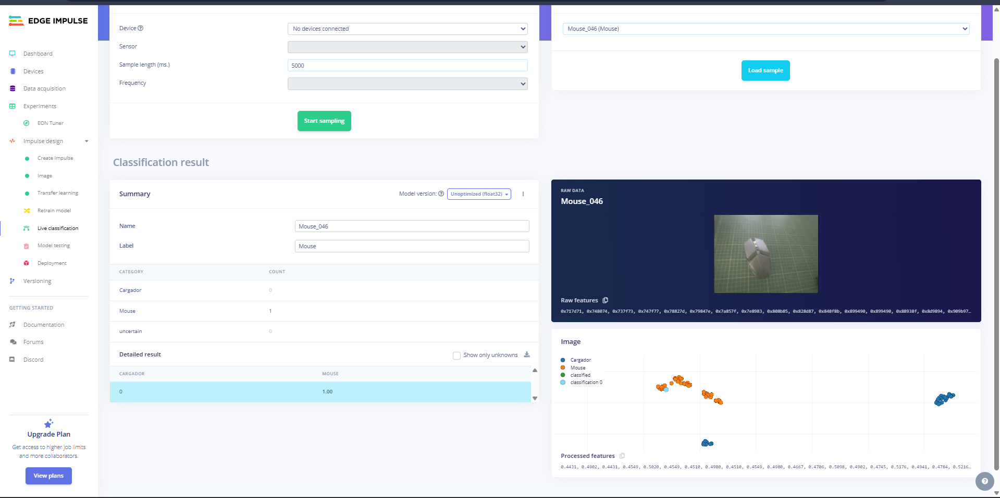

Después exportamos el modelo cuantizado **int8** como biblioteca para Arduino IDE y realizamos pruebas con la cámara XIAO ESP32S3 Sense, revisando las predicciones en el monitor serie.

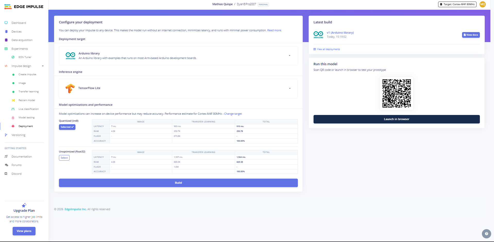

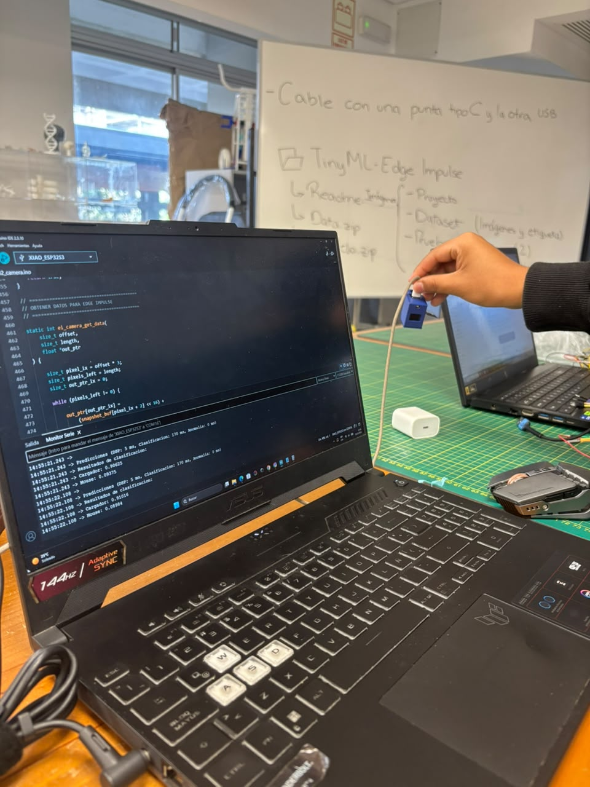

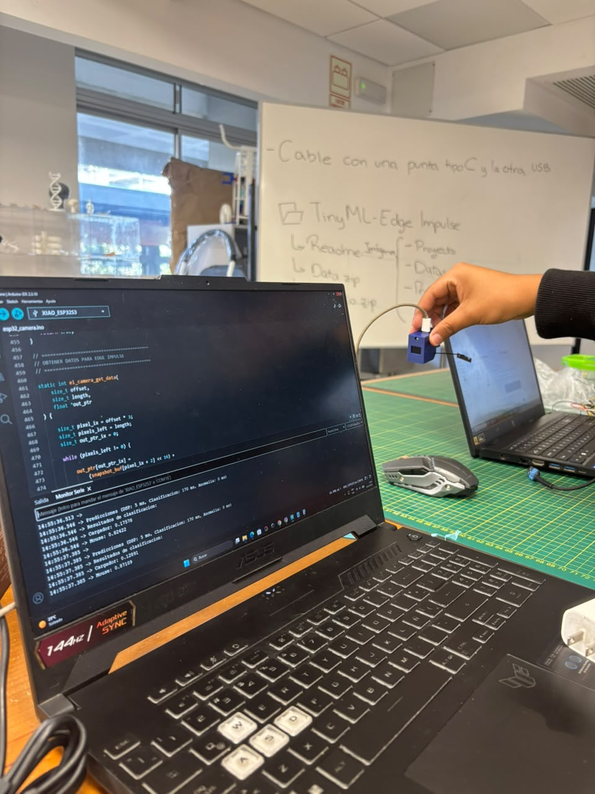

## 5. Pruebas en SenseCraft

Importamos el modelo TensorFlow Lite en SenseCraft y comprobamos la clasificación de ambos objetos con la cámara.

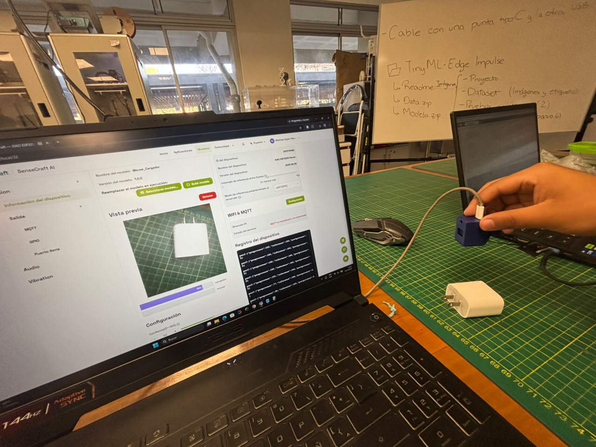

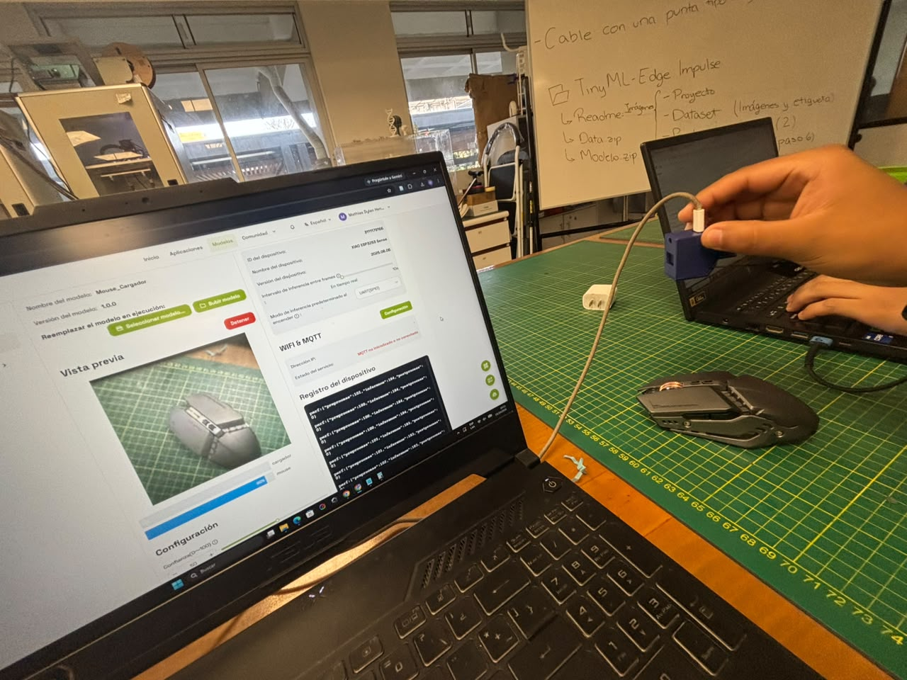

## Archivos del proyecto

- `Imagenes/`: capturas y fotografías de nuestras pruebas.
- `Data.zip`: dataset original de 100 imágenes, agrupadas en `Cargador_images_50.zip` y `Mouse_images_50.zip`.
- `Modelo.zip`: contiene `Modelo_Arduino.zip` (biblioteca para Arduino IDE) y `Modelo_SenseCraft.tflite` (modelo para SenseCraft).

**Referencia:** [1] UPCH, *Guía TinyML con Edge Impulse*, material de laboratorio, 2026.
