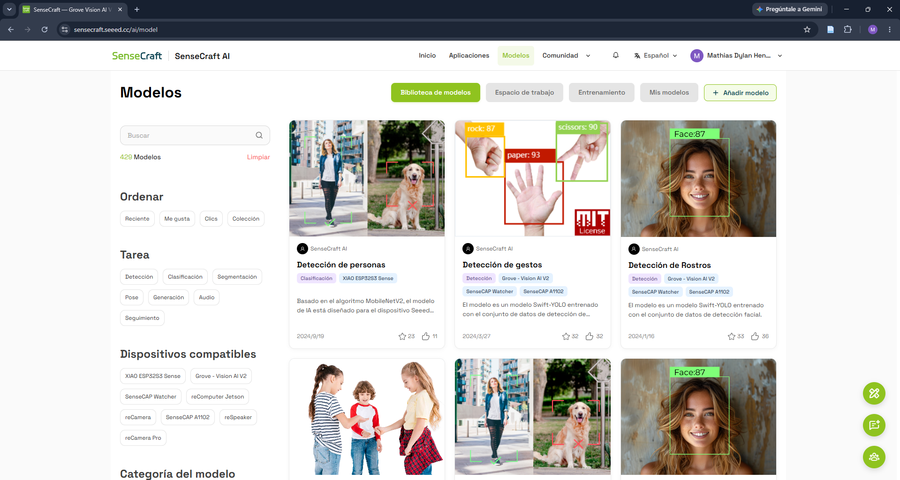
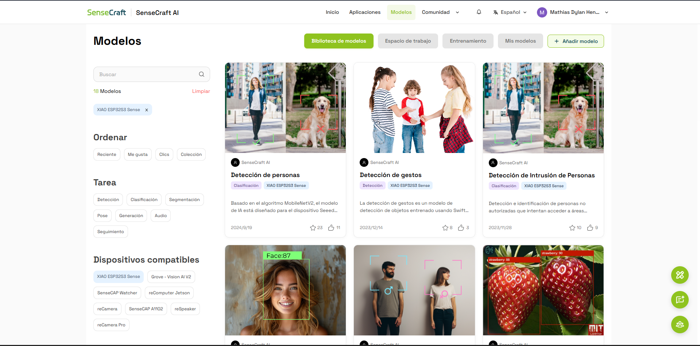
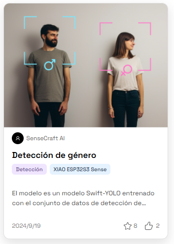
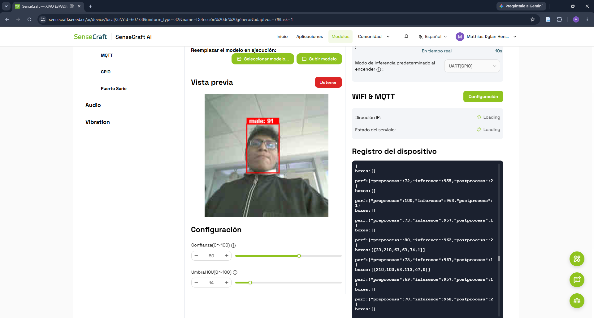
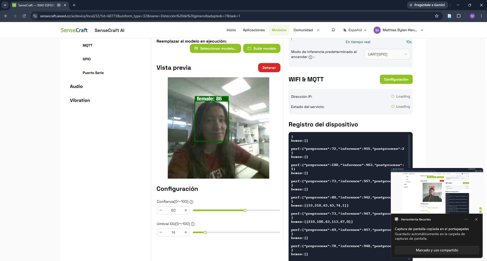
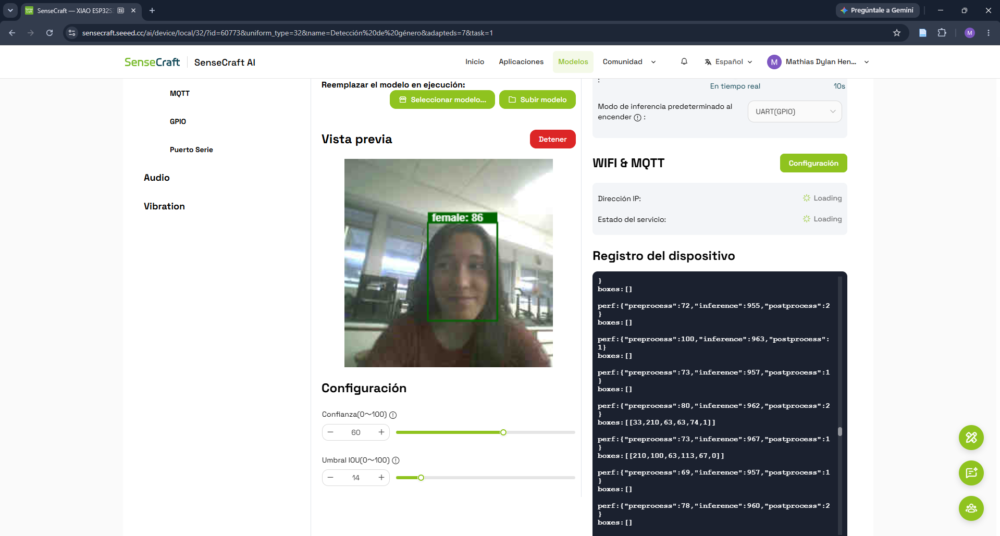
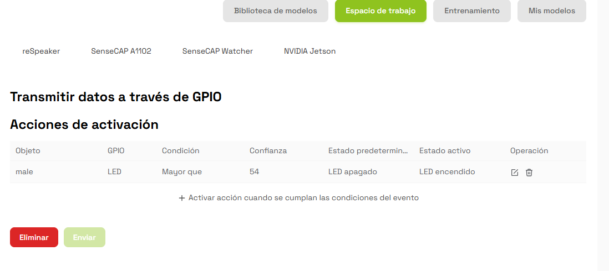
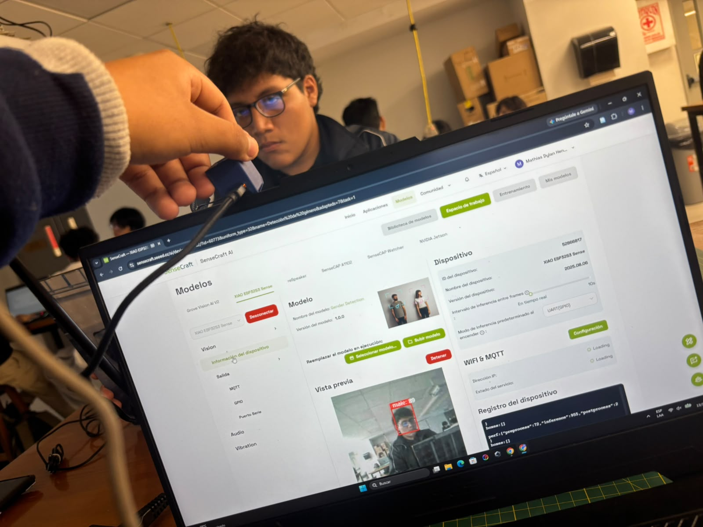

# Detección de género con SenseCraft AI

**Universidad:** Universidad Peruana Cayetano Heredia (UPCH)  
**Fecha:** 13/10/2026  
**Plataforma:** SenseCraft AI  
**Dispositivo:** XIAO ESP32S3 Sense

## 1. Introducción

En esta práctica trabajamos con la plataforma SenseCraft AI para conocer cómo funcionan los modelos de inteligencia artificial que ya se encuentran entrenados.

Como grupo seleccionamos el modelo **Detección de género**, el cual permite detectar rostros y mostrar las etiquetas `male` y `female`, junto con un porcentaje de confianza.

Para realizar las pruebas utilizamos la placa XIAO ESP32S3 Sense con su cámara. También exploramos la configuración GPIO para relacionar las detecciones con el funcionamiento de un LED.

## 2. Materiales utilizados

- XIAO ESP32S3 Sense.
- Cámara del dispositivo.
- Laptop.
- Cable USB.
- Navegador Google Chrome.
- Plataforma SenseCraft AI.

## 3. Procedimiento

### 3.1. Exploración de SenseCraft AI

Primero ingresamos a la plataforma [SenseCraft AI](https://sensecraft.seeed.cc/ai/) y exploramos la sección de modelos.

En esta parte encontramos diferentes modelos de inteligencia artificial, los cuales se pueden filtrar por tipo de tarea y dispositivo compatible.

*Figura 1. Biblioteca de modelos disponibles en SenseCraft AI.*

Después seleccionamos el dispositivo **XIAO ESP32S3 Sense** para visualizar los modelos que podíamos utilizar con nuestra placa.

*Figura 2. Modelos compatibles con XIAO ESP32S3 Sense.*

### 3.2. Selección del modelo

Entre las opciones disponibles elegimos el modelo **Detección de género**.

Según la información de la plataforma, este modelo está basado en Swift-YOLO y permite identificar rostros mediante recuadros de detección.

En esta primera actividad no entrenamos ningún modelo nuevo, ya que utilizamos uno que se encontraba disponible en la biblioteca.

*Figura 3. Modelo de detección de género seleccionado.*

### 3.3. Conexión del dispositivo

Luego ingresamos a **Espacio de trabajo**, seleccionamos la XIAO ESP32S3 Sense e intentamos conectarla a la laptop mediante USB.

Durante uno de los intentos apareció el mensaje **"No se encontraron dispositivos compatibles"**, por lo que inicialmente no pudimos iniciar las pruebas.

*Figura 4. Problema presentado durante la conexión del dispositivo.*

Posteriormente logramos establecer la conexión y continuar con la ejecución del modelo.

### 3.4. Prueba con la etiqueta MALE [Josue Cristian Mogollon]

Una vez conectado el dispositivo, iniciamos la vista previa y colocamos a uno de los integrantes frente a la cámara.

El modelo mostró un recuadro rojo alrededor del rostro y presentó el siguiente resultado:

- **Etiqueta:** male.
- **Confianza:** 91 %.

También observamos que en el registro del dispositivo se mostraban datos relacionados con las detecciones realizadas.

*Figura 5. Resultado obtenido durante la detección de la etiqueta male.*

### 3.5. Prueba con la etiqueta FEMALE [Dayra Martina Kuang]

Después realizamos otra prueba colocando a una compañera frente a la cámara.

En esta ocasión el modelo mostró un recuadro verde sobre el rostro con los siguientes resultados:

- **Etiqueta:** female.
- **Confianza:** 86 %.

*Figura 6. Primera prueba con la etiqueta female.*

También realizamos otra captura con una posición diferente frente a la cámara.

*Figura 7. Segunda prueba realizada con la etiqueta female.*

Con estas pruebas pudimos observar cómo el modelo realizaba las predicciones en tiempo real.

### 3.6. Configuración GPIO

Después de probar el modelo ingresamos a la opción **Salida → GPIO**, donde encontramos las acciones que se pueden configurar según los resultados de la detección.

Como grupo configuramos una condición para que el LED se active cuando se detecte la etiqueta `male` con una confianza mayor a 54.

La configuración realizada fue la siguiente:

| Parámetro | Configuración |
|---|---|
| Objeto | male |
| GPIO | LED |
| Condición | Mayor que |
| Confianza | 54 |
| Estado inicial | LED apagado |
| Estado activo | LED encendido |

*Figura 8. Configuración GPIO realizada para la detección male.*

Esta opción nos permitió conocer cómo se puede utilizar el resultado de un modelo de inteligencia artificial para controlar una salida del dispositivo.

En la captura quedó registrada la configuración de la condición, aunque no se muestra una comprobación física del encendido del LED.

### 3.7. Evidencia de la práctica

Durante el desarrollo de la actividad también tomamos fotografías del trabajo realizado en el laboratorio.

En ellas se puede observar la laptop ejecutando SenseCraft AI y el dispositivo utilizado para las pruebas.

*Figura 9. Pruebas realizadas durante la práctica de laboratorio.*

## 4. Resultados obtenidos

| Prueba | Resultado | Confianza |
|---|---|---|
| Detección MALE | male | 91 % |
| Detección FEMALE | female | 86 % |
| Configuración GPIO | LED asociado a male | Mayor a 54 |

Durante las pruebas observamos que el modelo identificaba los rostros y mostraba una etiqueta junto con su nivel de confianza.

Estos porcentajes corresponden a las predicciones de las pruebas realizadas, por lo que no representan la precisión general del modelo.

Además, las etiquetas `male` y `female` son estimaciones visuales del modelo y no permiten determinar la identidad de género real de una persona.

## 5. Dificultades encontradas

Una de las dificultades que tuvimos fue la conexión inicial de la XIAO ESP32S3 Sense, ya que el navegador no detectaba el dispositivo.

También tuvimos que revisar las opciones de la plataforma para entender cómo seleccionar el modelo, iniciar la vista previa y configurar las acciones GPIO.

Después de realizar las pruebas pudimos familiarizarnos mejor con estas herramientas.

## 6. Conclusiones

En esta práctica aprendimos a utilizar un modelo preentrenado desde SenseCraft AI y ejecutarlo mediante la XIAO ESP32S3 Sense.

Logramos realizar pruebas con las etiquetas `male` y `female`, obteniendo valores de confianza de 91 % y 86 %, respectivamente.

También conocimos cómo configurar una condición GPIO para relacionar una predicción del modelo con una salida LED.

Finalmente, esta actividad nos ayudó a comprender mejor cómo se pueden utilizar los modelos de visión artificial en dispositivos pequeños.

## 7. Referencias

[1] Seeed Studio, "SenseCraft AI", *Seeed Studio Wiki*. [En línea]. Disponible: https://wiki.seeedstudio.com/es/sensecraft-ai/overview/.

[2] Seeed Studio, "Configuración de salida GPIO en SenseCraft AI para XIAO ESP32S3 Sense", *Seeed Studio Wiki*. [En línea]. Disponible: https://wiki.seeedstudio.com/es/sensecraft_ai_output_gpio_xiao/.
