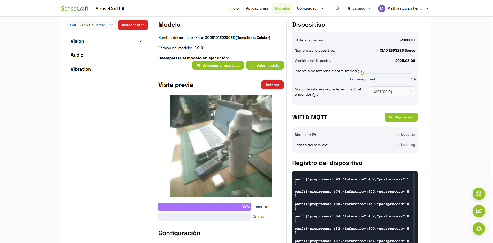
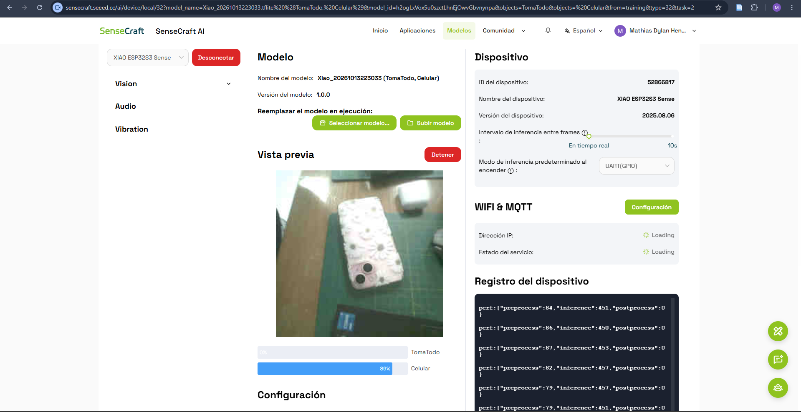

# Clasificación de Tomatodo y Celular con SenseCraft AI

**Universidad:** Universidad Peruana Cayetano Heredia (UPCH)  
**Fecha:** 13/10/2026  
**Plataforma:** SenseCraft AI  
**Dispositivo:** XIAO ESP32S3 Sense

## 1. Introducción

En esta práctica trabajamos con SenseCraft AI para entrenar y probar un modelo de clasificación de imágenes que pudiera diferenciar dos objetos: un tomatodo y un celular.

Para realizar la actividad utilizamos fotografías de ambos objetos, las herramientas de entrenamiento de la plataforma y la XIAO ESP32S3 Sense para comprobar los resultados.

## 2. Materiales utilizados

- XIAO ESP32S3 Sense.
- Cámara.
- Tomatodo.
- Cable USB.

## 3. Entrenamiento del modelo

### 3.1. Creación de las categorías

Primero ingresamos a SenseCraft AI y seleccionamos la opción **Modelos → Entrenamiento → Clasificación de imágenes**.

Para nuestro modelo trabajamos con dos categorías:

- **TomaTodo:** imágenes del tomatodo.
- **Celular:** imágenes del teléfono celular.

El objetivo fue que el modelo aprendiera a diferenciar ambos objetos a partir de las imágenes utilizadas.

### 3.2. Recolección de imágenes

Para preparar el entrenamiento reunimos imágenes del tomatodo y del celular.

Estas fotografías conformaron nuestro conjunto de datos, el cual utilizamos para trabajar con las dos categorías.

SenseCraft AI cuenta con una opción para utilizar la webcam durante la recolección de imágenes.

También guardamos las fotografías en un archivo comprimido llamado `datos.zip`, para conservar los datos utilizados.

### 3.3. Entrenamiento

Después de preparar las categorías y las imágenes, continuamos con el entrenamiento del modelo desde SenseCraft AI.

Seleccionamos **XIAO ESP32S3 Sense** como dispositivo de destino.

El modelo personalizado utilizado en las pruebas mostró la siguiente información:

| Parámetro | Información |
|---|---|
| Nombre | Xiao_20261013223033 |
| Versión | 1.0.0 |
| Tipo | Clasificación de imágenes |
| Clase 1 | TomaTodo |
| Clase 2 | Celular |
| Dispositivo | XIAO ESP32S3 Sense |

Una vez disponible el modelo, continuamos con las pruebas para comprobar cómo clasificaba los objetos.

## 4. Pruebas del modelo

### 4.1. Clasificación del TOMATODO

Para realizar la primera prueba colocamos un tomatodo frente a la cámara del dispositivo.

En la vista previa observamos que el modelo mostraba los porcentajes correspondientes a las dos categorías.

Los resultados fueron:

- **TomaTodo:** 100 %.
- **Celular:** 0 %.

*Figura 1. Resultado de la clasificación del tomatodo.*

Durante esta prueba el modelo identificó correctamente el objeto que estábamos mostrando.

### 4.2. Clasificación del CELULAR

Después retiramos el tomatodo y colocamos un celular frente a la cámara para realizar la segunda prueba.

En este caso el modelo cambió su predicción y mostró los siguientes resultados:

- **Celular:** 89 %.
- **TomaTodo:** 0 %.

*Figura 2. Resultado de la clasificación del celular.*

Con esta prueba observamos que el modelo pudo diferenciar el celular del tomatodo.

## 5. Resultados obtenidos

| Prueba | Objeto | Confianza |
|---|---|---|
| 1 | TomaTodo | 100 % |
| 2 | Celular | 89 % |

Durante las pruebas el modelo logró clasificar correctamente los dos objetos que colocamos frente a la cámara.

El tomatodo obtuvo una confianza de 100 %, mientras que el celular obtuvo 89 %.

Estos valores corresponden a las pruebas registradas, por lo que sería necesario utilizar más imágenes y realizar nuevas pruebas para conocer mejor el desempeño del modelo.

## 6. Archivos utilizados

Para mantener organizado nuestro trabajo guardamos el conjunto de imágenes y el modelo entrenado.

### 6.1. Dataset

El archivo `datos.zip` contiene las imágenes correspondientes a las dos categorías utilizadas.

[Ver dataset de Tomatodo y Celular](datos/datos.zip)

### 6.2. Modelo TensorFlow Lite

También incluiremos el modelo en formato `.tflite`, para conservar el archivo generado durante la práctica.

[Ver modelo entrenado](modelo/modelo_tomatodo_celular.tflite)

Ambos archivos estarán disponibles en el repositorio de GitHub.

## 7. Dificultades encontradas

Durante la actividad tuvimos que revisar cómo organizar las imágenes de los dos objetos y utilizar las opciones de entrenamiento de SenseCraft AI.

También fue necesario conocer cómo seleccionar el dispositivo y ejecutar el modelo para observar sus resultados.

Estas pruebas nos ayudaron a familiarizarnos con el entrenamiento y la clasificación de imágenes.

## 8. Conclusiones

En esta actividad aprendimos a trabajar con un modelo de clasificación de imágenes utilizando SenseCraft AI.

Entrenamos un modelo para diferenciar un tomatodo y un celular, y después realizamos pruebas con ambos objetos.

Obtuvimos una confianza de 100 % para el tomatodo y 89 % para el celular en las pruebas registradas.

Finalmente, guardaremos el conjunto de imágenes y el archivo `.tflite` en GitHub para conservar los recursos utilizados durante la práctica.

## 9. Referencias

[1] Seeed Studio, "SenseCraft AI", *Seeed Studio Wiki*. [En línea]. Disponible: https://wiki.seeedstudio.com/es/sensecraft-ai/overview/.

[2] Seeed Studio, "Entrenamiento de modelos de clasificación de imágenes", *Seeed Studio Wiki*. [En línea]. Disponible: https://wiki.seeedstudio.com/es/train_classification_model_online/.
