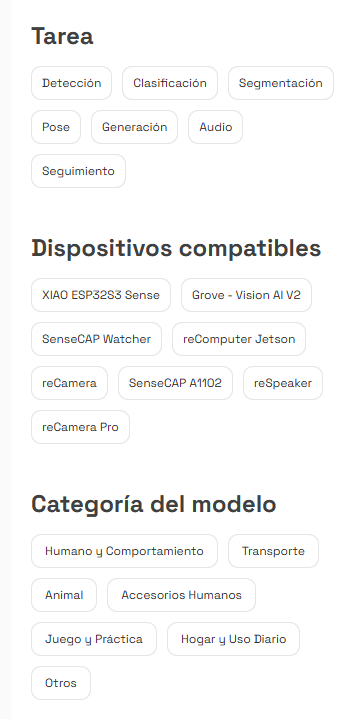
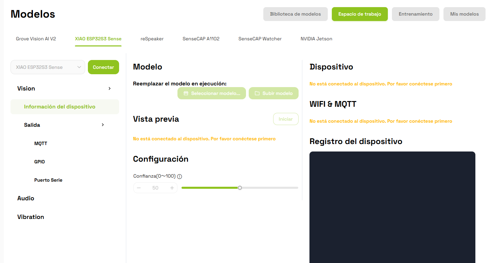
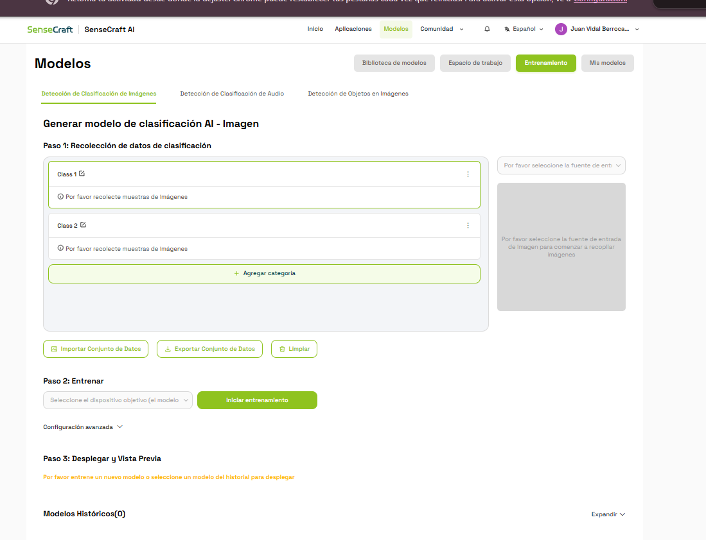
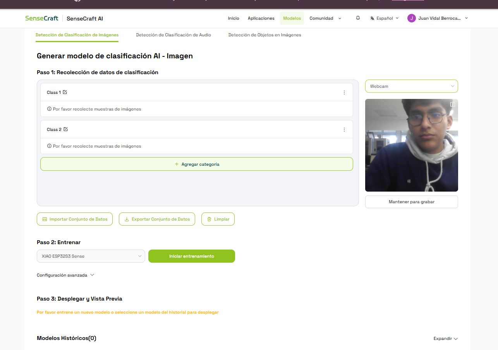
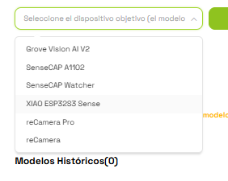
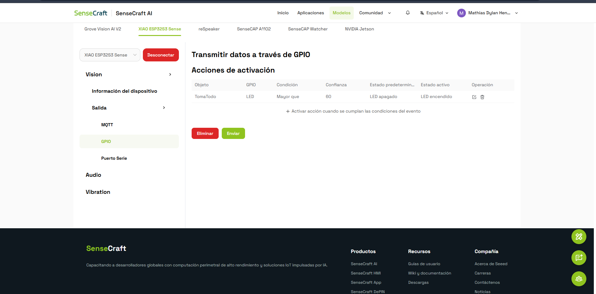

# Clasificación de Tomatodo y Celular con SenseCraft AI

**Universidad:** Universidad Peruana Cayetano Heredia (UPCH)  
**Fecha:** 13/10/2026  
**Plataforma:** SenseCraft AI  
**Dispositivo:** XIAO ESP32S3 Sense

## 1. Introducción

En esta segunda actividad trabajamos con SenseCraft AI para crear y probar un modelo de clasificación de imágenes.

A diferencia de la práctica anterior, donde utilizamos un modelo preentrenado, en esta ocasión trabajamos con un modelo personalizado para reconocer dos objetos: un **tomatodo** y un **celular**.

Para realizar la actividad exploramos las opciones de entrenamiento, utilizamos la webcam de una laptop para recolectar imágenes y probamos el modelo con la XIAO ESP32S3 Sense.

También configuramos una acción GPIO para relacionar el reconocimiento del tomatodo con el funcionamiento de un LED.

## 2. Materiales utilizados

- XIAO ESP32S3 Sense.
- Laptop con webcam.
- Cable USB.
- Tomatodo.
- Celular.
- Plataforma SenseCraft AI.
- Imágenes de los objetos utilizados.

## 3. Procedimiento

### 3.1. Exploración de la plataforma

Primero ingresamos a SenseCraft AI y revisamos los diferentes modelos disponibles en la biblioteca.

Observamos que la plataforma cuenta con distintas opciones, como detección de objetos, clasificación de imágenes y otros modelos que se pueden utilizar dependiendo del dispositivo.

También revisamos los filtros disponibles para seleccionar el tipo de tarea y los dispositivos compatibles.

*Figura 1. Opciones de clasificación y dispositivos compatibles.*

### 3.2. Conexión del dispositivo

Luego ingresamos al espacio de trabajo y seleccionamos **XIAO ESP32S3 Sense**.

Al inicio la plataforma mostraba un mensaje indicando que el dispositivo no estaba conectado, por lo que todavía no podíamos ejecutar ningún modelo.

*Figura 2. Espacio de trabajo sin conexión al dispositivo.*

Posteriormente conseguimos establecer la conexión para continuar con las pruebas.

### 3.3. Creación del modelo de clasificación

Después ingresamos a la sección **Modelos → Entrenamiento** y seleccionamos la opción de clasificación de imágenes.

La plataforma nos mostró tres pasos:

1. Recolección de datos.
2. Entrenamiento.
3. Despliegue y vista previa.

En el primer paso aparecían dos categorías llamadas `Class 1` y `Class 2`, las cuales podían modificarse.

Para nuestro trabajo utilizamos dos clases:

- **TomaTodo:** para reconocer el tomatodo.
- **Celular:** para reconocer el teléfono celular.

*Figura 3. Pantalla de entrenamiento y creación de categorías.*

### 3.4. Recolección de imágenes con la webcam

Una de las herramientas que probamos fue la opción para utilizar la cámara de la laptop.

Seleccionamos **Webcam** como fuente de entrada y comprobamos que SenseCraft AI mostraba la imagen capturada por la cámara.

También encontramos la opción **Mantener para grabar**, que permite recolectar imágenes para las categorías del modelo.

*Figura 4. Prueba de la webcam desde SenseCraft AI.*

Con esta opción comprobamos que podíamos utilizar la cámara de la laptop durante la recolección de imágenes, sin necesidad de utilizar la cámara de la XIAO en esa etapa.

### 3.5. Selección del dispositivo

En el segundo paso revisamos las opciones disponibles para entrenar el modelo según el dispositivo que se iba a utilizar.

La plataforma mostraba diferentes dispositivos compatibles, entre ellos Grove Vision AI V2, SenseCAP y XIAO ESP32S3 Sense.

Para nuestra práctica seleccionamos **XIAO ESP32S3 Sense**, ya que era el dispositivo que estábamos utilizando en el laboratorio.

*Figura 5. Selección del dispositivo para el modelo.*

### 3.6. Modelo utilizado

Después trabajamos con el modelo personalizado que aparecía en nuestro espacio de trabajo.

La información mostrada por la plataforma fue la siguiente:

| Parámetro | Información |
|---|---|
| Nombre del modelo | Xiao_20261013223033 |
| Versión | 1.0.0 |
| Tipo | Clasificación de imágenes |
| Categorías | TomaTodo y Celular |
| Dispositivo | XIAO ESP32S3 Sense |

Este modelo fue utilizado para realizar las pruebas con los dos objetos.

### 3.7. Prueba con el tomatodo [Nicole Anyosa]

Para comenzar colocamos un tomatodo frente a la cámara del dispositivo.

En la vista previa observamos que el modelo mostraba las dos categorías con sus porcentajes de confianza.

El resultado obtenido fue:

- **TomaTodo:** 100 %.
- **Celular:** 0 %.

*Figura 6. Resultado de la clasificación del tomatodo.*

Durante esta prueba el modelo identificó correctamente el tomatodo que colocamos frente a la cámara.

### 3.8. Prueba con el celular [Dylan Quispe]

Después retiramos el tomatodo y colocamos un celular frente a la cámara para comprobar si el modelo podía distinguir entre ambos objetos.

En esta ocasión observamos los siguientes resultados:

- **Celular:** 89 %.
- **TomaTodo:** 0 %.

*Figura 7. Resultado de la clasificación del celular.*

Con esta segunda prueba comprobamos que el modelo mostraba predicciones diferentes dependiendo del objeto colocado frente a la cámara.

### 3.9. Configuración GPIO

Después de realizar las pruebas ingresamos a **Salida → GPIO**.

En esta sección configuramos una condición para que el LED se active cuando el modelo reconozca la clase `TomaTodo` con una confianza mayor a 60.

Los valores utilizados fueron:

| Parámetro | Configuración |
|---|---|
| Objeto | TomaTodo |
| GPIO | LED |
| Condición | Mayor que |
| Confianza | 60 |
| Estado inicial | LED apagado |
| Estado activo | LED encendido |

*Figura 8. Configuración GPIO para la detección del tomatodo.*

Esta parte nos permitió conocer cómo se puede configurar una acción dependiendo de los resultados obtenidos por el modelo.

En las capturas se observa la condición configurada, aunque no se registra una prueba física del encendido del LED.

### 3.10. Pruebas realizadas en el laboratorio

Durante el desarrollo de la práctica también tomamos fotografías del equipo y los objetos utilizados.

En la siguiente imagen se observa una de las pruebas que realizamos con el tomatodo y la XIAO ESP32S3 Sense.

*Figura 9. Prueba realizada con el tomatodo en el laboratorio.*

## 4. Dataset utilizado

Para esta actividad utilizamos imágenes correspondientes a los dos objetos que queríamos clasificar.

Estas imágenes forman parte del conjunto de datos empleado para trabajar con el modelo.

Decidimos guardar las fotografías en un solo archivo comprimido llamado `datos.zip`, para mantener organizado el material utilizado durante la práctica.

El archivo reúne las imágenes de las dos categorías:

- TomaTodo.
- Celular.

### Archivo del dataset

[Ver datos de entrenamiento](datos/datos.zip)

De esta manera podemos conservar las imágenes y utilizarlas nuevamente si necesitamos realizar otras pruebas o entrenar otro modelo.

## 5. Modelo entrenado

También guardaremos el modelo en formato **TensorFlow Lite (.tflite)**.

Este formato permite almacenar modelos de inteligencia artificial que pueden ejecutarse en dispositivos con recursos limitados, siempre que sean compatibles.

### Archivo del modelo

[Ver modelo TomaTodo y Celular](modelo/modelo_tomatodo_celular.tflite)

Tanto el dataset como el archivo del modelo se incluirán en el repositorio para conservar los recursos de la práctica.

## 6. Resultados obtenidos

| Prueba | Resultado | Confianza |
|---|---|---|
| Clasificación de tomatodo | TomaTodo | 100 % |
| Clasificación de celular | Celular | 89 % |
| Configuración GPIO | LED asociado a TomaTodo | Mayor a 60 |

Durante las pruebas realizadas observamos que el modelo logró reconocer correctamente los dos objetos mostrados frente a la cámara.

También vimos que la plataforma actualizaba los resultados según el objeto que aparecía en la imagen.

Los porcentajes corresponden a las predicciones observadas durante las pruebas. Para evaluar mejor el modelo sería necesario realizar más pruebas con otros fondos, posiciones e iluminaciones.

## 7. Dificultades encontradas

Una de las primeras dificultades fue establecer la conexión con la XIAO ESP32S3 Sense desde la plataforma.

También tuvimos que explorar las opciones disponibles para utilizar la webcam, seleccionar las categorías y configurar el dispositivo de destino.

Durante el desarrollo de la práctica fuimos entendiendo mejor cada una de estas herramientas y cómo se relacionan con el funcionamiento del modelo.

## 8. Conclusiones

En esta actividad aprendimos a trabajar con un modelo personalizado de clasificación de imágenes utilizando SenseCraft AI.

Realizamos pruebas con un tomatodo y un celular, obteniendo resultados de confianza de 100 % y 89 %, respectivamente.

También conocimos las opciones para recolectar imágenes mediante la webcam, seleccionar el dispositivo de ejecución y configurar una condición GPIO.

Finalmente, guardar el dataset y el modelo en GitHub nos permitirá mantener organizados los archivos utilizados y tenerlos disponibles para futuras pruebas.

## 9. Referencias

[1] Seeed Studio, "SenseCraft AI", *Seeed Studio Wiki*. [En línea]. Disponible: https://wiki.seeedstudio.com/es/sensecraft-ai/overview/.

[2] Seeed Studio, "Entrenamiento de modelos de clasificación de imágenes en SenseCraft AI", *Seeed Studio Wiki*. [En línea]. Disponible: https://wiki.seeedstudio.com/es/train_classification_model_online/.

[3] Seeed Studio, "Configuración de salida GPIO en SenseCraft AI para XIAO ESP32S3 Sense", *Seeed Studio Wiki*. [En línea]. Disponible: https://wiki.seeedstudio.com/es/sensecraft_ai_output_gpio_xiao/.
