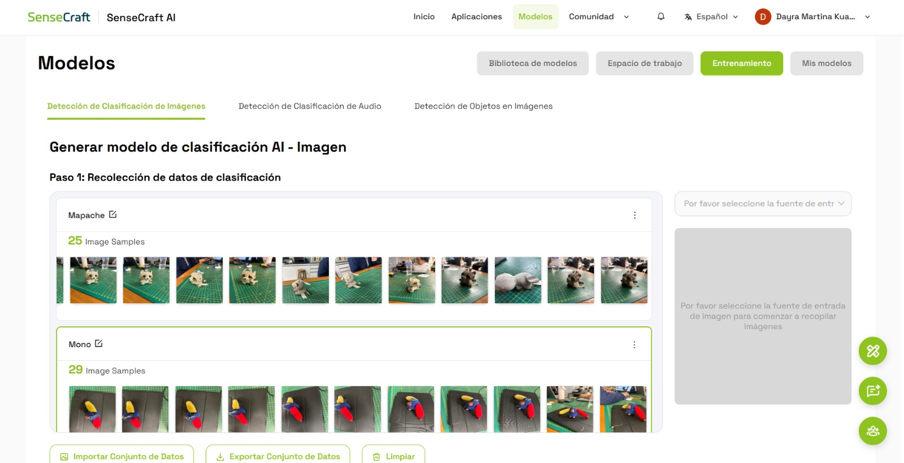
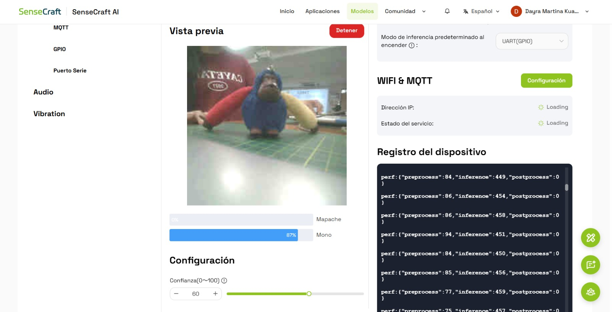
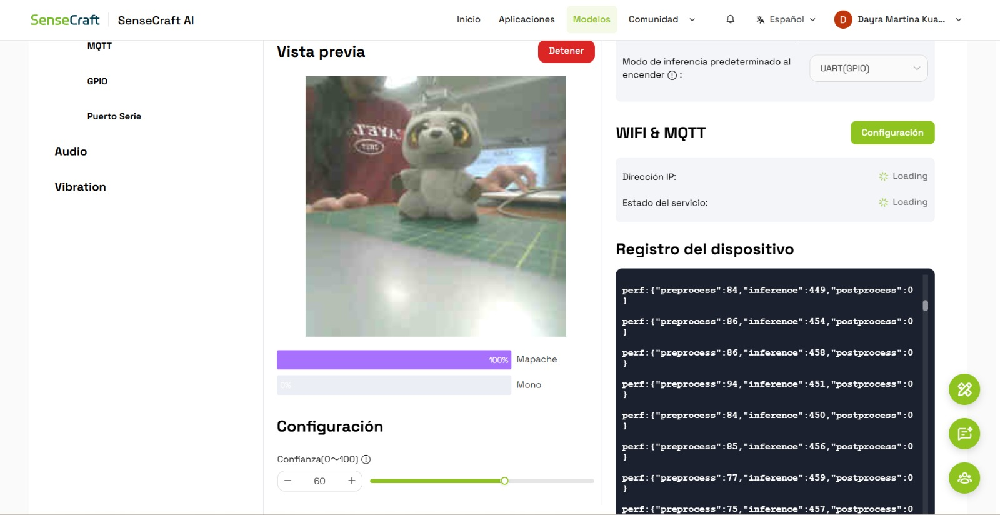

# Clasificación de Mapache y Mono con SenseCraft AI

**Universidad:** Universidad Peruana Cayetano Heredia (UPCH)  
**Fecha:** 13/10/2026  
**Plataforma:** SenseCraft AI  
**Dispositivo:** XIAO ESP32S3 Sense

## 1. Introducción

En esta práctica trabajamos con SenseCraft AI para entrenar y probar un modelo de clasificación de imágenes que pudiera diferenciar dos objetos: un tomatodo y un celular.

Para realizar la actividad utilizamos fotografías de ambos objetos, las herramientas de entrenamiento de la plataforma y la XIAO ESP32S3 Sense para comprobar los resultados.

## 2. Materiales utilizados

- XIAO ESP32S3 Sense.
- Cámara.
- Tomatodo.
- Cable USB.

## 3. Entrenamiento del modelo

### 3.1. Creación de las categorías

Primero ingresamos a SenseCraft AI y seleccionamos la opción **Modelos → Entrenamiento → Clasificación de imágenes**.

Para nuestro modelo trabajamos con dos categorías:

- **Mapache:** imágenes del Mapache.
- **Mono:** imágenes del Mono.

**Figura 1. Selección de las categorías para el modelo de clasificación.**

### 3.2. Recolección de imágenes

Después de crear las categorías, recopilamos fotografías de los dos peluches para utilizarlas durante el entrenamiento del modelo.

También revisamos la opción Webcam de SenseCraft AI, que permite utilizar la cámara de la laptop para capturar imágenes directamente desde la plataforma.

Las fotografías se organizaron en dos categorías, correspondientes al mapache y al mono, para que el modelo pudiera aprender a diferenciarlos a partir de sus características visuales.

### 3.3. Selección del dispositivo

Una vez preparadas las imágenes, seleccionamos el dispositivo XIAO ESP32S3 Sense, ya que era la placa que utilizamos durante la práctica.

Esta selección permitió preparar el modelo para trabajar con el dispositivo y realizar posteriormente las pruebas de clasificación.

**Figura 3. Selección del dispositivo XIAO ESP32S3 Sense.**

### 3.4. Entrenamiento del modelo

Después de definir las categorías y recopilar las fotografías, continuamos con el entrenamiento del modelo de clasificación de imágenes.

El objetivo fue obtener un modelo capaz de distinguir entre el mapache de peluche y el mono de peluche. Una vez disponible el modelo, ingresamos al espacio de trabajo para comprobar su funcionamiento.

Los datos del modelo entrenado se pueden registrar en la siguiente tabla:

| Parámetro | Información |
|---|---|
| Nombre del modelo | [Nombre mostrado en SenseCraft AI] |
| Versión | [Versión del modelo] |
| Tipo | Clasificación de imágenes |
| Categorías | Mapache y Mono |
| Dispositivo | XIAO ESP32S3 Sense |

**Figura 4. Modelo entrenado en SenseCraft AI.**

## 4. Pruebas de clasificación

Después del entrenamiento, conectamos la XIAO ESP32S3 Sense y utilizamos la vista previa para comprobar las predicciones del modelo.

### 4.1. Prueba con el mapache de peluche

Primero colocamos el mapache de peluche frente a la cámara del dispositivo para observar si el modelo podía reconocerlo.

Los resultados obtenidos fueron:

- Mapache: [porcentaje de confianza] %.
- Mono: [porcentaje de confianza] %.

**Figura 5. Resultado de la clasificación del mapache de peluche.**

En esta prueba observamos la predicción realizada por el modelo y su nivel de confianza para cada categoría.

### 4.2. Prueba con el mono de peluche

Luego colocamos el mono de peluche frente a la cámara para comprobar si el modelo podía diferenciarlo del mapache.

Los resultados obtenidos fueron:

- Mono: [porcentaje de confianza] %.
- Mapache: [porcentaje de confianza] %.

**Figura 6. Resultado de la clasificación del mono de peluche.**

Esta segunda prueba permitió observar cómo cambiaba la predicción al colocar un objeto diferente frente a la cámara.

## 5. Resultados obtenidos

Los resultados de las pruebas se resumen en la siguiente tabla:

| Prueba | Objeto evaluado | Confianza |
|---|---|---|
| 1 | Mapache de peluche | [porcentaje] % |
| 2 | Mono de peluche | [porcentaje] % |

Los resultados permitieron observar la capacidad del modelo para diferenciar los dos peluches a partir de las imágenes capturadas por la cámara.

Sin embargo, para evaluar mejor su funcionamiento sería necesario realizar más pruebas con diferentes posiciones, distancias e iluminaciones.

## 6. Archivos de la práctica

Para conservar los recursos utilizados durante la actividad, organizamos los archivos del entrenamiento y las evidencias de las pruebas.

- **Dataset (`datos.zip`):** contiene las fotografías utilizadas para entrenar el modelo, separadas por categorías.
- **Modelo entrenado (`.tflite`):** archivo del modelo exportado desde la plataforma, si se encuentra disponible.
- **Evidencias:** capturas de pantalla del entrenamiento, la selección del dispositivo y las pruebas de clasificación.

Estos archivos se incorporarán al repositorio del proyecto para mantener organizada la información de la práctica.

## 7. Conclusión

En esta práctica aprendimos a utilizar SenseCraft AI para preparar imágenes y entrenar un modelo de clasificación. Trabajamos con dos categorías, mapache y mono, correspondientes a dos peluches diferentes.

Asimismo, utilizamos la XIAO ESP32S3 Sense para realizar las pruebas y observar las predicciones del modelo frente a cada objeto. Esta experiencia nos permitió comprender cómo se puede aplicar la inteligencia artificial para reconocer objetos mediante imágenes y por qué es importante recopilar fotografías adecuadas para el entrenamiento.
