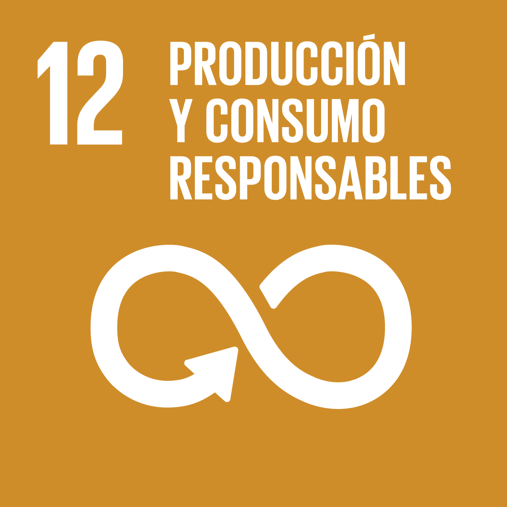
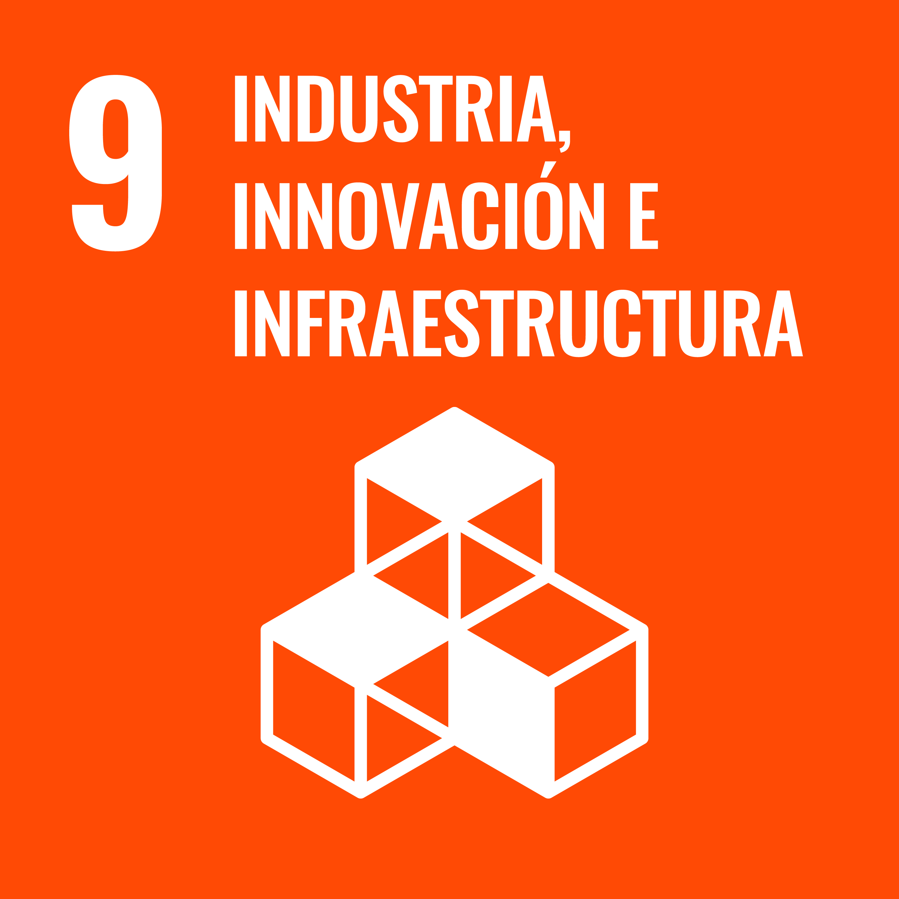

# TRL 1 — KARTOFFELMACHINE

## Identificación y documentación de los principios científicos y tecnológicos

**Proyecto:** Kartoffelmachine — Sistema mecatrónico para la inspección visual y clasificación de papas comercialmente denominadas «Chaucha».  
**Universidad:** Universidad Peruana Cayetano Heredia (UPCH)  
**Curso:** Proyecto Integrador 2026-II  
**Equipo:** 10  
**Nivel de madurez:** TRL 1 — Principios básicos observados y documentados, de acuerdo con la clasificación de madurez tecnológica de la NASA [12].

En esta etapa se estudian los fundamentos científicos de la inspección visual automatizada de papas y se revisan investigaciones relacionadas. El trabajo reúne antecedentes sobre captura de imágenes, procesamiento digital y aprendizaje automático. No se presentan ensayos propios ni resultados de un prototipo: esos aspectos se abordarán en etapas posteriores del proyecto.

---

## 1. Introducción y problemática

La papa forma parte de la alimentación cotidiana de muchas familias peruanas y es una fuente de ingresos para productores y comerciantes. Su importancia no termina con la cosecha: durante el almacenamiento, transporte y venta, las condiciones de manejo influyen en cuánto producto puede aprovecharse. La FAO señala que fortalecer esta cadena requiere atender también los procesos posteriores a la cosecha [1].

En la selección poscosecha se evalúan características como tamaño, forma, color, integridad de la superficie y presencia de daños visibles. Cuando esta selección se realiza a simple vista, dos personas pueden tomar decisiones distintas sobre una misma papa, sobre todo si la luz o los criterios de evaluación cambian. De igual manera, clasificar solamente por peso o dimensiones no permite reconocer por sí solo todas las alteraciones que aparecen en la cáscara [2], [3].

La visión artificial permite capturar imágenes y analizar características del producto de manera no destructiva. La investigación en procesamiento digital de imágenes y aprendizaje profundo ha demostrado que es posible identificar ciertos atributos geométricos y defectos externos en papas, bajo condiciones de estudio definidas [2]–[4].

**Kartoffelmachine** surge como una propuesta de investigación aplicada orientada a explorar estos principios para la clasificación visual de papas de tipo Chaucha. El propósito de este nivel no es demostrar el rendimiento de una máquina construida, sino documentar la base científica que justifica investigar su desarrollo.

### 1.1. Delimitación del producto de estudio

El nombre común «papa Chaucha» puede emplearse para distintos materiales cultivados. En Cajamarca, por ejemplo, se han estudiado como «chauchas» varios cultivares del grupo Phureja [5]. A su vez, el banco de germoplasma del Centro Internacional de la Papa distingue las entidades taxonómicas *Solanum phureja* y *Solanum × chaucha* [6]. Por esta razón, antes de formar el conjunto de imágenes de Kartoffelmachine será necesario precisar qué papas se estudiarán y registrar su procedencia.

Esta aclaración importa porque una papa de piel rojiza, amarilla o con textura particular no necesariamente está en mal estado. Las categorías de clasificación deberán definirse mediante criterios visuales observables, consistentes y documentados antes del etiquetado del conjunto de datos.

### 1.2. Pregunta de investigación de base

**¿Qué principios de visión artificial, procesamiento de imágenes y aprendizaje automático permiten diferenciar características externas de papas y cuáles son sus principales limitaciones para una futura clasificación automatizada?**

---

## 2. Objetivos

### 2.1. Objetivo general

Investigar y documentar los fundamentos científicos y tecnológicos de la inspección visual y clasificación automatizada de papas, como base para el desarrollo posterior del sistema Kartoffelmachine.

### 2.2. Objetivos específicos

1. Describir la problemática de la clasificación poscosecha y las características externas que pueden observarse en papas.
2. Explicar los principios de adquisición de imágenes, iluminación, orientación del producto y procesamiento digital de imágenes.
3. Analizar investigaciones científicas sobre clasificación de papas mediante visión artificial y redes neuronales convolucionales.
4. Identificar antecedentes de patentes relacionadas con la inspección óptica, el giro del producto y la separación automatizada.
5. Reconocer las limitaciones científicas y las variables que deberán investigarse experimentalmente en niveles posteriores.

---

## 3. Fundamentos científicos y tecnológicos

### 3.1. Clasificación visual poscosecha

La inspección visual permite observar ciertas alteraciones externas —por ejemplo, brotación, reverdecimiento, lesiones mecánicas o manchas superficiales—, además de atributos físicos como forma y tamaño. Sin embargo, una imagen de luz visible no permite establecer por sí sola todas las propiedades internas, la inocuidad ni la aptitud final para consumo.

Por consiguiente, debe diferenciarse entre **clasificación visual basada en criterios definidos** y una afirmación más amplia sobre la «calidad total» de una papa. En Kartoffelmachine, el primer enfoque es el científicamente justificable a partir de una cámara convencional.

### 3.2. Captura de imágenes e iluminación

Un sistema de visión artificial transforma la luz reflejada por el producto en información digital. La calidad de la imagen depende, entre otros factores, del enfoque, la resolución, la distancia de captura, la exposición, la iluminación y el contraste con el fondo. Las variaciones no controladas pueden modificar la apariencia de una misma superficie y afectar la interpretación de las imágenes.

De forma general, el procedimiento puede comprender cuatro momentos: capturar una o más vistas; revisar la calidad de las fotografías; reconocer rasgos visibles; y tomar una decisión según categorías previamente definidas. La Figura 1 resume las etapas habituales de este tipo de inspección.

*Figura 1. Secuencia conceptual del proceso de inspección mediante visión artificial.*

Las patentes de inspección de productos agrícolas también consideran la iluminación controlada y la exposición de distintas caras del producto como aspectos relevantes para el análisis visual [7], [8].

### 3.3. Observación de superficies mediante múltiples vistas

Una sola fotografía no necesariamente muestra toda la superficie de un tubérculo. La orientación o rotación del producto permite obtener vistas adicionales y reducir zonas no observadas. Este principio aparece en antecedentes de clasificación mediante imágenes tridimensionales y en sistemas patentados que giran productos frente a una cámara [2], [7], [8].

La revisión documental permite considerar la **captura multivista** como un fundamento útil. Como ejemplo, la patente US12059712B2 presenta una disposición de cámara, iluminación y rodillos para observar diferentes caras de un producto agrícola. Se pueden consultar sus dibujos técnicos en [Google Patents](https://patents.google.com/patent/US12059712B2/en) [8]. La aplicación de ese principio al diseño de Kartoffelmachine se definirá en las siguientes etapas.

### 3.4. Aprendizaje automático y redes neuronales convolucionales

El aprendizaje automático utiliza ejemplos para identificar patrones y generar predicciones sobre datos no vistos durante el entrenamiento. En imágenes, las redes neuronales convolucionales (CNN) permiten aprender representaciones visuales asociadas con formas, texturas y otros patrones.

En el análisis de imágenes se distinguen tres tareas principales:

- **Clasificación de imágenes:** asigna una categoría a una imagen completa.
- **Detección de objetos o defectos:** identifica la localización de elementos mediante regiones o cuadros delimitadores.
- **Segmentación:** identifica los píxeles asociados con una región u objeto.

La familia **YOLO** constituye un antecedente para identificar defectos visibles mediante detección de objetos. Por ejemplo, Li *et al.* investigaron una adaptación de YOLOv5s para defectos externos en papas [4]. Esto permite justificar la exploración de esta familia de modelos, aunque decidir qué versión usará Kartoffelmachine y demostrar su desempeño corresponde a etapas posteriores.

### 3.5. Evidencia científica frente a evidencia experimental propia

Los resultados de investigaciones anteriores demuestran que las técnicas pueden funcionar **bajo sus condiciones particulares**. No demuestran que un modelo determinado ya funcione con papa Chaucha ni con el hardware de Kartoffelmachine. Será necesario obtener un conjunto de datos representativo y realizar evaluaciones propias para verificar esa transferencia tecnológica.

---

## 4. Estado del arte: estudios científicos relacionados

| Referencia | Enfoque investigado | Resultado o aporte reportado | Límite para Kartoffelmachine |
|---|---|---|---|
| FAO (2010) [1] | Cadena de valor de la papa | Contextualiza dificultades y oportunidades de la cadena poscosecha. | No evalúa el prototipo propuesto. |
| Su et al. (2018) [2] | Visión artificial e información de forma 3D | Presenta métodos para evaluar forma, dimensión y apariencia mediante imágenes de profundidad. | Emplea una metodología de captura y condiciones distintas de las de una cámara RGB común. |
| Su et al. (2020) [3] | Imágenes de profundidad y CNN | Reporta **86,6 %** de aciertos globales en seis categorías combinadas de tamaño y apariencia. | Se estudiaron papas y una tecnología de captura distintas a las que se usarán en el proyecto. |
| Li et al. (2025) [4] | Detección de defectos con YOLOv5s modificado | Reporta **85,1 % de mAP** para seis categorías, incluidas brotación y daños mecánicos. | No es una evaluación de YOLOv8 ni de papa Chaucha en Kartoffelmachine. |

El trabajo de Su *et al.* [3] también presenta ejemplos de imágenes RGB y de profundidad, que permiten apreciar la información adicional utilizada para analizar la forma del tubérculo. Las imágenes originales pueden consultarse en [la publicación científica](https://onlinelibrary.wiley.com/doi/10.1155/2020/8815896).

### 4.1. Análisis crítico

Las investigaciones revisadas coinciden en que el análisis digital de imágenes permite abordar distintas tareas de clasificación de papas. Sin embargo, sus resultados no son directamente comparables, porque difieren las categorías, tecnologías de captura, variedades, muestras y métricas empleadas [2]–[4].

En consecuencia, los antecedentes justifican estudiar una inspección automatizada, pero **no permiten afirmar todavía que Kartoffelmachine tendrá una precisión concreta**. La hipótesis tecnológica requiere ensayos específicos durante TRL 3 y validación de integración durante TRL 4.

### 4.2. Brecha de investigación identificada

Aunque existen estudios que clasifican papas con buenos resultados, todavía queda una pregunta importante para el equipo: ¿qué ocurrirá cuando intentemos reconocer características externas en las papas Chaucha disponibles para nuestras pruebas, con imágenes obtenidas en condiciones controladas y recursos limitados? Las principales preguntas abiertas son la variabilidad del aspecto natural del tubérculo, la iluminación, la cobertura de superficie y la capacidad de generalización de un modelo entrenado con datos disponibles.

---

## 5. Antecedentes tecnológicos y patentes

La revisión identificó tres patentes que permiten conocer soluciones técnicas aplicadas a la inspección visual y clasificación de productos. Estos antecedentes no constituyen una evaluación formal de patentabilidad del proyecto.

| Patente | Descripción del antecedente | Principio que interesa investigar |
|---|---|---|
| **CN109030504B** [7] | Dispositivo de detección panorámica de defectos de papas mediante combinación de imágenes y análisis computacional. | Observación de diferentes zonas de la superficie. |
| **US12059712B2** [8] | Dispositivo de clasificación de productos agrícolas con adquisición de imágenes y mecanismo de volteo o rotación. | Exposición multivista, iluminación y decisión automatizada. |
| **US9527115B2** [9] | Sistema de visión y aprendizaje automático para clasificar plantas de vivero. | Relación general entre procesamiento visual y decisión de separación; **no es una patente específica de clasificación de tubérculos**. |

### 5.1. Qué se puede concluir de las patentes

Los antecedentes muestran que existen enfoques para combinar inspección óptica, variación de orientación del producto y decisiones automáticas de separación. Su estudio orienta la investigación conceptual. **No se ha efectuado en este TRL un análisis jurídico de libertad de operación ni una evaluación formal de patentabilidad.**

---

## 6. Relación con los Objetivos de Desarrollo Sostenible

La investigación se relaciona principalmente con el ODS 12 y, de manera complementaria, con el ODS 9.

  
  &nbsp;&nbsp;&nbsp;
  

<em>Figura 2. Objetivos de Desarrollo Sostenible relacionados con la investigación. Imágenes recuperadas de los recursos del proyecto; créditos institucionales: Naciones Unidas.</em>

### 6.1. ODS 12 — Producción y consumo responsables (principal)

La meta 12.3 promueve la reducción de pérdidas de alimentos en las cadenas de producción y suministro [10]. La investigación se relaciona con esta meta porque aborda la posibilidad de hacer más consistente la inspección visual poscosecha.

Aún no se ha medido una reducción de pérdidas alimentarias atribuible a Kartoffelmachine. Esa posible contribución deberá evaluarse experimentalmente.

### 6.2. ODS 9 — Industria, innovación e infraestructura (secundario)

El ODS 9 comprende la promoción de la innovación y el desarrollo tecnológico [11]. Kartoffelmachine se vincula con este objetivo por investigar la aplicación conjunta de visión artificial, procesamiento de imágenes y automatización a un problema agrícola.

---

## 7. Limitaciones y preguntas para los siguientes TRL

| Aspecto | Limitación identificada | Cuestión pendiente para futuras etapas |
|---|---|---|
| Identidad de la papa | «Chaucha» puede referirse a distintos materiales cultivados. | Documentar variedad, procedencia y características de las muestras. |
| Color y textura natural | Diferentes variedades presentan apariencias distintas sin que ello indique necesariamente deterioro. | Definir criterios observables y protocolo de etiquetado. |
| Defectos internos | Una cámara de luz visible no detecta de forma fiable todas las condiciones internas. | Delimitar el alcance exclusivamente a características visibles. |
| Iluminación | Sombras, brillos y exposición cambian la apariencia de la superficie. | Establecer condiciones controladas y evaluarlas. |
| Cobertura superficial | Una vista puede ocultar partes relevantes del tubérculo. | Evaluar el beneficio de capturar varias vistas. |
| Datos de aprendizaje | Un conjunto insuficiente o poco representativo puede limitar la generalización. | Preparar y evaluar un conjunto de datos adecuado. |
| Transferencia de resultados | Los porcentajes publicados no garantizan el mismo desempeño local. | Medir precisión y errores con muestras y criterios propios. |
| Integración física | El principio óptico no demuestra por sí solo un mecanismo funcional de alimentación o separación. | Diseñar y experimentar los subsistemas en TRL 2–4. |

---

## 8. Conclusiones del TRL 1

1. La revisión bibliográfica permitió identificar principios científicos relevantes para la inspección visual de papas: formación y captura de imágenes, análisis de características superficiales, adquisición multivista y aprendizaje automático [2]–[4].
2. Las investigaciones consultadas reportan resultados experimentales favorables en aplicaciones específicas, pero esos valores **no constituyen resultados propios de Kartoffelmachine** ni garantizan el rendimiento con papa Chaucha [2]–[4].
3. Las patentes revisadas documentan soluciones previas que combinan observación óptica, orientación del producto y clasificación automatizada [7]–[9].
4. Se identificaron variables críticas para las etapas posteriores: identidad varietal, criterio de calidad visual, iluminación, cantidad y representatividad de imágenes, cobertura de la superficie y limitaciones de la inspección externa.
5. Por lo tanto, el TRL 1 establece una **base científica documentada para formular la propuesta tecnológica en TRL 2**, sin afirmar que ya exista una prueba de concepto o prototipo validado.

---

## 9. Referencias bibliográficas (IEEE)

[1] N. Cromme, A. B. Prakash, N. Lutaladio y F. Ezeta, coords., *Strengthening Potato Value Chains: Technical and Policy Options for Developing Countries*. Roma: FAO y Common Fund for Commodities, 2010. [En línea]. Disponible: https://www.fao.org/4/i1710e/i1710e.pdf

[2] Q. Su, N. Kondo, M. Li, H. Sun, D. F. Al Riza y H. Habaragamuwa, “Potato quality grading based on machine vision and 3D shape analysis,” *Computers and Electronics in Agriculture*, vol. 152, pp. 261–268, 2018, doi: 10.1016/j.compag.2018.07.012.

[3] Q. Su, N. Kondo, D. F. Al Riza y H. Habaragamuwa, “Potato quality grading based on depth imaging and convolutional neural network,” *Journal of Food Quality*, vol. 2020, art. 8815896, 2020, doi: 10.1155/2020/8815896.

[4] X. Li, F. Wang, Y. Guo, Y. Liu, H. Lv, F. Zeng y C. Lv, “Improved YOLO v5s-based detection method for external defects in potato,” *Frontiers in Plant Science*, vol. 16, art. 1527508, 2025, doi: 10.3389/fpls.2025.1527508.

[5] L. P. Rojas Mercado y J. F. Seminario Cunya, “Productividad de diez cultivares promisorios de papa chaucha (*Solanum tuberosum*, grupo Phureja) de la región Cajamarca,” *Scientia Agropecuaria*, vol. 5, núm. 4, 2014, doi: 10.17268/sci.agropecu.2014.04.01. [En línea]. Disponible: https://www.scielo.org.pe/scielo.php?pid=S2077-99172014000400001&script=sci_arttext&tlng=es

[6] Centro Internacional de la Papa, “Papa cultivada,” CIP Genebank. [En línea]. Disponible: https://cipotato.org/genebankcip/es/papa-cultivada/

[7] Zhengzhou University of Light Industry, “Panoramic potato defect detection device and method based on virtual and real imaging combination,” patente china CN109030504B, 2020. [En línea]. Disponible: https://patents.google.com/patent/CN109030504B/en

[8] D. Dubrulle, H. Serrat, T. Deschodt, G. Jourdain y D.-A. Luu, “Sorting device for agricultural products and corresponding method,” patente estadounidense US12059712B2, 2024. [En línea]. Disponible: https://patents.google.com/patent/US12059712B2/en

[9] D. A. LaRose *et al.*, “Computer vision and machine learning software for grading and sorting plants,” patente estadounidense US9527115B2, 2016. [En línea]. Disponible: https://patents.google.com/patent/US9527115B2/en

[10] Naciones Unidas, “Objetivo 12: Garantizar modalidades de consumo y producción sostenibles.” [En línea]. Disponible: https://www.un.org/sustainabledevelopment/es/sustainable-consumption-production/

[11] Naciones Unidas, “Objetivo 9: Construir infraestructuras resilientes, promover la industrialización sostenible y fomentar la innovación.” [En línea]. Disponible: https://www.un.org/sustainabledevelopment/es/infrastructure/

[12] NASA, “Technology Readiness Levels (TRLs),” Earth Science Technology Office. [En línea]. Disponible: https://esto.nasa.gov/trl/

---
