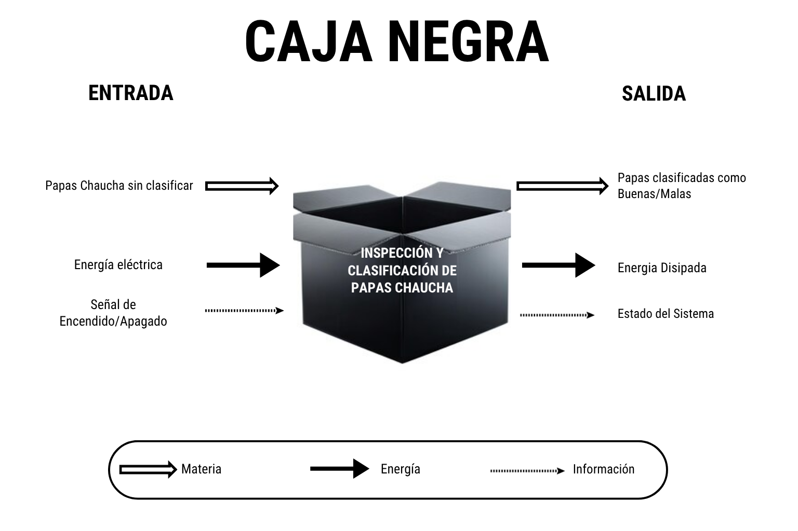
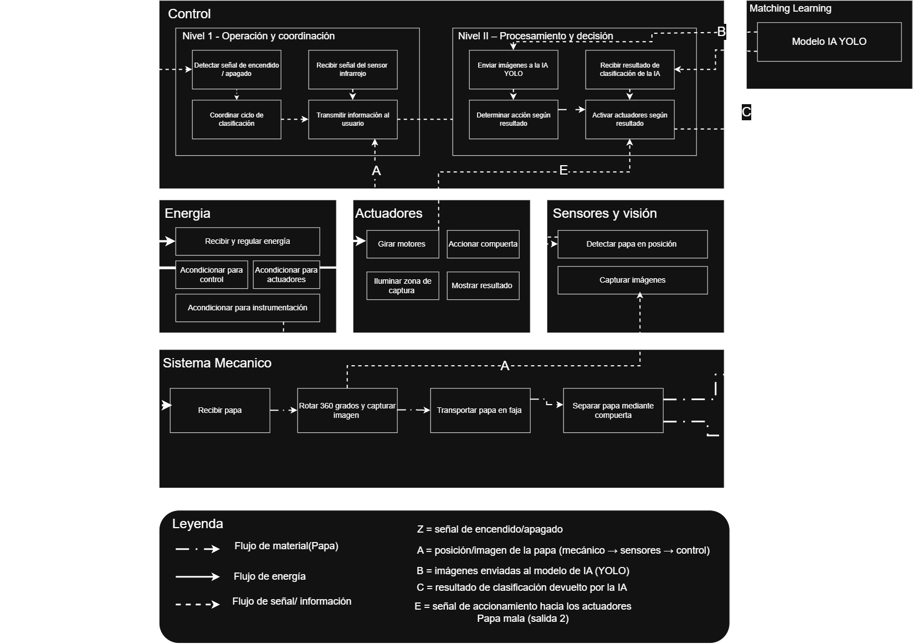
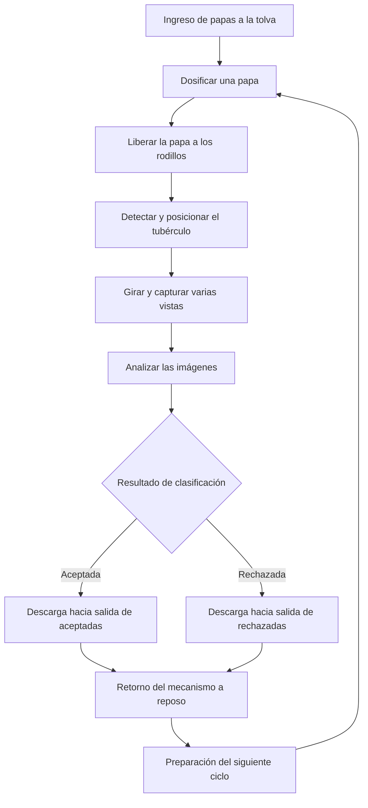
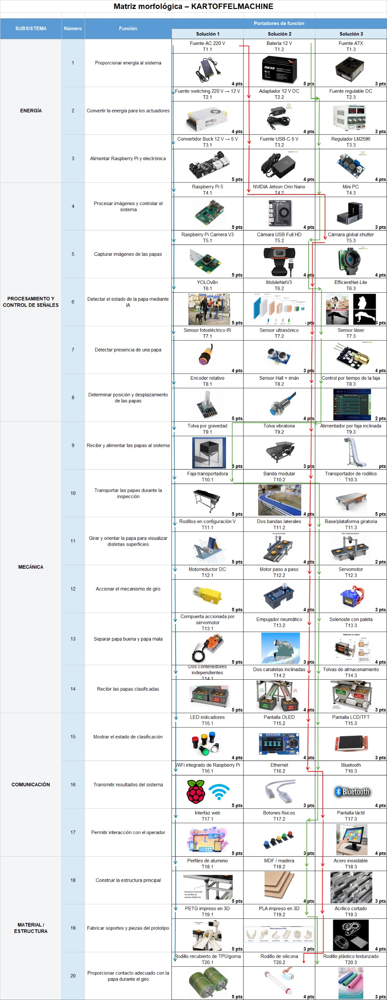
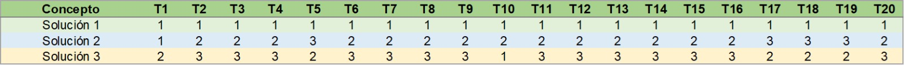
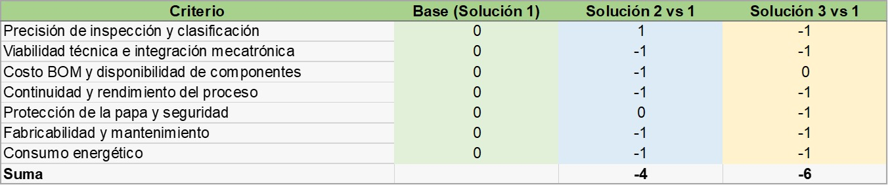
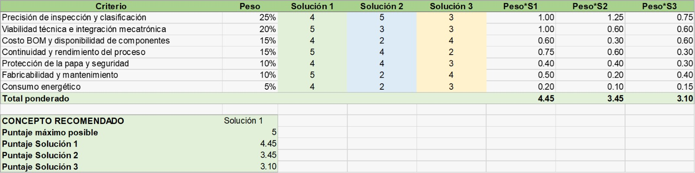
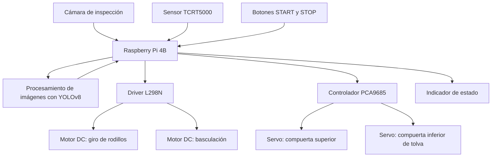

# TRL 2 — KARTOFFELMACHINE

## Formulación del concepto tecnológico y diseño conceptual del sistema de clasificación de papas Chaucha

**Universidad:** Universidad Peruana Cayetano Heredia (UPCH)  
**Curso:** Proyecto Integrador 2026-II  
**Equipo:** 10  
**Proyecto:** Kartoffelmachine  
**Nivel de madurez tecnológica:** TRL 2 — Concepto tecnológico y aplicación formulados.

---

## 1. Introducción

La clasificación de papas después de la cosecha exige observar características que varían de un tubérculo a otro, como el tamaño, la forma, la coloración y la presencia de daños externos. Cuando la inspección se realiza manualmente, la decisión depende de las condiciones de trabajo y de los criterios aplicados por cada persona. Por ello, resulta pertinente estudiar una alternativa que permita observar las papas de manera más uniforme y realizar una clasificación basada en imágenes.

En el TRL 1 de Kartoffelmachine se revisaron los fundamentos científicos de la visión artificial, la adquisición de imágenes desde distintas perspectivas y el aprendizaje automático. También se identificaron investigaciones que emplean información visual para reconocer características externas de papas [1]–[3]. A partir de esa base, el TRL 2 se concentra en formular una solución tecnológica y establecer cómo podrían trabajar sus componentes.

**Kartoffelmachine** se plantea como una máquina mecatrónica compacta que recibe papas comercialmente denominadas Chaucha, las posiciona en una zona de inspección, permite observar diferentes partes de su superficie y las dirige hacia dos salidas según una decisión de clasificación visual. El sistema combina un mecanismo de alimentación por gravedad, rodillos de inspección, una cámara, procesamiento computacional y actuadores eléctricos.

Esta etapa corresponde a la **formulación del concepto**, no a su validación experimental. De acuerdo con los criterios de madurez tecnológica, en el TRL 2 se identifica una aplicación práctica y se documenta su funcionamiento previsto, mientras que las pruebas de concepto y la validación de componentes integrados corresponden a niveles posteriores [4].

## 2. Objetivos

### 2.1. Objetivo general

Formular el concepto tecnológico de Kartoffelmachine mediante la definición de sus requerimientos, funciones, alternativas de solución y arquitectura mecatrónica, con el propósito de establecer una propuesta viable para la inspección visual y clasificación automatizada de papas Chaucha.

### 2.2. Objetivos específicos

1. Identificar los requerimientos funcionales, técnicos y de seguridad asociados con la manipulación e inspección de papas.
2. Describir las entradas, salidas y funciones que intervienen en el proceso de clasificación.
3. Comparar alternativas de alimentación, orientación, captura de imágenes, procesamiento y separación mediante una matriz morfológica.
4. Evaluar los conceptos de solución utilizando criterios de viabilidad, costo, funcionamiento y facilidad de fabricación.
5. Definir una arquitectura conceptual que relacione los elementos mecánicos, electrónicos y computacionales del sistema.
6. Reconocer las limitaciones y variables que deberán evaluarse mediante simulaciones y pruebas experimentales.

## 3. Formulación del problema tecnológico

### 3.1. Necesidad identificada

Una papa puede presentar una apariencia diferente según el lado desde el cual se observa. Una imagen tomada desde arriba podría mostrar una región sin daños y ocultar una alteración ubicada en la cara opuesta. Además, el color natural de algunas papas Chaucha puede variar sin que esa diferencia represente necesariamente un defecto.

Por esta razón, el problema no consiste únicamente en instalar una cámara y clasificar una fotografía. También es necesario resolver cómo ingresar una papa por vez, mantenerla en una posición estable, exponer varias zonas de su superficie y asociar la decisión del sistema con la descarga correcta del tubérculo.

### 3.2. Pregunta tecnológica

**¿Cómo diseñar un sistema mecatrónico compacto que permita alimentar, orientar, inspeccionar visualmente y separar papas Chaucha de forma automatizada, integrando mecanismos de movimiento, una cámara y procesamiento mediante inteligencia artificial?**

### 3.3. Hipótesis tecnológica

Una arquitectura que combine dosificación individual por gravedad, rotación sobre rodillos, captura de múltiples vistas, procesamiento de imágenes y un mecanismo de descarga controlado podría permitir la clasificación automatizada de papas según criterios de apariencia externa previamente definidos.

La propuesta parte de dos condiciones: la información visual capturada debe ser suficiente para establecer una decisión y los mecanismos deben coordinarse para que esa decisión se aplique a la papa correspondiente. Ambas condiciones requieren comprobación experimental posterior.

### 3.4. Alcance de la clasificación

La solución contempla dos categorías operativas: **papa aceptada** y **papa rechazada**. Estas categorías se definirán mediante características externas visibles y criterios de etiquetado consistentes, como lesiones superficiales o alteraciones previamente acordadas. La clasificación no implica que una papa aceptada esté libre de defectos internos ni constituye una evaluación de inocuidad alimentaria.

El producto de estudio se delimita a papas comercialmente identificadas como Chaucha. Para el diseño mecánico se considera, de manera preliminar, un intervalo aproximado de **30 a 50 mm de diámetro** y **40 a 70 mm de longitud**. Estos valores son referencias de diseño del equipo y no representan una caracterización estadística de todas las variedades Chaucha.

## 4. Metodología de diseño conceptual

El desarrollo de la propuesta sigue una secuencia de identificación de necesidades, definición de funciones, generación de alternativas y selección de conceptos. Esta organización es coherente con el enfoque interdisciplinario de desarrollo de sistemas mecatrónicos descrito por la directriz VDI/VDE 2206 [5].

Como primer paso se elaboró una lista de exigencias. Luego se representó el sistema mediante una caja negra y un esquema de funciones, diferenciando los flujos de materia, energía e información. A continuación, la matriz morfológica permitió reunir distintas posibilidades técnicas y construir tres conceptos preliminares. La comparación de estas propuestas se realizó mediante criterios ponderados y una Matriz de Pugh.

Los resultados de esa evaluación sirvieron como punto de partida para las revisiones posteriores del concepto. Por tanto, se distingue entre **la solución seleccionada inicialmente** y **la arquitectura conceptual actualizada** durante el desarrollo del semestre.

## 5. Lista de exigencias y requerimientos

La lista de exigencias elaborada por el equipo define las condiciones que deben orientar la propuesta tecnológica. Incluye aspectos relacionados con el manejo de las papas, el control de movimiento, la adquisición de imágenes, la seguridad, la fabricación y el mantenimiento. El documento original se encuentra en el [Entregable 01 — Lista de Exigencias](../../Entregables/Entregable01_ListaDeExigencias.md) [7].

Los requerimientos principales se resumen a continuación:

| Código | Requerimiento | Justificación dentro del concepto |
|:---:|---|---|
| R1 | Recibir y dosificar una papa por ciclo | Evitar que dos tubérculos ocupen al mismo tiempo la zona de inspección. |
| R2 | Manipular papas de formas y tamaños variables | Adaptar el equipo a la geometría irregular del producto. |
| R3 | Orientar la papa para observar diferentes superficies | Disminuir las regiones que quedan ocultas en una sola fotografía. |
| R4 | Capturar imágenes con iluminación estable | Reducir sombras y variaciones que dificulten el análisis visual. |
| R5 | Identificar características externas mediante procesamiento de imágenes | Producir una decisión de clasificación basada en criterios definidos. |
| R6 | Separar físicamente las papas según el resultado | Traducir la decisión digital a una acción mecánica. |
| R7 | Coordinar sensores, motores y actuadores | Evitar errores de secuencia y descargas incorrectas. |
| R8 | Evitar golpes, atascos y presión excesiva | Reducir posibles daños ocasionados por el propio mecanismo. |
| R9 | Emplear componentes accesibles y una estructura compacta | Favorecer el montaje, transporte y mantenimiento del prototipo universitario. |
| R10 | Contar con controles de inicio y detención | Permitir una operación supervisada y la interrupción del proceso. |
| R11 | Mantener condiciones eléctricas seguras y estables | Proteger la unidad de procesamiento, los actuadores y al operador. |
| R12 | Facilitar la limpieza de superficies en contacto con las papas | Considerar las condiciones de higiene propias de la manipulación de alimentos. |

La inspección visual es la función central, pero depende de las demás. Por ejemplo, un modelo de inteligencia artificial no podrá evaluar adecuadamente una papa si esta queda fuera del campo de visión o si se mueve de manera impredecible durante la captura.

## 6. Caja negra del sistema

La caja negra permite representar Kartoffelmachine sin entrar todavía en la distribución interna de sus componentes. En ella se identifica qué recibe el sistema y qué debe entregar después de realizar la inspección y la clasificación.

  

<em>Figura 1. Caja negra del sistema de inspección y clasificación de papas Chaucha. Elaboración del Equipo 10.</em>

Las entradas y salidas se agrupan en tres tipos de flujo:

| Tipo | Entradas | Salidas |
|---|---|---|
| **Materia** | Papas Chaucha sin clasificar | Papas separadas en las categorías aceptada y rechazada. |
| **Energía** | Alimentación eléctrica | Energía disipada por los elementos eléctricos y mecánicos. |
| **Información** | Orden de inicio y detención, detección de presencia e imágenes capturadas | Resultado de clasificación y estado de funcionamiento. |

Esta representación evidencia que la clasificación es un proceso de transformación tanto de materia como de información. El sistema recibe un tubérculo sin clasificar, obtiene datos sobre su apariencia y utiliza el resultado para dirigirlo hacia una de las dos salidas.

## 7. Esquema de funciones

A partir de la caja negra, se identificaron las operaciones necesarias para completar el proceso. El [Entregable 02 — Caja Negra, Esquema de Funciones y Matriz Morfológica](../../Entregables/Entregable02_Kartoffelmachine_CajaNegra_EsquemaFunciones_MatrizMorfologica.md) contiene el desarrollo de estas representaciones [8].

  

<em>Figura 2. Estructura funcional elaborada durante la etapa de diseño conceptual. Elaboración del Equipo 10.</em>

El análisis separa las funciones en subsistemas de energía, control, sensores y visión, procesamiento de información, actuadores y elementos mecánicos. Aunque la disposición particular de algunos componentes cambió durante el desarrollo, las funciones esenciales se mantuvieron: recibir, posicionar, observar, analizar, decidir y separar.

La secuencia funcional de la arquitectura actual se expresa de la siguiente manera:

*Figura 3. Secuencia funcional propuesta para la versión actual de Kartoffelmachine. Elaboración del Equipo 10.*

Este esquema permite distinguir la toma de decisiones de los movimientos mecánicos. Mientras el modelo de visión artificial se encarga de interpretar las imágenes, el sistema de control debe coordinar la apertura de compuertas, el giro de rodillos y la descarga de la papa.

## 8. Matriz morfológica y generación de alternativas

La matriz morfológica se utilizó para reunir posibles soluciones a las diferentes funciones del sistema. Su propósito fue evitar que el diseño dependiera desde el inicio de un único mecanismo o componente, y facilitar la comparación de opciones en términos de costo, complejidad y funcionamiento esperado.

  

<em>Figura 4. Matriz morfológica de alternativas para las funciones del sistema. Elaboración del Equipo 10.</em>

La matriz desarrollada por el equipo comprende veinte funciones y alternativas asociadas con alimentación, movimiento, inspección, procesamiento, separación, control y estructura. Entre las opciones consideradas destacan diferentes maneras de desplazar u orientar las papas, utilizar cámaras y sensores, ejecutar el procesamiento y realizar la separación final.

De manera resumida, las decisiones más relevantes pueden agruparse así:

| Función | Alternativas analizadas en el proceso de diseño | Criterio de comparación |
|---|---|---|
| Alimentación | Tolva y mecanismos de dosificación | Control del ingreso individual y reducción de atascos. |
| Desplazamiento y orientación | Faja, rodillos y mecanismos de giro | Estabilidad del tubérculo y cobertura visual. |
| Captura de imágenes | Distintas posiciones de cámara e iluminación | Visibilidad de la superficie y facilidad de integración. |
| Procesamiento | Unidad local de cómputo y alternativas de control | Capacidad de análisis y coordinación con actuadores. |
| Detección | Sensores de presencia y señales de control | Identificación del momento oportuno para inspeccionar. |
| Separación | Compuertas, canales y descarga controlada | Simplicidad mecánica y correspondencia con la clasificación. |
| Estructura | Perfiles comerciales y piezas fabricadas a medida | Costo, montaje, resistencia y mantenimiento. |

### 8.1. Configuración de tres soluciones preliminares

La combinación de alternativas permitió formular tres conceptos de solución. Cada uno reunió opciones para las veinte funciones, de modo que pudieran compararse como sistemas completos y no solo como componentes aislados.

  

<em>Figura 5. Combinaciones de alternativas que conformaron los tres conceptos de solución. Elaboración del Equipo 10.</em>

La **Solución 1** buscaba un equilibrio entre las funciones necesarias y la facilidad de implementación. La **Solución 2** incorporaba alternativas de mayor desempeño en algunos apartados, a costa de una integración más exigente. La **Solución 3** proponía una combinación diferente de mecanismos y componentes, con ventajas puntuales, pero también con limitaciones en la continuidad del proceso.

La comparación permitió reconocer que elegir el componente más avanzado en cada función no siempre conduce al diseño más conveniente. Para un prototipo de alcance universitario también importan el mantenimiento, la disponibilidad de materiales y la capacidad real de ensamblar los subsistemas.

## 9. Evaluación y selección del concepto

### 9.1. Criterios de evaluación

Para comparar las soluciones se definieron siete criterios y se asignó una ponderación según su importancia para el proyecto.

| Criterio | Peso |
|---|---:|
| Precisión de inspección y clasificación | 25 % |
| Viabilidad técnica e integración mecatrónica | 20 % |
| Costo y disponibilidad de componentes | 15 % |
| Continuidad y rendimiento del proceso | 15 % |
| Protección de la papa y seguridad | 10 % |
| Fabricabilidad y mantenimiento | 10 % |
| Consumo energético | 5 % |
| **Total** | **100 %** |

La precisión visual recibió el mayor peso porque representa el propósito principal de Kartoffelmachine. La viabilidad de integración también se consideró decisiva, debido a que la propuesta reúne elementos mecánicos, electrónicos y computacionales que deben operar de manera coordinada.

### 9.2. Matriz de Pugh

La Matriz de Pugh permitió comparar las alternativas tomando como referencia la Solución 1. Para cada criterio, se asignó una valoración positiva, equivalente o negativa, según el desempeño relativo de las demás propuestas.

  

<em>Figura 6. Comparación relativa de las soluciones preliminares mediante la Matriz de Pugh. Elaboración del Equipo 10.</em>

Con esta comparación, la Solución 2 obtuvo un resultado acumulado de **−4** frente a la referencia y la Solución 3 obtuvo **−6**. Aunque la segunda propuesta resultó más favorable en precisión de inspección, sus desventajas en otros criterios redujeron su valoración global.

### 9.3. Evaluación ponderada

También se aplicó una valoración de 1 a 5 puntos en cada criterio. El puntaje total se obtuvo multiplicando la calificación por su peso y sumando los resultados:

$$
P = \sum_{i=1}^{n} w_i s_i
$$

Donde `wᵢ` representa el peso de cada criterio y `sᵢ` la puntuación asignada a la solución.

  

<em>Figura 7. Resultados de la evaluación ponderada de los conceptos de Kartoffelmachine. Elaboración del Equipo 10.</em>

| Concepto evaluado | Puntaje sobre 5 |
|---|---:|
| **Solución 1** | **4,45** |
| Solución 2 | 3,45 |
| Solución 3 | 3,10 |

La Solución 1 obtuvo el resultado más alto y se seleccionó como **base de diseño conceptual**. Esta elección se apoyó en un balance favorable entre precisión esperada, integración, costo, continuidad de trabajo y facilidad de construcción.

Los resultados expresan una **valoración comparativa de alternativas**, no mediciones de precisión ni rendimiento obtenidas en una máquina construida. Los valores de desempeño real deberán determinarse mediante las pruebas de los siguientes niveles de madurez tecnológica.

## 10. Evolución del concepto y arquitectura propuesta

A medida que se revisó la integración mecánica, el concepto inicial experimentó cambios orientados a reducir elementos de transporte y simplificar el proceso de inspección. Las primeras propuestas contemplaron una faja y distintas soluciones para orientar el tubérculo. La arquitectura posteriormente adoptada se concentra en una estación fija con dos rodillos paralelos y alimentación individual por gravedad.

La modificación conserva las funciones identificadas en la matriz morfológica, pero cambia la manera de cumplirlas. La papa ya no necesita desplazarse continuamente por una faja durante la inspección: permanece sobre los rodillos mientras gira frente a una cámara. Una vez obtenida la clasificación, el mismo conjunto de rodillos se inclina para liberarla hacia la salida correspondiente.

### 10.1. Alimentación y dosificación

Se propone una **tolva tubular de caída por gravedad** con dos compuertas accionadas de manera independiente. La primera regula el ingreso a un espacio intermedio, mientras que la segunda libera el tubérculo hacia los rodillos. La secuencia busca que solo una papa llegue a la zona de inspección por ciclo.

Esta disposición responde a uno de los principales problemas de la alimentación: si dos papas ingresaran juntas, podrían cubrirse entre sí, alterar las imágenes o impedir la separación individual. Las dimensiones de la cámara intermedia y el momento de accionamiento de las compuertas deben adaptarse al rango de tamaño previsto.

### 10.2. Estación de inspección

La zona central está formada por **dos rodillos paralelos**, destinados a sostener y hacer girar la papa. El movimiento de ambos se transmite mediante un motorreductor y elementos de transmisión mecánica. La finalidad es exponer sucesivamente diferentes partes de la superficie sin trasladar el tubérculo fuera del área de captura.

La geometría de los rodillos debe contemplar la separación entre ejes, el diámetro del producto, la fricción con su superficie y la estabilidad del conjunto. Un giro excesivamente rápido podría afectar la nitidez de las imágenes, mientras que un contacto inadecuado podría ocasionar deslizamiento o caída.

### 10.3. Captura de imágenes y decisión de clasificación

Se contempla una cámara colocada sobre la zona de inspección, acompañada de iluminación controlada. Durante el giro, el sistema capturará varias vistas del tubérculo, que serán analizadas por un modelo de visión artificial.

El concepto considera la familia **YOLOv8**, con el objetivo de obtener una decisión entre las categorías operativas aceptada y rechazada. La forma concreta de entrenar el modelo dependerá de la organización del conjunto de imágenes y de los criterios de etiquetado. Por ello, la arquitectura no presupone una precisión específica ni que todos los defectos puedan observarse con luz visible.

### 10.4. Separación mediante basculación

La descarga se plantea mediante un **segundo motorreductor** que inclina el conjunto de los dos rodillos hacia uno u otro lado según el resultado de la inspección. Esta solución sustituye la idea anterior de incorporar una compuerta clasificadora independiente debajo de la estación.

Después de la caída, el mecanismo debe regresar a su posición de reposo antes de permitir que ingrese la siguiente papa. Así, una misma estructura participa tanto en la inspección como en la separación.

### 10.5. Unidad de procesamiento y control

La arquitectura contempla una **Raspberry Pi 4 Model B con 4 GB de RAM** como unidad principal. La placa dispone de interfaces GPIO, conexión para cámara y capacidad de ejecutar software de procesamiento de imágenes [6]. Se propone que coordine los estados del proceso, interprete la información visual y envíe las órdenes a los controladores externos.

Los elementos de control considerados son:

| Elemento | Función prevista |
|---|---|
| Raspberry Pi 4B (4 GB) | Coordinar la secuencia y procesar las imágenes. |
| Cámara compatible con Raspberry Pi | Capturar las vistas de la papa durante la inspección. |
| Sensor TCRT5000 | Detectar la presencia del tubérculo mediante una señal óptica. |
| Driver L298N | Controlar los dos motorreductores DC. |
| Módulo PCA9685 | Generar señales de control para los dos servomotores de la tolva. |
| Motor DC 1 | Accionar el giro de los rodillos. |
| Motor DC 2 | Producir la basculación del conjunto de inspección. |
| Servomotor 1 | Accionar la primera compuerta de dosificación. |
| Servomotor 2 | Accionar la segunda compuerta de liberación. |
| Botones START y STOP | Iniciar y detener la operación supervisada. |
| Indicador luminoso | Comunicar el estado de funcionamiento. |
| Iluminación LED | Proporcionar condiciones más estables para las capturas. |

El planteamiento considera **cuatro actuadores principales: dos motores DC y dos servomotores**. El L298N y el PCA9685 funcionan como módulos de control externos, mientras que la Raspberry Pi actúa como unidad de coordinación. No se considera un ESP32 como controlador adicional en esta configuración.

### 10.6. Alimentación eléctrica

Se ha considerado una línea de **12 V de corriente continua** para los elementos compatibles con esa tensión, junto con una alimentación regulada para la electrónica que requiera 5 V. Los motores, la iluminación y la unidad de procesamiento no tienen necesariamente las mismas exigencias de corriente ni la misma tolerancia a perturbaciones eléctricas.

Por esta razón, el diseño debe prever una distribución adecuada de energía, tierras comunes donde correspondan, protección de las señales de la Raspberry Pi y un suministro estable para los servomotores. La alimentación definitiva dependerá de las especificaciones verificadas de cada componente. La Raspberry Pi no debe conectarse directamente a una línea de 12 V.

### 10.7. Arquitectura de comunicación y control

La comunicación del sistema combina la captura de imágenes, señales de sensores y órdenes a los actuadores. La cámara proporciona información visual a la Raspberry Pi; el sensor indica la presencia de la papa; y la unidad de control envía instrucciones a los módulos de motores y servos.

*Figura 8. Arquitectura conceptual de procesamiento, sensado y accionamiento. Elaboración del Equipo 10.*

El controlador deberá impedir que la tolva libere una nueva papa mientras los rodillos no se encuentren en posición de recepción. Del mismo modo, la descarga tendrá que ejecutarse únicamente cuando exista una decisión de clasificación asociada con el tubérculo inspeccionado.

## 11. Secuencia operativa propuesta

El funcionamiento previsto es continuo, pero con **inspección individual de cada papa**. El botón START inicia el ciclo automático y el botón STOP permite solicitar su detención.

| Etapa | Operación |
|---|---|
| 1. Inicio | El sistema recibe la orden de START y comprueba que el mecanismo esté en posición de recepción. |
| 2. Dosificación | La primera compuerta admite una papa a la zona intermedia y vuelve a cerrarse. |
| 3. Liberación | La segunda compuerta deja caer la papa sobre los rodillos y después se cierra. |
| 4. Detección | El sensor confirma la presencia del tubérculo en la estación. |
| 5. Inspección | Los rodillos giran y la cámara obtiene distintas vistas de la superficie. |
| 6. Clasificación | El procesamiento visual produce la categoría operativa correspondiente. |
| 7. Descarga | Se detiene el giro y el conjunto bascula hacia la salida asignada. |
| 8. Retorno | Los rodillos vuelven a su posición inicial. |
| 9. Repetición | El proceso comienza nuevamente mientras el sistema permanezca habilitado. |

La secuencia descrita constituye una lógica de funcionamiento propuesta. Su implementación requiere definir tiempos, condiciones de seguridad y comprobaciones de posición para evitar órdenes incompatibles entre mecanismos.

## 12. Consideraciones técnicas y limitaciones del diseño

### 12.1. Condiciones mecánicas

Las papas presentan una geometría variable. Una tolva demasiado estrecha podría atascarse y una separación inadecuada entre rodillos podría impedir la rotación o dejar caer el producto antes de completar la inspección. También será necesario estudiar el par requerido por los motores, los soportes de los ejes y las condiciones de fricción en los puntos de contacto.

La selección de piezas impresas y elementos comerciales debe responder a estas condiciones. El PLA se contempla para fabricar componentes del prototipo, aunque su resistencia, estabilidad dimensional y comportamiento bajo carga deberán evaluarse en las pruebas mecánicas.

### 12.2. Condiciones ópticas y computacionales

La calidad de las imágenes depende del enfoque, la iluminación, la distancia a la cámara y la velocidad de giro. Además, el modelo debe aprender a diferenciar defectos definidos de variaciones naturales de color o textura. No basta con utilizar una arquitectura de aprendizaje profundo: el conjunto de datos y los criterios de etiquetado influyen de manera decisiva en la clasificación.

### 12.3. Condiciones eléctricas y de control

La Raspberry Pi trabaja con señales GPIO de baja tensión. Por ello, las conexiones externas deben diseñarse sin aplicar directamente tensiones superiores a las admitidas por sus entradas. El accionamiento de motores y servos también puede generar variaciones de corriente que deben considerarse para evitar reinicios o comportamientos inestables.

### 12.4. Riesgos técnicos principales

| Riesgo identificado | Posible efecto sobre el proceso | Consideración de diseño |
|---|---|---|
| Ingreso de dos papas simultáneamente | Imágenes ambiguas o interferencia mecánica | Dosificación mediante dos compuertas consecutivas. |
| Atasco en la tolva | Interrupción del proceso | Geometría adecuada al tamaño del producto. |
| Deslizamiento en los rodillos | Cobertura visual insuficiente | Revisión de fricción, separación y velocidad. |
| Sombras o reflejos | Errores de interpretación visual | Posición estable de cámara e iluminación. |
| Datos de entrenamiento poco representativos | Clasificación inconsistente ante papas distintas | Criterios de etiquetado y muestras variadas. |
| Tiempo de procesamiento elevado | Retraso en la descarga | Coordinación de captura, inferencia y actuación. |
| Basculación antes de finalizar el análisis | Descarga hacia una salida incorrecta | Secuencia de estados y confirmación de decisión. |
| Corriente insuficiente o señales incompatibles | Fallas de motores o unidad de control | Dimensionamiento de fuentes y adaptación de interfaces. |
| Contacto mecánico brusco | Daños en la papa | Superficies de contacto y velocidades controladas. |

En esta etapa los riesgos se identifican a partir del razonamiento de diseño. Su frecuencia e impacto real todavía no se han medido.

## 13. Resultados del desarrollo conceptual

El trabajo realizado en TRL 2 permitió transformar el problema identificado en el nivel anterior en una propuesta técnica organizada. Los resultados documentales principales son:

1. Una **lista de exigencias** que delimita el funcionamiento esperado y las restricciones de diseño.
2. Una **caja negra** que representa las entradas y salidas de materia, energía e información.
3. Un **esquema de funciones** que separa las operaciones de alimentación, movimiento, captura, procesamiento y clasificación.
4. Una **matriz morfológica** con alternativas tecnológicas para veinte funciones del sistema.
5. Tres **conceptos preliminares** comparados mediante criterios técnicos, Matriz de Pugh y evaluación ponderada.
6. La selección inicial de la **Solución 1**, con un resultado de **4,45 puntos sobre 5**, como referencia para desarrollar el concepto.
7. Una **arquitectura conceptual actualizada**, basada en tolva de doble compuerta, dos rodillos paralelos, captura multivista y descarga por basculación.
8. La identificación de condiciones mecánicas, ópticas, eléctricas y de control que deben verificarse posteriormente.

Estos resultados respaldan la formulación del concepto tecnológico, pero no constituyen una demostración de su desempeño experimental. La simulación estructural, la evaluación de los circuitos, las pruebas de funcionamiento de los mecanismos y la precisión del clasificador deberán sustentarse con evidencias propias durante el TRL 3. La integración del sistema y su validación de laboratorio corresponden al TRL 4.

## 14. Conclusiones

1. La definición de requerimientos permitió establecer que la clasificación visual de papas depende tanto del procesamiento de imágenes como de una manipulación mecánica estable. Por esta razón, el diseño se abordó como un sistema mecatrónico y no como un problema exclusivamente computacional.
2. La caja negra y el esquema de funciones ayudaron a ordenar las operaciones necesarias y a identificar las relaciones entre materia, energía e información. Esta descomposición hizo posible evaluar distintas soluciones para cada función.
3. La matriz morfológica, la Matriz de Pugh y la evaluación ponderada permitieron seleccionar la Solución 1 como base conceptual. El resultado de 4,45/5 corresponde a la evaluación de propuestas realizada por el equipo y no debe confundirse con una medición del desempeño del prototipo.
4. Las revisiones posteriores del diseño condujeron a una arquitectura que emplea dosificación individual por gravedad, inspección sobre dos rodillos y separación mediante basculación del mismo conjunto. Esta disposición busca reducir mecanismos independientes y conservar el control de una papa por ciclo.
5. La propuesta actual integra de manera conceptual una Raspberry Pi 4B, cámara, sensor de presencia, dos motores DC y dos servomotores. La viabilidad de la coordinación, la calidad de las capturas y la confiabilidad de la separación deberán comprobarse mediante ensayos.
6. Con la formulación del concepto, la documentación de las alternativas y la identificación de los requisitos críticos, Kartoffelmachine cuenta con una base de diseño para avanzar hacia las pruebas de concepto del TRL 3, sin atribuir todavía al sistema resultados de funcionamiento que no se hayan medido.

---

## 15. Referencias bibliográficas (IEEE)

[1] Q. Su, N. Kondo, M. Li, H. Sun, D. F. Al Riza y H. Habaragamuwa, “Potato quality grading based on machine vision and 3D shape analysis,” *Computers and Electronics in Agriculture*, vol. 152, pp. 261–268, 2018, doi: [10.1016/j.compag.2018.07.012](https://doi.org/10.1016/j.compag.2018.07.012).

[2] Q. Su, N. Kondo, D. F. Al Riza y H. Habaragamuwa, “Potato quality grading based on depth imaging and convolutional neural network,” *Journal of Food Quality*, vol. 2020, art. 8815896, 2020, doi: [10.1155/2020/8815896](https://doi.org/10.1155/2020/8815896).

[3] X. Li, F. Wang, Y. Guo, Y. Liu, H. Lv, F. Zeng y C. Lv, “Improved YOLO v5s-based detection method for external defects in potato,” *Frontiers in Plant Science*, vol. 16, art. 1527508, 2025, doi: [10.3389/fpls.2025.1527508](https://doi.org/10.3389/fpls.2025.1527508).

[4] NASA, “Technology Readiness Levels (TRLs),” Earth Science Technology Office. [En línea]. Disponible: https://esto.nasa.gov/trl/

[5] Verein Deutscher Ingenieure, *VDI/VDE 2206: Development of Mechatronic and Cyber-Physical Systems*. Düsseldorf, Alemania: VDI, 2021. [En línea]. Disponible: https://www.vdi.de/en/home/vdi-standards/details/vdivde-2206-development-of-mechatronic-and-cyber-physical-systems

[6] Raspberry Pi Ltd., “Raspberry Pi 4 Model B — Product Brief.” [En línea]. Disponible: https://datasheets.raspberrypi.com/rpi4/raspberry-pi-4-product-brief.pdf

[7] Equipo 10, “Lista de exigencias y plan de trabajo — Kartoffelmachine,” *Proyecto Integrador 2026-II*, Universidad Peruana Cayetano Heredia, 2026. [En línea]. Disponible: [Entregable 01](../../Entregables/Entregable01_ListaDeExigencias.md).

[8] Equipo 10, “Caja negra, esquema de funciones y matriz morfológica — Kartoffelmachine,” *Proyecto Integrador 2026-II*, Universidad Peruana Cayetano Heredia, 2026. [En línea]. Disponible: [Entregable 02](../../Entregables/Entregable02_Kartoffelmachine_CajaNegra_EsquemaFunciones_MatrizMorfologica.md).
