# TRL 3 — KARTOFFELMACHINE

## Prueba de concepto y evaluación preliminar de los subsistemas de clasificación de papas Chaucha

**Universidad:** Universidad Peruana Cayetano Heredia (UPCH)  
**Curso:** Proyecto Integrador 2026-II  
**Equipo:** 10  
**Proyecto:** Kartoffelmachine  
**Etapa:** TRL 3 — Prueba de concepto analítica y experimental  
**Revisión del documento:** noviembre de 2026

---

## 1. Introducción

En las primeras etapas del proyecto se estudiaron los fundamentos de la clasificación visual de papas y se planteó un sistema capaz de alimentarlas de forma individual, inspeccionar diferentes partes de su superficie y separarlas según su estado aparente. La propuesta fue tomando forma a través de la lista de exigencias, la caja negra, el esquema de funciones y la matriz morfológica, hasta llegar a una arquitectura basada en una tolva tubular, dos rodillos de inspección y un conjunto que bascula para realizar la descarga.

El trabajo correspondiente al TRL 3 busca comprobar por separado las funciones principales de esa propuesta. Para ello se elaboró un modelo mecánico tridimensional, se diseñó la electrónica de control, se analizó un soporte mediante simulación estructural y se probó un modelo de clasificación de imágenes. También se prepararon los archivos y parámetros de impresión 3D necesarios para fabricar los componentes mecánicos.

De acuerdo con la definición de niveles de madurez tecnológica de NASA [1], el TRL 3 se relaciona con la demostración analítica y experimental de funciones o características críticas. En esta etapa no es indispensable que la máquina completa esté ensamblada; sí es importante reconocer qué funciones cuentan con evidencia de funcionamiento y cuáles todavía deben pasar por ensayos de laboratorio. En Kartoffelmachine, las pruebas de software y el análisis estructural ya tienen resultados, mientras que la fabricación y las pruebas físicas de accionamiento e integración continúan en proceso.

## 2. Objetivos

### 2.1. Objetivo general

Evaluar la viabilidad inicial de los principales subsistemas de Kartoffelmachine mediante modelado CAD, simulación, desarrollo electrónico, pruebas de clasificación de imágenes y preparación de fabricación, con el propósito de identificar los avances logrados y las verificaciones pendientes antes de integrar el prototipo.

### 2.2. Objetivos específicos

1. Describir el diseño mecánico y la relación entre el mecanismo de alimentación, la zona de inspección y la descarga por basculación.
2. Analizar el comportamiento estructural preliminar de un soporte del mecanismo, considerando una carga de ensayo y un material definido.
3. Documentar la PCB principal y verificar el cumplimiento de las reglas de diseño configuradas en EasyEDA Pro.
4. Ejecutar el clasificador de papas con imágenes de referencia y registrar sus predicciones.
5. Estimar la cantidad de material y el tiempo requeridos para fabricar las piezas en PLA.
6. Identificar las pruebas físicas y de integración que todavía deben realizarse.

## 3. Alcance y metodología

Se trabajó con evidencias generadas específicamente para Kartoffelmachine, diferenciándolas de los ejercicios de aprendizaje realizados durante los talleres del curso. El estudio comprende el modelo mecánico de la Revisión D, la PCB principal del equipo, un soporte de rodamiento analizado en SimScale y el clasificador de dos clases exportado a NCNN.

La evaluación se organizó en cuatro líneas de trabajo: diseño mecánico y estudio del movimiento; simulación estructural; desarrollo de la placa de control; y clasificación computacional de imágenes. Finalmente, se preparó la distribución de componentes para impresión 3D. Las observaciones obtenidas corresponden a pruebas parciales: no describen todavía un ciclo automatizado completo ejecutado por una máquina física.

## 4. Desarrollo del diseño mecánico

### 4.1. Conjunto general

El modelo fue desarrollado en FreeCAD y se consolidó en el archivo `Kartoffelmachine_Revision_D_Corregida.FCStd`. La estructura contempla una tolva tubular curva, una zona de inspección con dos rodillos paralelos, una transmisión mediante engranajes, soportes para los ejes y un motorreductor destinado a la basculación del conjunto móvil. En la tolva se representan dos compuertas consecutivas para controlar el paso de una papa por ciclo.

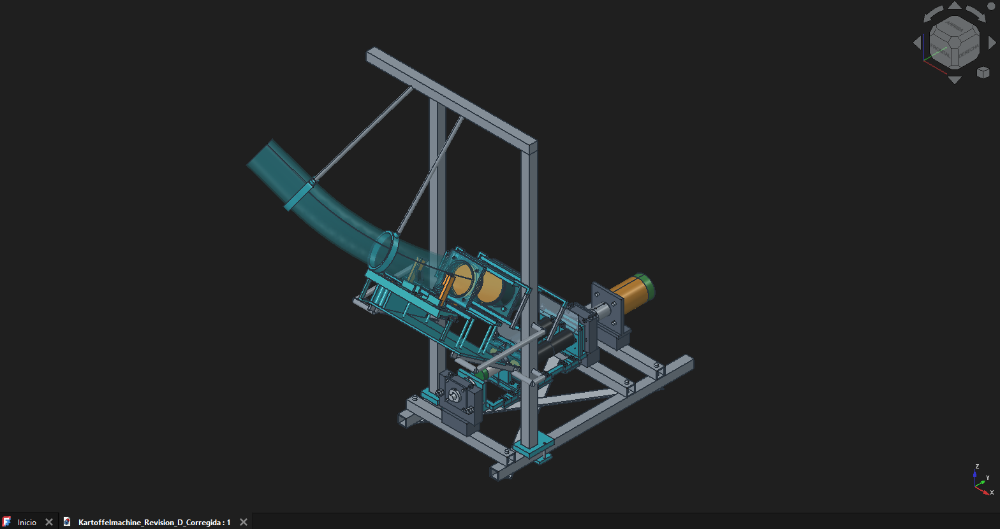

*Figura 1. Vista isométrica del diseño mecánico correspondiente a la Revisión D. Modelo elaborado por el Equipo 10 en FreeCAD.*

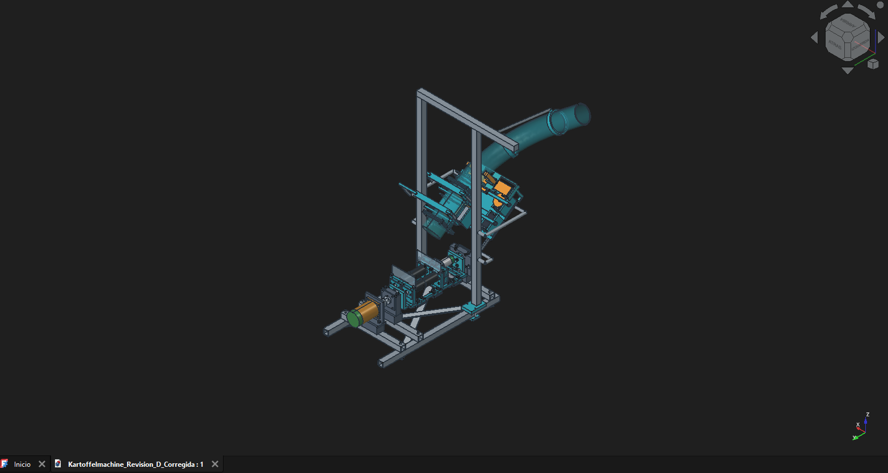

*Figura 2. Disposición general de los elementos mecánicos y la estructura de soporte.*

Las vistas permiten estudiar las posiciones relativas de los mecanismos, pero no demuestran por sí solas que las piezas se muevan sin interferencias ni que todos los ajustes mecánicos sean correctos. Estos aspectos se comprobarán una vez que se disponga de las piezas fabricadas.

### 4.2. Inspección mediante rodillos

Se adoptaron dos rodillos paralelos para hacer girar la papa durante la captura de imágenes. La transmisión diseñada utiliza dos engranajes principales unidos mediante un engranaje intermedio; esta disposición busca transmitir el giro a ambos rodillos. Los elementos de unión, los ejes y las tolerancias entre las piezas deberán revisarse durante el montaje.

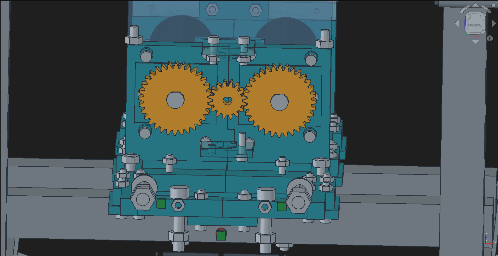

*Figura 3. Detalle de la transmisión mecánica del conjunto de rodillos.*

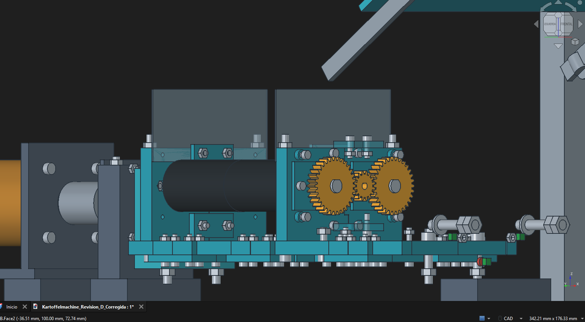

*Figura 4. Posición del accionamiento y de los componentes de la estación de inspección.*

### 4.3. Basculación del conjunto móvil

El diseño incorpora un segundo motorreductor DC para orientar el mecanismo de inspección hacia la salida correspondiente. La descarga se plantea hacia uno u otro lado, en función de la clasificación obtenida, y después se prevé el retorno a la posición de recepción. Esta solución evita depender de una compuerta clasificadora adicional debajo de los rodillos.

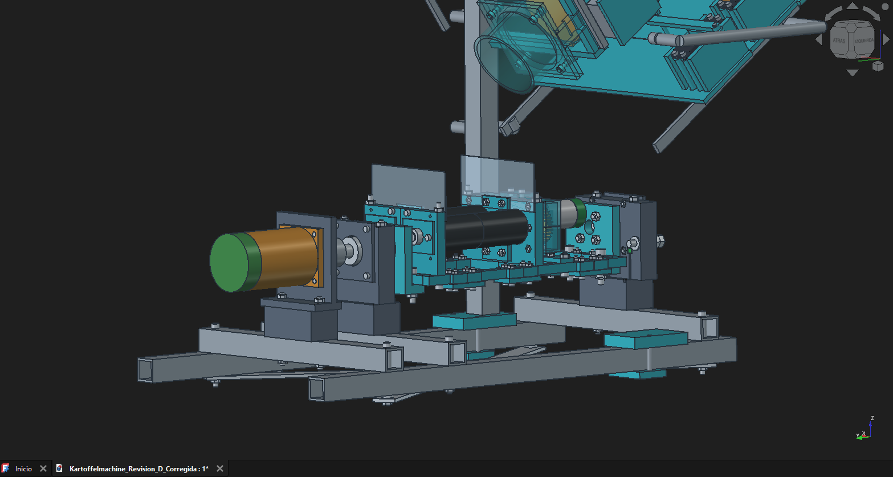

*Figura 5. Motorreductor destinado a la basculación y soportes del conjunto móvil.*

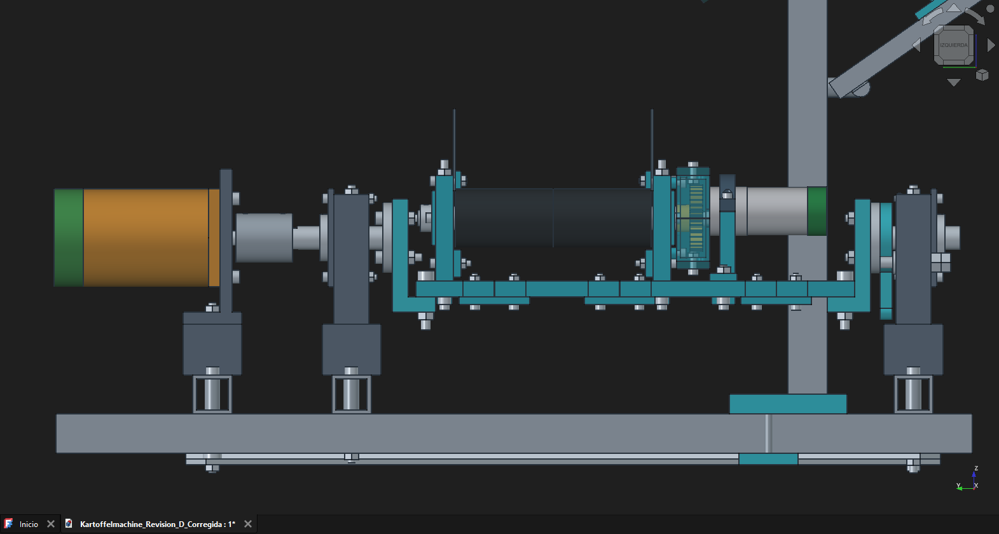

*Figura 6. Vista lateral del acoplamiento y los elementos de apoyo del mecanismo basculante.*

### 4.4. Alimentación y dosificación

La alimentación se resuelve mediante una tolva tubular inclinada y dos compuertas ubicadas en serie. La primera regula el ingreso a una zona intermedia y la segunda libera la papa hacia los rodillos. El modelo muestra la ubicación prevista de las compuertas, sus mecanismos y elementos de soporte. La coordinación temporal de los servomotores aún no ha sido ensayada con papas reales.

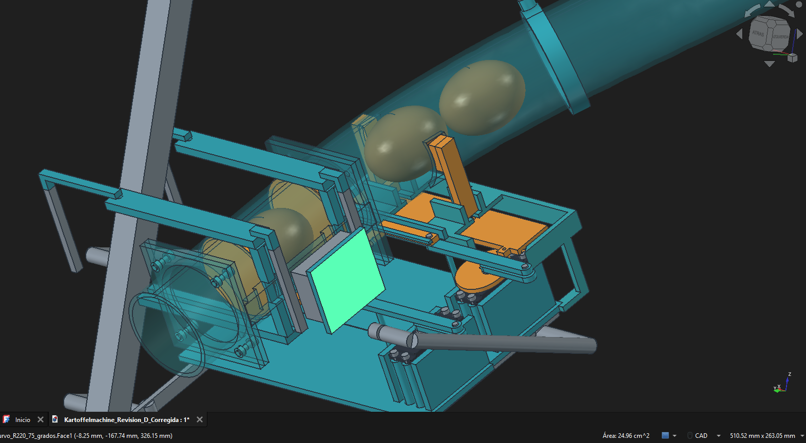

*Figura 7. Tolva tubular con trayectoria de caída por gravedad y conjunto dosificador.*

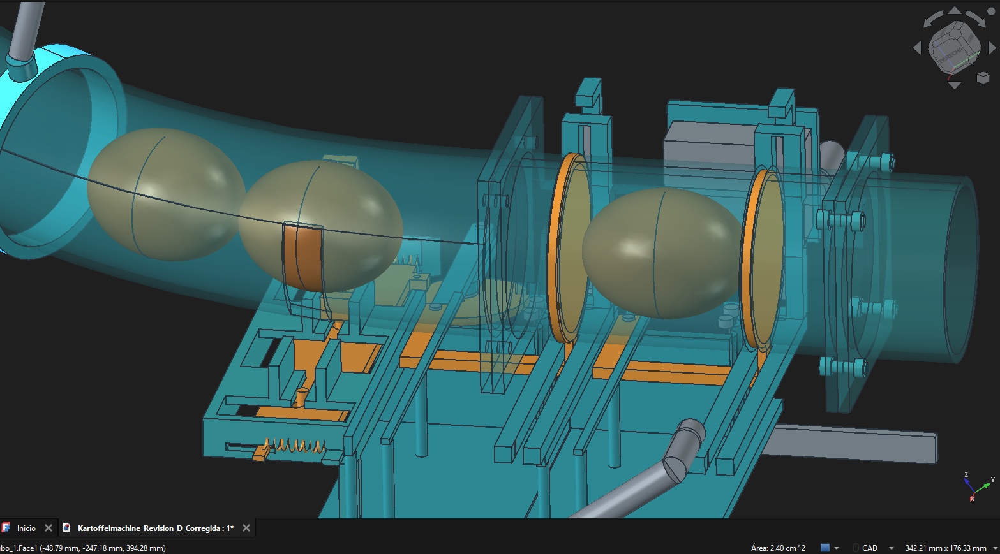

*Figura 8. Vista del mecanismo interno y de las zonas de separación de papas.*

### 4.5. Secuencia de funcionamiento representada

Se elaboró una animación a partir del diseño para estudiar la secuencia de alimentación, inspección, clasificación y descarga. En ella se representa cómo las compuertas regulan el paso de las papas y cómo el conjunto móvil se inclina en sentidos opuestos. La animación permite comunicar el funcionamiento previsto, pero no equivale a una medición de velocidad, torque, rozamiento o ausencia de choques.

*Figura 9. Fotograma de la animación CAD correspondiente a la dosificación.*

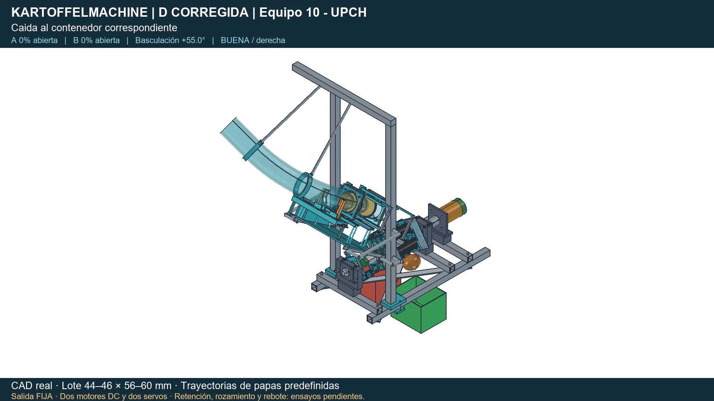

*Figura 10. Fotograma de la animación de descarga hacia una de las salidas.*

El archivo de la animación se conserva en [`Datos/Animacion_Kartoffelmachine_Revision_D.mp4`](Datos/Animacion_Kartoffelmachine_Revision_D.mp4). La comprobación del ángulo de descarga, la estabilidad de la papa, la fricción con los rodillos y el retorno sin interferencias queda pendiente para las pruebas del mecanismo físico.

## 5. Simulación estructural del soporte del rodamiento

### 5.1. Componente seleccionado

Para iniciar la evaluación estructural se utilizó el soporte `C14_Apoyo_6201_A`, extraído del CAD actual y exportado en formato STEP. El análisis se concentró en esta pieza porque forma parte de los puntos de apoyo del mecanismo y recibe cargas transmitidas a través de un rodamiento.

Se realizó un análisis estático lineal en SimScale. Las propiedades del PLA y las condiciones de borde fueron adoptadas como hipótesis preliminares de cálculo, no como una caracterización experimental de la pieza impresa.

### 5.2. Parámetros del análisis

| Parámetro | Configuración |
|---|---|
| Componente | `C14_Apoyo_6201_A` |
| Material | PLA |
| Modelo del material | Elástico lineal, isotrópico |
| Módulo de Young | 3,5 GPa |
| Coeficiente de Poisson | 0,36 |
| Densidad | 1250 kg/m³ |
| Tipo de estudio | Estático |
| Sujeción | Cara inferior restringida mediante *Fixed support* |
| Carga | 10 N aplicados en dirección global −Z |
| Región de aplicación | Superficie cilíndrica del alojamiento del rodamiento |

La fuerza de **10 N** se utilizó como una carga de referencia para estudiar la respuesta del soporte. No proviene de una medición del peso del mecanismo, ya que el conjunto todavía no está completamente fabricado y ensamblado. La sujeción rígida de la cara inferior también simplifica la unión mediante los elementos de montaje. Por estas razones, el resultado sirve como primera aproximación y no representa todavía el comportamiento exacto del soporte en funcionamiento.

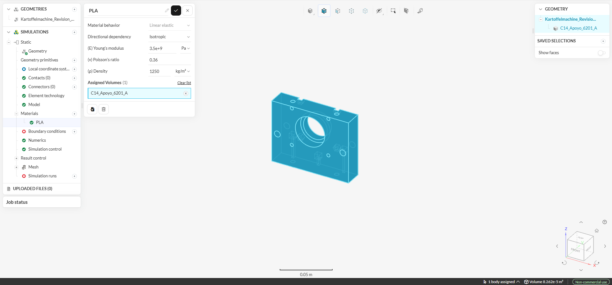

*Figura 11. Parámetros del material definidos en SimScale.*

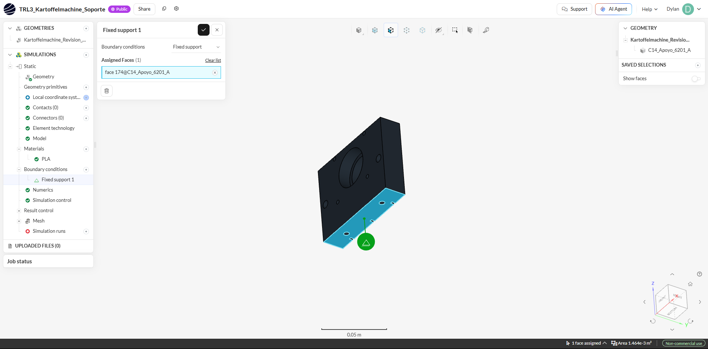

*Figura 12. Superficie inferior utilizada como condición de apoyo fijo.*

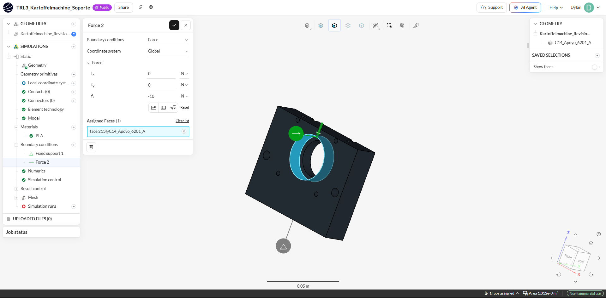

*Figura 13. Aplicación de la fuerza de referencia sobre el alojamiento del rodamiento.*

### 5.3. Mallado y comprobación de sensibilidad

Se generaron dos mallados automáticos con distinto nivel de refinamiento, manteniendo el mismo modelo, material, sujeción y carga. La comparación permitió observar qué tanto varían los máximos calculados cuando aumenta la cantidad de elementos.

| Parámetro | Mallado 1 | Mallado 2 |
|---|---:|---:|
| Nivel de refinamiento (*Fineness*) | 5 | 6 |
| Elementos aproximados | 62 900 | 74 900 |
| Nodos aproximados | 95 000 | 112 500 |
| Estado de ejecución | Finalizado | Finalizado |

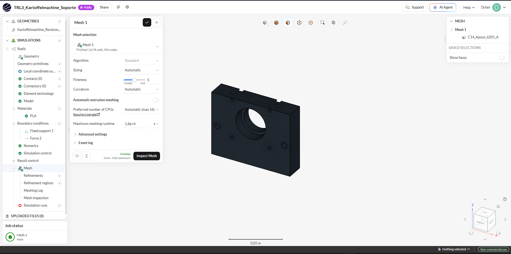

*Figura 14. Primer mallado de la pieza, con nivel de refinamiento 5.*

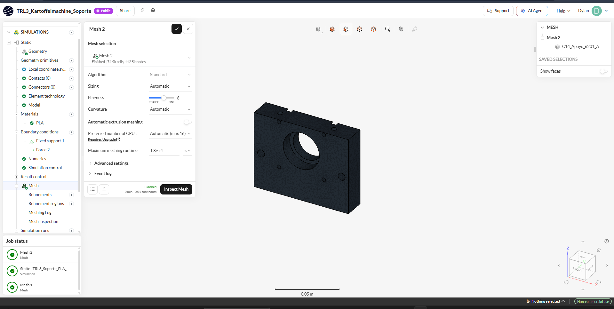

*Figura 15. Segundo mallado de la misma pieza, con nivel de refinamiento 6.*

Durante la inspección visual de calidad se observaron regiones de mayor relación de aspecto alrededor de detalles pequeños y perforaciones. Se empleó este primer control para continuar con el cálculo; un estudio más amplio de independencia de malla y de condiciones de contacto sería necesario antes de utilizar los resultados con fines de dimensionamiento definitivo.

### 5.4. Resultados del análisis

Los valores de esfuerzo equivalente de von Mises y desplazamiento máximo fueron extraídos del panel de resultados de SimScale. Se presentan tal como fueron obtenidos para la carga de referencia.

| Magnitud | Mallado 1 | Mallado 2 | Variación relativa respecto al mallado 1 |
|---|---:|---:|---:|
| Esfuerzo máximo de von Mises | 0,05153 MPa | 0,05161 MPa | 0,16 % |
| Desplazamiento máximo | 0,0009422 mm | 0,0009436 mm | 0,15 % |

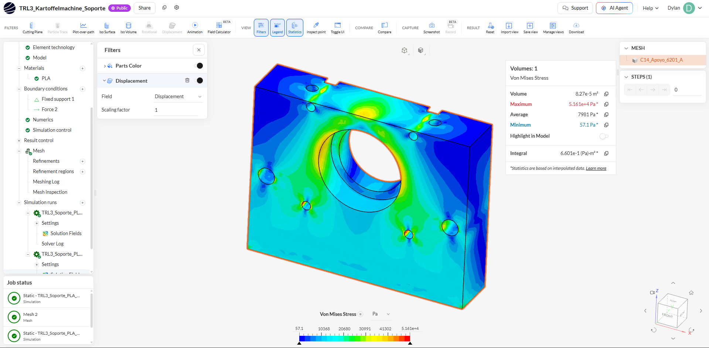

*Figura 16. Distribución de esfuerzo equivalente de von Mises en el soporte, con estadísticas del segundo mallado.*

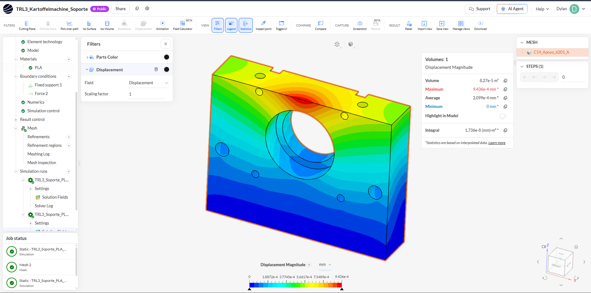

*Figura 17. Distribución de desplazamiento total y valor máximo para el segundo mallado.*

La diferencia entre ambas discretizaciones fue inferior al 0,2 % en los máximos comparados. Esto sugiere una estabilidad numérica favorable en este ensayo concreto. Los mayores esfuerzos aparecen cerca del alojamiento y de algunas perforaciones, mientras que la zona de mayor desplazamiento se ubica hacia la parte superior del soporte.

No es posible concluir todavía que el componente sea seguro ante todas las cargas de trabajo. Además de estimar el peso real y las fuerzas dinámicas, será necesario considerar la dirección de impresión, el porcentaje de relleno, los efectos de uniones roscadas y las propiedades mecánicas de las piezas fabricadas. El análisis constituye una evidencia de comportamiento estructural bajo condiciones definidas, no una certificación de resistencia.

## 6. Desarrollo electrónico de la PCB principal

### 6.1. Esquemático de control

Se diseñó en EasyEDA Pro una PCB principal para organizar las conexiones de la Raspberry Pi 4B y de los módulos periféricos. El esquema se separó por funciones: computadora de control, servomotores, motores DC, finales de carrera, botones, iluminación y alimentación.

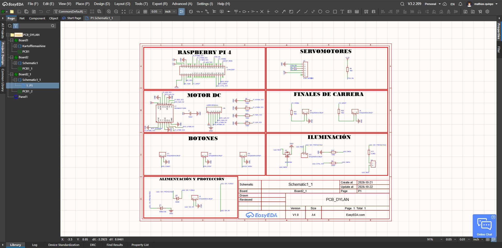

*Figura 18. Esquemático organizado por subsistemas de la PCB principal del proyecto.*

El diseño refleja la arquitectura prevista de control, pero algunos nombres de señales proceden de versiones anteriores del controlador de motores. El uso del módulo L298N externo y el cableado de sus entradas requieren comprobarse durante la conexión de los componentes. La presencia de etiquetas eléctricas en el esquema no reemplaza la comprobación de tensiones ni la validación de cada circuito.

### 6.2. Diseño físico y visualización tridimensional

La placa se trazó en dos capas, distribuyendo las pistas y los conectores dentro del contorno definido. También se incluyeron elementos de identificación del proyecto y del Equipo 10.

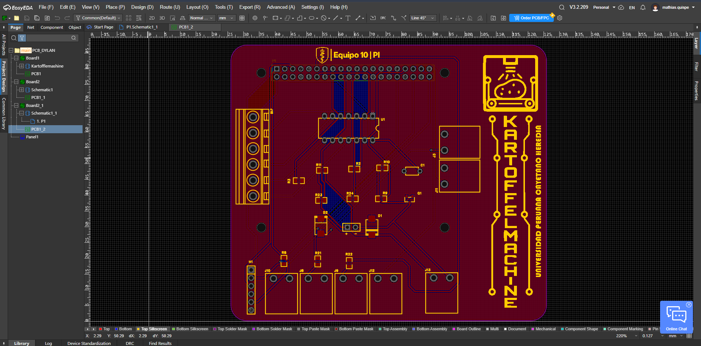

*Figura 19. Distribución de pistas en las capas superior e inferior de la PCB.*

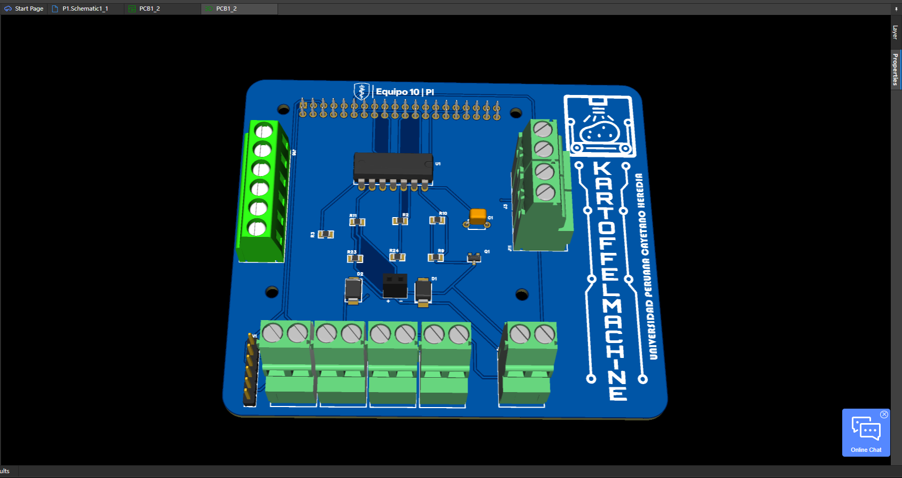

*Figura 20. Representación tridimensional de la PCB y la disposición de sus componentes.*

### 6.3. Revisión de reglas de diseño

Se ejecutó la verificación DRC (*Design Rule Check*) de EasyEDA Pro sobre la PCB principal. En la revisión del **2 de noviembre de 2026**, el programa registró **124 elementos comprobados y cero incidencias** bajo las reglas configuradas en ese momento.

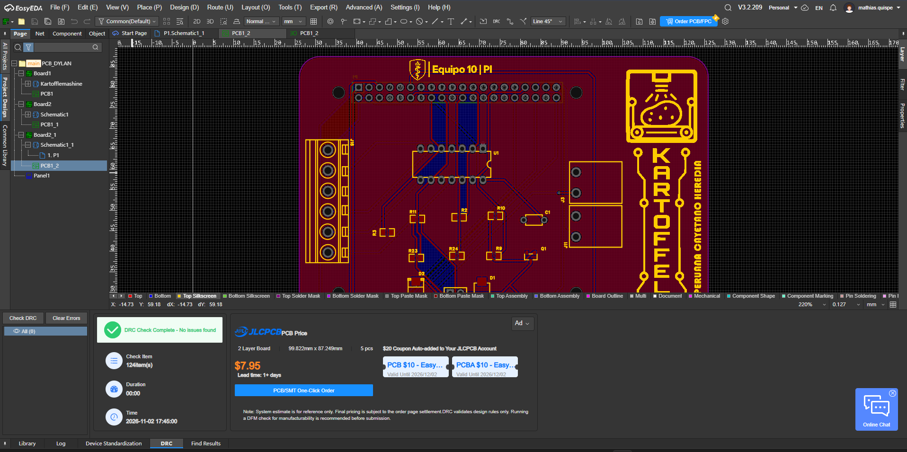

*Figura 21. Resultado de la verificación de reglas de diseño de la PCB principal.*

Este resultado respalda la consistencia geométrica del trazado respecto a las restricciones configuradas. No comprueba por sí solo el funcionamiento eléctrico, la compatibilidad de niveles lógicos ni la respuesta de los actuadores. La verificación con instrumentos y conexiones reales sigue en proceso, al igual que la revisión final de las señales asociadas al controlador de motores y a la alimentación.

## 7. Pruebas del modelo de clasificación de papas

### 7.1. Modelo utilizado

El subsistema de visión utiliza un modelo **YOLOv8n-cls** de clasificación de imágenes, exportado a formato **NCNN** para facilitar su futura ejecución en una computadora de recursos limitados. Según sus metadatos, procesa imágenes de **224 × 224 píxeles** y distingue dos clases: `Buen estado` y `Defectuoso`.

Esta variante de YOLO clasifica la imagen completa. No debe confundirse con un detector de objetos que localiza defectos mediante recuadros. En Kartoffelmachine, la interpretación se orienta a decidir la categoría visual de la papa observada. La evaluación de varias vistas y su combinación en una única decisión todavía se encuentra en desarrollo.

### 7.2. Primera prueba en Google Colab

Se ejecutó el modelo NCNN con cuatro fotografías etiquetadas previamente. Dos correspondían a papas en buen estado y dos a papas con un daño externo visible. Las cuatro predicciones coincidieron con sus etiquetas de referencia.

| Fotografía | Etiqueta de referencia | Predicción | Confianza de la clase predicha |
|---|---|---|---:|
| `Papa_BE_4.jpg` | Buen estado | Buen estado | 99,9972 % |
| `Papa_BE_13.jpg` | Buen estado | Buen estado | 99,9970 % |
| `Papa_D_7.jpg` | Defectuoso | Defectuoso | 100,0000 % |
| `Papa_D_5.jpg` | Defectuoso | Defectuoso | 100,0000 % |

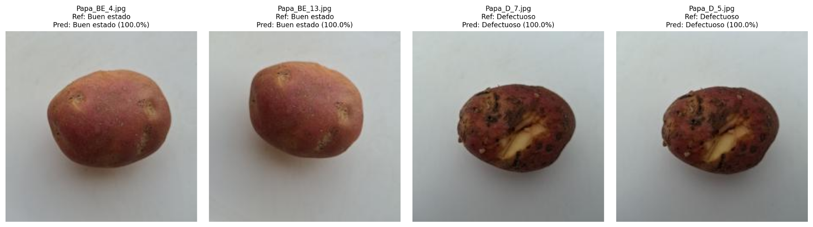

*Figura 22. Primera prueba del modelo NCNN con imágenes de referencia y sus predicciones.*

### 7.3. Segunda prueba con imágenes de apariencia diferente

La segunda prueba se realizó con cuatro imágenes adicionales, dos de papas amarillas sin daños graves evidentes y dos de papas con brotes visibles, consideradas defectuosas para esta prueba. El modelo volvió a coincidir con las etiquetas propuestas.

| Fotografía | Etiqueta de referencia | Predicción | Confianza de la clase predicha |
|---|---|---|---:|
| `IA2_BE_01.png` | Buen estado | Buen estado | 95,612 % |
| `IA2_BE_02.png` | Buen estado | Buen estado | 99,999 % |
| `IA2_D_Brotes_01.png` | Defectuoso | Defectuoso | 100,000 % |
| `IA2_D_Brotes_02.png` | Defectuoso | Defectuoso | 100,000 % |

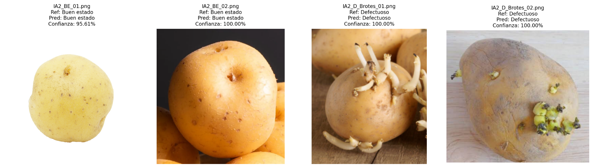

*Figura 23. Clasificación de cuatro imágenes adicionales con diferente coloración, iluminación y tipo de alteración visible.*

### 7.4. Interpretación y límites de las pruebas

En total se observaron **ocho coincidencias en ocho fotografías** procesadas. Las puntuaciones de confianza corresponden a la salida del clasificador para cada imagen, no a una tasa de acierto medida sobre una población representativa.

El alcance de esta prueba es limitado: algunas fotografías representan vistas parecidas de una misma papa, no se ha comprobado que todas las imágenes estén completamente fuera del conjunto de entrenamiento y la segunda serie presenta variaciones de fondo y procedencia que no reproducen necesariamente las condiciones de la máquina. Por ello, sería incorrecto presentar el resultado como una exactitud general del 100 %.

La evidencia obtenida permite afirmar que el archivo NCNN se carga, ejecuta inferencias y produce las categorías esperadas para estas imágenes. La validación estadística exige un conjunto independiente, mayor diversidad de papas y criterios de etiquetado definidos. También será necesario evaluar los errores de clasificación ante variaciones de iluminación, posición y defectos menos evidentes.

Los resultados tabulados se conservan en [`TRL3_Predicciones_IA.csv`](Datos/TRL3_Predicciones_IA.csv) y [`IA_Prueba2_Predicciones.csv`](Datos/IA_Prueba2_Predicciones.csv).

## 8. Preparación de fabricación mediante impresión 3D

### 8.1. Laminado de componentes

Los archivos de las piezas mecánicas se organizaron en **tres camas de impresión** dentro de Bambu Studio, utilizando un perfil de Bambu Lab P1P y filamento PLA Basic. El proyecto incluye 62 instancias de piezas distribuidas para su fabricación.

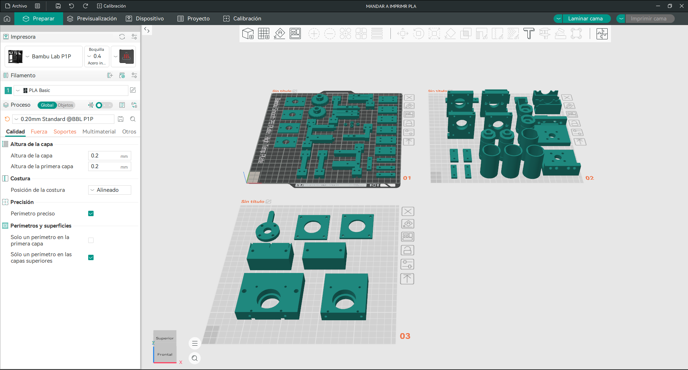

*Figura 24. Preparación de los componentes mecánicos en tres camas del laminador.*

Los parámetros considerados fueron una boquilla de 0,4 mm, altura de capa de 0,20 mm, cuatro perímetros, cinco capas superiores e inferiores, relleno giroide del 25 % y soportes tipo árbol automáticos.

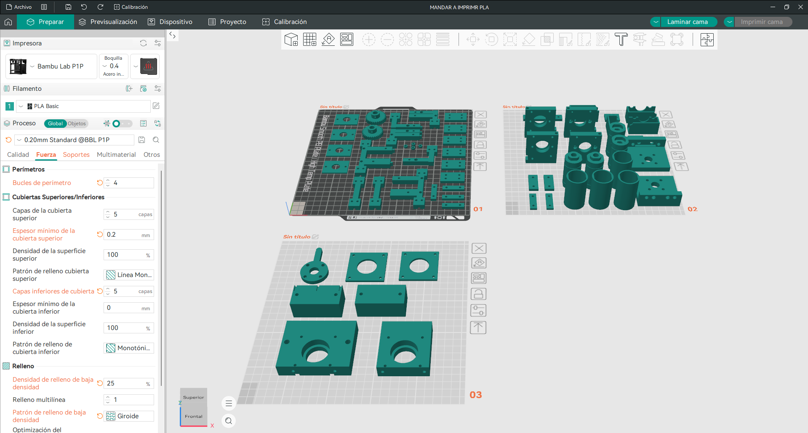

*Figura 25. Configuración del relleno y las paredes de las piezas.*

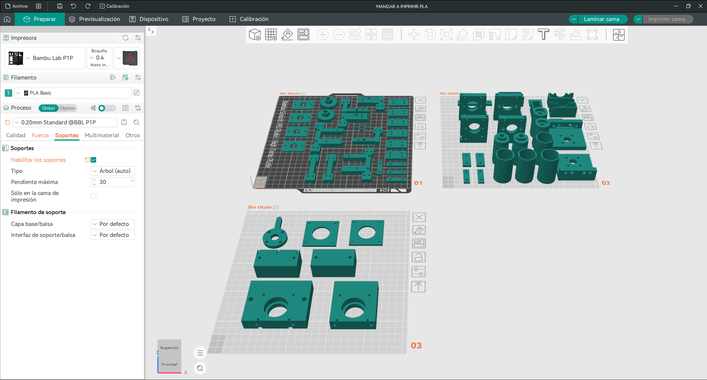

*Figura 26. Configuración de estructuras de soporte para las zonas que las requieren.*

### 8.2. Estimación de consumo de material y tiempo

Se obtuvo la estimación del laminador para las tres camas. El consumo incluye el material del modelo y los elementos auxiliares previstos en el proceso de impresión.

| Cama | Instancias de piezas | PLA estimado | Tiempo estimado |
|---|---:|---:|---:|
| 1 | 30 | 101,75 g | 4 h 06 min |
| 2 | 25 | 261,65 g | 9 h 44 min |
| 3 | 7 | 155,95 g | 5 h 26 min |
| **Total** | **62** | **519,35 g** | **19 h 16 min** |

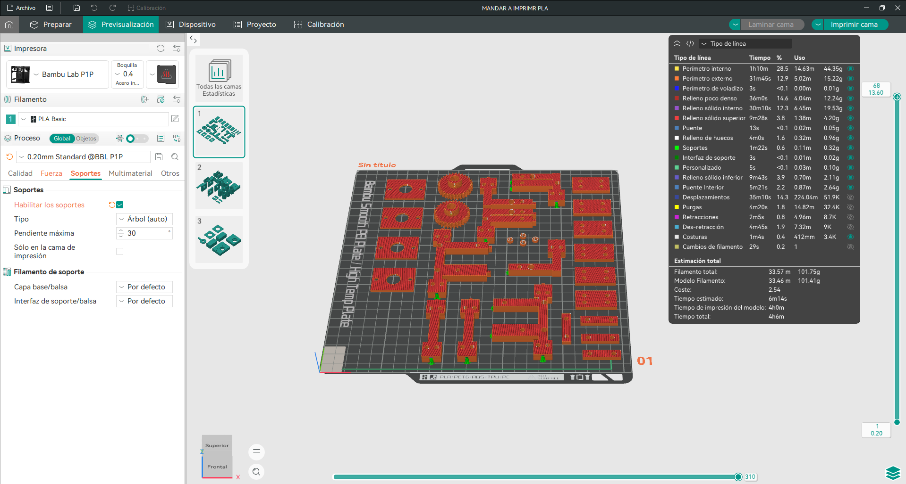

*Figura 27. Primera cama y estimación de material y tiempo.*

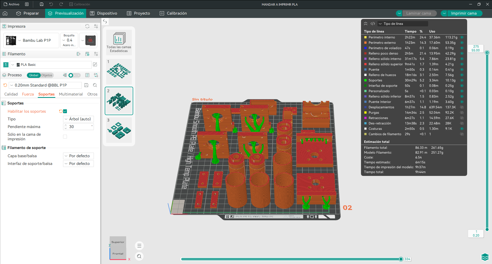

*Figura 28. Segunda cama y estimación de material y tiempo.*

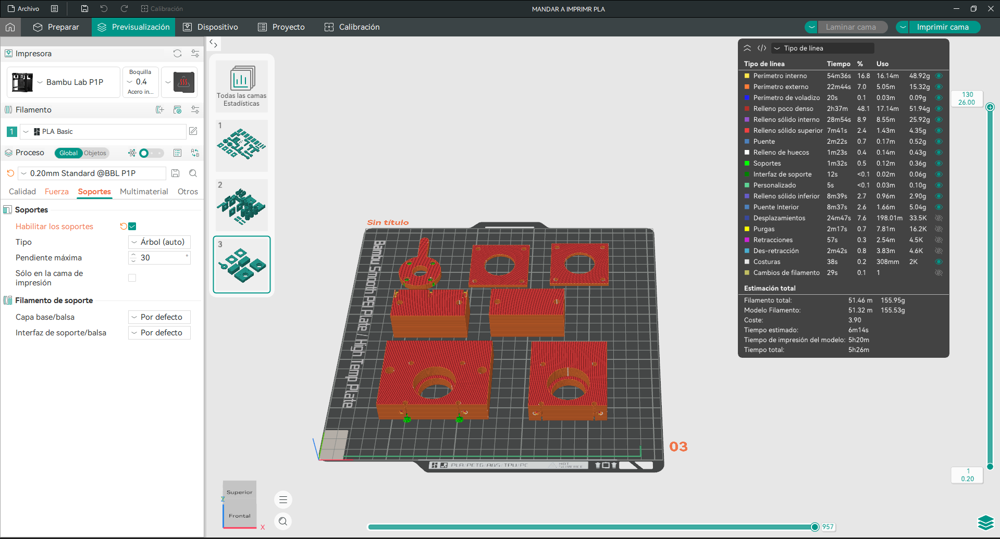

*Figura 29. Tercera cama y estimación de material y tiempo.*

### 8.3. Estado de fabricación y disponibilidad de filamento

La fabricación de las piezas **se encuentra en proceso de coordinación con el servicio de impresión**. El laboratorio de la UPCH asignó **300 g de PLA** al equipo. Como el laminado estima un consumo de 519,35 g, existe una diferencia aproximada de **219,35 g** antes de considerar una reserva adicional para desperdicio, fallas o reimpresiones.

Para disponer del material faltante, se acordó gestionar una compra compartida de **1 kg de PLA junto con el Equipo 3**. Esta adquisición permitirá completar el suministro necesario según el reparto que coordinen ambos equipos. Al momento de esta documentación, el consumo calculado corresponde a la preparación digital y no a material efectivamente utilizado.

La impresión y revisión de las piezas continúan en proceso porque deben completarse la disponibilidad de filamento, la fabricación por camas y la comprobación de ajustes dimensionales. Una vez recibidos los componentes será posible examinar los engranajes, uniones, alojamientos de rodamientos y elementos de sujeción, y determinar si alguna pieza requiere corrección o reimpresión.

El archivo de laminado se conserva en [`Datos/Preparacion_Impresion_PLA.3mf`](Datos/Preparacion_Impresion_PLA.3mf).

## 9. Estado de los subsistemas y actividades en proceso

### 9.1. Raspberry Pi y ejecución local del modelo

La **Raspberry Pi 4 Model B de 4 GB** se encuentra en proceso de configuración. Se ha avanzado en la preparación del sistema operativo y del entorno de trabajo, pero todavía falta completar la instalación y comprobación de las dependencias necesarias para ejecutar NCNN y controlar los periféricos. Por esta razón, las predicciones documentadas en este informe se obtuvieron en Google Colab y no constituyen una medición de rendimiento en la Raspberry Pi.

La prueba en el dispositivo queda en proceso hasta que se comprueben la carga del modelo, el tiempo de inferencia por imagen, el uso de memoria y la operación estable del programa en la plataforma prevista.

### 9.2. Accionamiento de los motores y servomotores

Las pruebas físicas de los **dos motores DC** y los **dos servomotores** siguen en proceso. Los componentes no se encontraban disponibles durante esta etapa de documentación, por lo que no fue posible registrar mediciones de velocidad, par, consumo de corriente, posiciones alcanzadas ni respuesta ante cambios de sentido.

El esquema de control contempla el uso del **L298N** para los motores DC y del **PCA9685** para las señales de los servomotores. El funcionamiento de estas conexiones y la adaptación de señales de la PCB deberán comprobarse en banco antes de conectar la transmisión mecánica definitiva.

### 9.3. Sensor de presencia, cámara e iluminación

La comprobación del sensor **TCRT5000** y del sistema de captura también se encuentra en proceso. Falta validar la detección de una papa en la ubicación prevista y comprobar la respuesta de la cámara bajo las condiciones reales de iluminación. La selección e integración final de la cámara, así como la definición del encuadre y la distancia de trabajo, deben resolverse antes de comparar las predicciones obtenidas en laboratorio con las de la máquina.

### 9.4. Pruebas mecánicas y funcionamiento integrado

El ensamblaje y la evaluación física continúan pendientes de la impresión de las piezas. Será necesario comprobar el giro real de los rodillos, la dosificación de una sola papa, la ausencia de atascos, la basculación hacia ambas salidas y el retorno seguro a la posición inicial. También deberá verificarse la coordinación entre los movimientos y las decisiones del clasificador.

En consecuencia, aún no se dispone de resultados medidos de clasificación automática en ciclos continuos. Esa validación del prototipo ensamblado corresponde al trabajo experimental posterior y servirá de base para el TRL 4.

## 10. Síntesis de avances

| Subsistema o actividad | Evidencia disponible | Estado |
|---|---|---|
| Diseño mecánico | CAD de Revisión D, vistas de componentes y animación del funcionamiento previsto | Desarrollado a nivel digital |
| Análisis estructural | SimScale, carga de referencia de 10 N, dos mallados y resultados comparativos | Ensayo numérico realizado |
| Placa principal | Esquemático, ruteo de dos capas, vistas 3D y DRC sin incidencias | Diseño digital desarrollado; prueba eléctrica en proceso |
| Clasificador de imágenes | Modelo YOLOv8n-cls en NCNN, dos pruebas en Colab y ocho predicciones coincidentes | Prueba funcional de software realizada; validación general pendiente |
| Impresión 3D | Tres camas laminadas, parámetros y estimación de PLA y tiempo | Fabricación en proceso |
| Raspberry Pi 4B | Plataforma seleccionada y entorno en configuración | En proceso |
| Motores y servos | Arquitectura de conexión prevista | Pruebas físicas en proceso |
| Sensor, cámara e iluminación | Arquitectura de adquisición prevista | Pruebas e integración en proceso |
| Sistema completo | Secuencia definida en CAD y animación | Ensamblaje y validación funcional pendientes |

## 11. Discusión

Los resultados muestran avances en tres aspectos importantes de la propuesta. En primer lugar, el modelado CAD permitió organizar espacialmente la alimentación, los rodillos, la transmisión y la descarga, lo que ofrece una referencia concreta para fabricar las piezas. En segundo lugar, el análisis estático proporcionó datos cuantitativos sobre un soporte bajo condiciones controladas: los cambios menores al 0,2 % entre dos mallados son favorables para ese escenario, aunque no sustituyen la evaluación de cargas reales. En tercer lugar, las pruebas con el modelo NCNN confirmaron que el clasificador puede producir las categorías esperadas en las imágenes utilizadas.

La electrónica y la preparación de impresión representan avances de diseño y fabricación, pero deben interpretarse con cuidado. Un DRC sin incidencias no equivale a una PCB funcionando, de la misma manera que un archivo laminado no significa que las piezas ya hayan sido producidas. Mantener esta distinción ayuda a identificar el trabajo realizado y evita anticipar conclusiones que todavía dependen del laboratorio.

La principal limitación del estado actual es que las distintas funciones aún no han sido verificadas en un equipo físico ensamblado. Asimismo, la clasificación de imágenes se efectuó con un conjunto pequeño y no se ha determinado la exactitud sobre una base independiente y representativa. Estas observaciones orientan la siguiente etapa de pruebas.

## 12. Conclusiones

1. El modelo CAD de la Revisión D permitió desarrollar una representación detallada del mecanismo de Kartoffelmachine, incluyendo alimentación, inspección sobre rodillos y descarga mediante basculación. La animación sirve para comprender la secuencia prevista, aunque aún requiere comprobación mecánica en un prototipo real.
2. La simulación del soporte `C14_Apoyo_6201_A` produjo un esfuerzo máximo de **0,05161 MPa** y un desplazamiento máximo de **0,0009436 mm** en el segundo mallado, bajo una carga de ensayo de **10 N** y condiciones de apoyo idealizadas. La variación frente al primer mallado fue reducida, sin que esto implique una validación definitiva de resistencia.
3. La PCB principal cuenta con esquemático, diseño de pistas, representación tridimensional y una revisión DRC sin incidencias. La verificación de su funcionamiento eléctrico y su conexión con los actuadores se encuentra en proceso.
4. El modelo **YOLOv8n-cls en formato NCNN** ejecutó correctamente dos series de pruebas en Google Colab y produjo **ocho coincidencias en ocho fotografías**. Se trata de una comprobación funcional inicial; todavía es necesario evaluar muestras independientes y condiciones de captura más cercanas a las de operación.
5. La preparación para impresión 3D contempla **62 instancias en tres camas**, con consumo estimado de **519,35 g de PLA** y **19 h 16 min** de fabricación. La impresión se está coordinando con apoyo de material proporcionado por la UPCH y una compra compartida con el Equipo 3.
6. Las pruebas de motores, servomotores, sensores, cámara e inferencia en Raspberry Pi permanecen en proceso. Su ejecución, junto con la fabricación y el ensamblaje, permitirá contrastar los resultados de diseño y simulación con el funcionamiento físico.

En conjunto, el proyecto presenta **evidencias parciales de prueba de concepto acordes con el trabajo de TRL 3**, especialmente en simulación y software. El nivel no debe considerarse cerrado como validación integral mientras falten las comprobaciones experimentales críticas. Los resultados y las actividades pendientes constituyen la base para continuar hacia la integración y las pruebas de laboratorio del TRL 4.

---

## 13. Referencias bibliográficas (IEEE)

[1] NASA, “Technology Readiness Levels (TRLs),” *Earth Science Technology Office*. [En línea]. Disponible: https://esto.nasa.gov/trl/

[2] SimScale GmbH, “Static Analysis,” *SimScale Documentation*. [En línea]. Disponible: https://www.simscale.com/docs/analysis-types/static/

[3] SimScale GmbH, “Fixed Support Constraint,” *SimScale Documentation*. [En línea]. Disponible: https://www.simscale.com/docs/simulation-setup/boundary-conditions/fixed-support-constraint-type/

[4] Ultralytics, “Image Classification,” *Ultralytics Documentation*. [En línea]. Disponible: https://docs.ultralytics.com/tasks/classify/

[5] Ultralytics, “NCNN Export,” *Ultralytics Documentation*. [En línea]. Disponible: https://docs.ultralytics.com/integrations/ncnn/

[6] Equipo 10, “Kartoffelmachine — Revisión D: modelo tridimensional, animación y archivos de fabricación,” Proyecto Integrador, Universidad Peruana Cayetano Heredia, 2026. Archivos de trabajo incluidos en este repositorio.

[7] Equipo 10, “Evaluación estructural del soporte C14 en SimScale, diseño de PCB en EasyEDA Pro y pruebas del clasificador NCNN,” Proyecto Integrador, Universidad Peruana Cayetano Heredia, 2026. Capturas y resultados incluidos en este repositorio.
