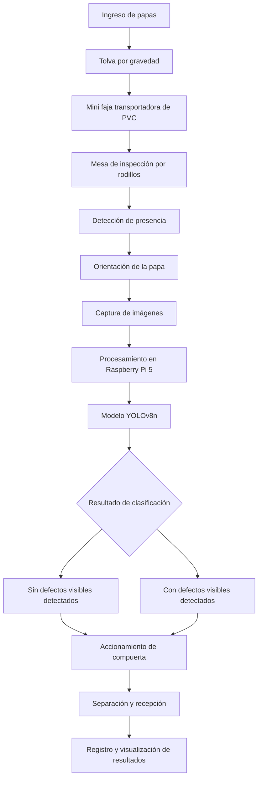
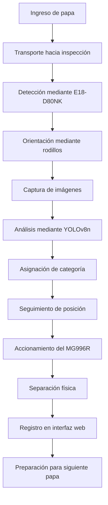

---

# TRL 2 — KARTOFFELMASCHINE

## Formulación del concepto tecnológico y diseño conceptual del prototipo

**Proyecto:** Kartoffelmaschine — Sistema mecatrónico de clasificación automatizada de papa Chaucha.

**Nivel de madurez tecnológica:** TRL 2 — Concepto tecnológico y aplicación formulados.

---

## 1. Introducción

A partir de los fundamentos científicos y tecnológicos identificados en el TRL 1, se plantea el desarrollo conceptual de **Kartoffelmaschine**, un sistema mecatrónico con destinado a optimizar el proceso de inspección y clasificación poscosecha de la papa Chaucha mediante visión artificial, aprendizaje automático y mecanismos automatizados de transporte y separación.

La clasificación tradicional mediante inspección visual humana puede presentar limitaciones relacionadas con la experiencia del agricultor, las condiciones de iluminación y trabajo. Frente a estas limitaciones, investigaciones previas han demostrado la utilidad de la visión artificial y las redes neuronales para analizar características externas de las papas [2], [3].

El proyecto propone integrar estas tecnologías en un sistema que permita transportar las papas, modificar su orientación para observar diferentes superficies, capturar imágenes digitales, identificar posibles defectos externos y realizar una separación física de acuerdo con los resultados obtenidos.

En este nivel de madurez tecnológica se define la arquitectura del prototipo, los requisitos principales y la interacción entre sus componentes. Asimismo, se plantea la metodología que permitirá comprobar la viabilidad técnica de la propuesta durante las siguientes etapas de desarrollo.

El TRL 2 corresponde a la formulación de una aplicación tecnológica sustentada en principios científicos, sin requerir todavía una demostración experimental completa [10].

---

## 2. Objetivos

### 2.1. Objetivo general

Formular el concepto tecnológico de Kartoffelmaschine mediante el diseño de un sistema mecatrónico que integre mecanismos de transporte y orientación, visión artificial, aprendizaje automático y separación automatizada de papa Chaucha.

### 2.2. Objetivos específicos

- Definir el funcionamiento conceptual del prototipo y las etapas del proceso de clasificación.
- Establecer las funciones de los subsistemas mecánicos, electrónicos y computacionales.
- Determinar los requisitos técnicos necesarios para la adquisición y procesamiento de imágenes.
- Plantear el funcionamiento del modelo YOLOv8n para la identificación de características externas de las papas.
- Establecer la interacción entre sensores, actuadores y unidad de procesamiento.
- Identificar las principales dificultades técnicas y los aspectos que deberán comprobarse experimentalmente.

---

## 3. Formulación del problema tecnológico

La clasificación visual de papa Chaucha requiere identificar características externas que permitan diferenciar productos sin defectos visibles de aquellos que presentan alteraciones superficiales.

En los procedimientos manuales, la inspección depende del criterio del operario y de las condiciones en las que se realiza la evaluación.

Asimismo, para inspeccionar adecuadamente una papa es importante observar diferentes regiones de su superficie, debido a que su forma irregular puede dificultar la identificación de defectos desde una única perspectiva.

Por esta razón, se propone desarrollar un sistema automatizado que combine mecanismos de manipulación y orientación con técnicas de visión artificial.

### 3.1. Pregunta tecnológica

**¿Cómo integrar un sistema mecatrónico de transporte, orientación y visión artificial que permita identificar características externas de la papa Chaucha y ejecutar su clasificación automatizada?**

### 3.2. Hipótesis tecnológica

La integración de mecanismos de transporte y orientación de papas, una cámara digital, una unidad de procesamiento Raspberry Pi y un modelo de aprendizaje automático basado en YOLOv8n permitiría desarrollar un sistema capaz de identificar características visuales externas y activar un mecanismo automatizado de separación.

Esta hipótesis deberá comprobarse mediante pruebas experimentales en los niveles TRL 3 y TRL 4.

---

## 4. Descripción de la solución tecnológica

Kartoffelmaschine se concibe como un sistema mecatrónico compuesto por diferentes subsistemas que trabajan de manera coordinada.

La propuesta comprende cinco áreas funcionales principales:

1. Sistema de energía.
2. Sistema de procesamiento y control.
3. Sistema mecánico.
4. Sistema de comunicación.
5. Sistema de materiales y estructura.

Cada subsistema desempeña funciones específicas dentro del proceso de clasificación.

### 4.1. Sistema de energía

El sistema de energía suministrará la alimentación eléctrica necesaria para el funcionamiento de los componentes electrónicos y mecánicos.

Se contemplan los siguientes elementos:

- Fuente Mean Well de 12 V.
- Fuente switching de 12 V.
- Convertidor Buck XL4015 a 5 V.

Las fuentes de 12 V se consideran para las necesidades generales y de accionamiento, mientras que el convertidor Buck se plantea para adecuar la tensión destinada a componentes electrónicos.

La distribución eléctrica deberá considerar las necesidades particulares de cada dispositivo.

En especial, la Raspberry Pi 5 requiere una alimentación adecuada y estable. La documentación oficial recomienda una fuente capaz de proporcionar 5 V y 5 A para su funcionamiento con la capacidad completa de alimentación de periféricos [12].

Por lo tanto, deberá comprobarse que el convertidor y la arquitectura eléctrica seleccionados cumplan con los requisitos de corriente, estabilidad y protección del sistema.

### 4.2. Sistema de procesamiento y control

Este subsistema constituye la unidad principal de adquisición y análisis de información.

Sus componentes son:

- Raspberry Pi 5 con 8 GB de memoria RAM.
- Raspberry Pi Camera Module 3.
- Modelo de inteligencia artificial YOLOv8n.
- Sensor E18-D80NK.
- Encoder rotativo incremental de 600 PPR.

La Raspberry Pi 5 se propone como unidad central para coordinar el procesamiento de imágenes y las señales de control.

La Raspberry Pi Camera Module 3 permitirá adquirir imágenes digitales de las papas. Este módulo dispone de un sensor de aproximadamente 12 megapíxeles y enfoque automático [13].

YOLOv8n será utilizado como modelo de detección visual. Se trata de una arquitectura compacta perteneciente a la familia YOLO, que permite realizar tareas de detección de objetos mediante aprendizaje profundo [11].

El sensor E18-D80NK permitirá detectar la presencia de una papa en la zona de inspección.

Finalmente, el encoder incremental proporcionará información sobre el desplazamiento o giro del mecanismo al que se acople, contribuyendo a la coordinación de las operaciones.

### 4.3. Sistema mecánico

El sistema mecánico permitirá alimentar, transportar, orientar y separar las papas.

Comprende los siguientes componentes:

- Tolva por gravedad fabricada en PETG.
- Mini faja transportadora de PVC.
- Mesa de inspección por rodillos.
- Mecanismo pin conveyor chain.
- Dos motorreductores DC JGA25-370.
- Compuerta accionada mediante servomotor MG996R.
- Compuerta con bandeja.

La tolva permitirá introducir las papas al sistema, mientras que la faja transportadora las conducirá hacia la zona de inspección.

En esta zona, la mesa de rodillos y el mecanismo de cadena permitirán estudiar una forma de orientar el producto durante la captura de imágenes.

Los motorreductores DC JGA25-370 proporcionarán el accionamiento necesario para el mecanismo de giro.

Posteriormente, la compuerta accionada por el servomotor MG996R permitirá desviar el producto según la clasificación obtenida.

### 4.4. Sistema de comunicación

El sistema de comunicación permitirá presentar información sobre el funcionamiento del prototipo.

Se utilizarán:

- LEDs indicadores de 5 mm.
- Conectividad Wi-Fi integrada de Raspberry Pi 5.
- Interfaz web desarrollada mediante Flask y HTML.

Los LEDs permitirán mostrar señales visuales del estado de funcionamiento.

La conectividad inalámbrica facilitará la comunicación del prototipo con una interfaz web para visualizar información relacionada con la clasificación.

### 4.5. Materiales y estructura

Para la construcción mecánica del prototipo se contemplan:

- Aluminio para la estructura principal.
- PETG eSUN impreso en 3D para soportes y piezas personalizadas.
- Rodillos recubiertos de TPU 95A para las superficies de contacto.

Estos materiales permitirán desarrollar una estructura adaptada a las dimensiones de los mecanismos y componentes electrónicos.

Su aplicación deberá comprobarse considerando estabilidad, resistencia mecánica y contacto con las papas.

---

## 5. Arquitectura conceptual del sistema

La arquitectura de Kartoffelmaschine se organiza en una secuencia de operaciones.

### 5.1. Flujo general de funcionamiento

### 5.2. Funcionamiento de cada etapa

**Etapa 1. Alimentación**

Las papas ingresarán al equipo mediante una tolva por gravedad.

Su diseño buscará facilitar el ingreso del producto hacia el mecanismo de transporte.

**Etapa 2. Transporte**

La mini faja de PVC trasladará las papas hacia la zona de inspección.

La velocidad deberá permitir que cada producto sea detectado, orientado y fotografiado.

**Etapa 3. Detección de presencia**

El sensor E18-D80NK identificará el ingreso de una papa al área de inspección.

La señal obtenida se utilizará como referencia para coordinar las siguientes operaciones.

**Etapa 4. Orientación**

La mesa de rodillos, el mecanismo pin conveyor chain y los motorreductores se utilizarán para modificar la orientación de la papa.

Esta operación buscará aumentar la superficie observable durante la captura de imágenes.

**Etapa 5. Adquisición de imágenes**

La Raspberry Pi Camera Module 3 capturará imágenes de la papa durante el proceso de inspección.

Las imágenes serán enviadas a la Raspberry Pi 5 para su procesamiento.

**Etapa 6. Clasificación mediante inteligencia artificial**

El modelo YOLOv8n analizará las imágenes obtenidas para identificar características asociadas con defectos externos.

La decisión final deberá basarse en criterios de clasificación previamente definidos.

**Etapa 7. Separación física**

La Raspberry Pi enviará las señales de control correspondientes al mecanismo de separación.

El servomotor MG996R accionará la compuerta para dirigir las papas hacia la salida prevista.

**Etapa 8. Visualización**

La información sobre el estado del sistema y los resultados de la clasificación se presentará mediante LEDs y una interfaz web.

---

## 6. Diseño conceptual del sistema de visión artificial

### 6.1. Adquisición de imágenes

La adquisición de imágenes constituye una etapa fundamental para el funcionamiento del sistema.

Se propone instalar la cámara de manera que permita observar las papas durante su paso por la zona de inspección.

Se deberán considerar los siguientes factores:

- Distancia entre la cámara y el producto.
- Campo de visión disponible.
- Condiciones de iluminación.
- Enfoque y nitidez de las imágenes.
- Velocidad de desplazamiento de la papa.
- Cantidad de superficies visibles durante la inspección.

Una adquisición adecuada permitirá obtener información visual útil para el entrenamiento y funcionamiento del modelo.

### 6.2. Procesamiento mediante YOLOv8n

Se propone utilizar YOLOv8n para estudiar la detección automática de características externas de las papas.

El procedimiento conceptual comprende:

1. Recopilación de imágenes de papa Chaucha.
2. Identificación de las características visuales de interés.
3. Etiquetado de las regiones con defectos visibles.
4. Preparación del conjunto de datos.
5. Entrenamiento del modelo.
6. Evaluación de las predicciones.
7. Generación de una decisión de clasificación.

Debido a que YOLOv8n es un modelo de detección de objetos, será necesario definir las clases visuales y las regiones que se desean identificar.

Una posible aplicación consiste en detectar defectos externos y establecer una regla para clasificar cada papa a partir de los resultados obtenidos en sus imágenes.

### 6.3. Criterios visuales de clasificación

La clasificación propuesta contempla dos categorías operativas:

| Categoría | Criterio visual |
|---|---|
| Papa sin defectos visibles detectados | No se identifican defectos externos bajo los criterios y condiciones de inspección establecidos. |
| Papa con defectos visibles detectados | Se reconocen características externas no deseadas, como manchas o alteraciones superficiales previamente definidas. |

Estas categorías se limitan a la apariencia externa del producto.

No permiten garantizar la ausencia de defectos internos ni determinar por sí solas la inocuidad de la papa.

---

## 7. Requisitos técnicos del prototipo

| Requisito | Descripción | Componentes relacionados |
|---|---|---|
| Alimentación | Permitir el ingreso de papas al sistema. | Tolva por gravedad PETG. |
| Transporte | Desplazar el producto hacia la inspección. | Mini faja PVC. |
| Orientación | Modificar la posición de la papa durante la captura. | Rodillos, pin conveyor chain y motorreductores. |
| Detección | Reconocer la presencia de una papa. | Sensor E18-D80NK. |
| Captura de imágenes | Obtener información de la superficie externa. | Raspberry Pi Camera Module 3. |
| Procesamiento | Analizar imágenes y coordinar el sistema. | Raspberry Pi 5 y YOLOv8n. |
| Sincronización | Relacionar movimiento, captura y separación. | Encoder y unidad de control. |
| Separación | Desviar las papas según la clasificación. | Compuerta y servomotor MG996R. |
| Comunicación | Mostrar información del funcionamiento. | LEDs, Wi-Fi y Flask/HTML. |
| Estructura | Soportar los componentes mecánicos. | Aluminio, PETG y TPU. |

---

## 8. Consideraciones para el diseño

### 8.1. Diseño mecánico

La disposición de los mecanismos deberá permitir que las papas se transporten y orienten de forma controlada.

Será necesario estudiar las dimensiones de la estructura, la separación entre rodillos y las características del mecanismo de giro.

### 8.2. Diseño electrónico

Se deberá establecer la distribución de energía, las conexiones entre sensores y unidad de procesamiento, así como el sistema de accionamiento de los motores.

También será necesario verificar la compatibilidad entre las señales eléctricas y los niveles admitidos por la Raspberry Pi.

### 8.3. Diseño computacional

El sistema deberá permitir obtener imágenes, procesarlas mediante el modelo de inteligencia artificial y generar una señal de clasificación.

Se estudiará el tiempo requerido para ejecutar estas operaciones y su compatibilidad con el desplazamiento de las papas.

### 8.4. Sincronización del sistema

La sincronización constituye un aspecto importante del prototipo.

La clasificación debe completarse antes de que la papa correspondiente llegue al punto de separación.

Una relación conceptual para estudiar esta condición es:

**Tiempo de procesamiento y actuación ≤ Tiempo disponible hasta la separación.**

El tiempo disponible dependerá de la distancia entre la inspección y la compuerta, así como de la velocidad del transporte.

Estos parámetros deberán determinarse posteriormente mediante el diseño y las pruebas experimentales.

---

## 9. Riesgos y limitaciones del diseño

| Riesgo o limitación | Posible consecuencia | Aspecto por evaluar |
|---|---|---|
| Iluminación variable | Alteraciones en la apariencia de las imágenes. | Control de las condiciones de captura. |
| Formas irregulares de las papas | Dificultades para orientarlas de manera uniforme. | Funcionamiento del mecanismo de giro. |
| Imágenes insuficientes para entrenamiento | Errores de detección de defectos. | Representatividad del conjunto de datos. |
| Procesamiento lento | Desfase entre clasificación y separación. | Tiempo de inferencia en Raspberry Pi. |
| Movimiento irregular | Captura de imágenes desenfocadas. | Velocidad y estabilidad mecánica. |
| Accionamiento incorrecto | Separación de una papa hacia la salida equivocada. | Sincronización de compuerta y transporte. |
| Alimentación eléctrica inadecuada | Interrupciones o funcionamiento inestable. | Verificación de tensión, corriente y potencia. |

---

## 10. Resultados esperados del TRL 2

Al finalizar este nivel de madurez tecnológica se espera contar con:

- Definición del concepto tecnológico de Kartoffelmaschine.
- Descripción de los subsistemas y sus funciones.
- Arquitectura funcional del proceso de clasificación.
- Documentación de los componentes mecánicos, electrónicos y computacionales.
- Criterios preliminares de clasificación visual.
- Identificación de los principales requisitos técnicos.
- Plan de pruebas para comprobar la viabilidad del concepto.

Estos resultados constituirán la base del desarrollo experimental del TRL 3.

---

## 11. Conclusiones del TRL 2

El desarrollo conceptual de Kartoffelmaschine permitió establecer una propuesta tecnológica orientada a la clasificación automatizada de papa Chaucha mediante visión artificial y aprendizaje automático.

Se definió una arquitectura que integra sistemas de alimentación, transporte, orientación, adquisición de imágenes, procesamiento computacional, separación física y comunicación.

La Raspberry Pi 5 y el modelo YOLOv8n constituyen los elementos centrales del procesamiento de imágenes, mientras que los mecanismos de transporte y giro se proponen para facilitar la inspección de diferentes superficies del producto.

Asimismo, se identificaron requisitos técnicos relacionados con la iluminación, el procesamiento de imágenes, la estabilidad mecánica, la alimentación eléctrica y la sincronización del sistema.

El TRL 2 establece así el concepto tecnológico necesario para iniciar la prueba experimental de sus funciones críticas.

---

# TRL 3 — KARTOFFELMASCHINE

## Prueba de concepto experimental y evaluación de funciones críticas

**Proyecto:** Kartoffelmaschine — Sistema mecatrónico de clasificación automatizada de papa Chaucha.

**Nivel de madurez tecnológica:** TRL 3 — Prueba de concepto analítica y experimental.

---

## 1. Introducción

Una vez establecido el concepto tecnológico de Kartoffelmaschine durante el TRL 2, el siguiente nivel consiste en comprobar experimentalmente los principios fundamentales que sustentan el funcionamiento del proyecto.

El **TRL 3** se caracteriza por la realización de estudios analíticos y experimentales destinados a demostrar la viabilidad de las funciones críticas de una tecnología [10].

En el caso de Kartoffelmaschine, esta etapa se centra en el estudio del reconocimiento visual de la papa Chaucha, la adquisición y procesamiento de imágenes, la detección del producto y el funcionamiento preliminar de los mecanismos de orientación y separación.

Las pruebas podrán realizarse inicialmente sobre componentes o subsistemas independientes, sin requerir todavía que todos los elementos se encuentren completamente integrados.

Su propósito será reunir evidencias experimentales que permitan determinar si los principios seleccionados pueden aplicarse al proceso de clasificación propuesto.

---

## 2. Objetivos

### 2.1. Objetivo general

Comprobar experimentalmente la viabilidad de las funciones críticas de Kartoffelmaschine mediante pruebas preliminares de visión artificial, aprendizaje automático, detección, orientación y separación de papa Chaucha.

### 2.2. Objetivos específicos

- Evaluar la captura de imágenes de papa Chaucha mediante la Raspberry Pi Camera Module 3.
- Estudiar la capacidad de YOLOv8n para identificar características externas a partir de imágenes etiquetadas.
- Comprobar el funcionamiento del sensor de presencia E18-D80NK.
- Evaluar la lectura del encoder incremental de 600 PPR.
- Analizar el comportamiento de los mecanismos de giro y orientación.
- Comprobar el accionamiento preliminar de la compuerta mediante el servomotor MG996R.
- Registrar los resultados experimentales para determinar la viabilidad de los subsistemas.

---

## 3. Hipótesis experimental

Se plantea que los componentes principales de Kartoffelmaschine pueden ejecutar individualmente las funciones necesarias para desarrollar un sistema automatizado de inspección y clasificación visual.

En particular, se espera que:

1. La cámara obtenga imágenes de calidad suficiente para observar las características externas de las papas.
2. El modelo YOLOv8n pueda aprender a reconocer defectos visibles previamente definidos.
3. Los sensores proporcionen información útil para coordinar el funcionamiento mecánico.
4. Los mecanismos de giro permitan modificar la orientación del producto.
5. La compuerta pueda ejecutar movimientos de separación de manera controlada.

Estas hipótesis deberán contrastarse con los resultados de los ensayos.

---

## 4. Componentes para la prueba de concepto

Para las pruebas se consideran los componentes tecnológicos definidos para el prototipo.

| Área experimental | Componentes principales | Función evaluada |
|---|---|---|
| Visión artificial | Raspberry Pi Camera Module 3 y Raspberry Pi 5. | Adquisición de imágenes. |
| Inteligencia artificial | YOLOv8n. | Reconocimiento de características externas. |
| Detección | Sensor E18-D80NK. | Identificación de presencia de papas. |
| Medición de movimiento | Encoder incremental de 600 PPR. | Registro de movimiento o posición angular. |
| Orientación mecánica | Mesa de rodillos, pin conveyor chain y motorreductores JGA25-370. | Giro y posicionamiento de papas. |
| Separación | Compuerta y servomotor MG996R. | Accionamiento del mecanismo de desvío. |
| Control y energía | Raspberry Pi 5, fuentes de 12 V y convertidor Buck. | Alimentación y control, previa verificación de compatibilidad. |

---

## 5. Metodología experimental propuesta

### 5.1. Prueba 1: Adquisición de imágenes de papa Chaucha

**Objetivo:**

Evaluar la capacidad de la cámara para obtener imágenes útiles durante la inspección visual.

**Procedimiento:**

1. Seleccionar muestras de papa Chaucha que presenten diferentes formas, tamaños y características externas.
2. Ubicar las muestras en una posición de inspección controlada.
3. Capturar imágenes mediante la Raspberry Pi Camera Module 3.
4. Repetir la captura utilizando diferentes orientaciones de las papas.
5. Registrar las condiciones de iluminación, distancia y enfoque utilizadas.
6. Comparar las imágenes obtenidas para determinar cuáles ofrecen mayor visibilidad de las características externas.

**Variables por registrar:**

- Distancia de captura.
- Condiciones de iluminación.
- Orientación de la papa.
- Nitidez de las imágenes.
- Visibilidad de defectos externos.

**Resultado esperado:**

Identificar condiciones de adquisición que permitan obtener imágenes suficientemente claras para desarrollar el sistema de clasificación.

**Evidencia requerida:**

Fotografías de las muestras, imágenes capturadas y registro de las condiciones de adquisición.

### 5.2. Prueba 2: Reconocimiento visual mediante YOLOv8n

**Objetivo:**

Evaluar preliminarmente la capacidad del modelo YOLOv8n para detectar características externas de papa Chaucha.

**Procedimiento:**

1. Reunir imágenes representativas de diferentes papas.
2. Definir los defectos externos que serán considerados.
3. Etiquetar las regiones de interés en las imágenes.
4. Organizar los datos para entrenamiento, validación y prueba.
5. Entrenar el modelo YOLOv8n utilizando las imágenes etiquetadas.
6. Evaluar el modelo con imágenes de papas que no hayan sido utilizadas durante el entrenamiento.
7. Comparar las predicciones con las etiquetas de referencia.
8. Registrar las detecciones correctas, errores y tiempos de procesamiento.

Para evitar una evaluación artificialmente favorable, las imágenes de una misma papa deberán mantenerse en un solo conjunto de datos, sin repartirse entre entrenamiento y prueba.

**Variables por registrar:**

- Número de imágenes utilizadas.
- Cantidad de papas diferentes.
- Categorías de defectos consideradas.
- Detecciones correctas e incorrectas.
- Tiempo de procesamiento por imagen.
- Rendimiento del modelo sobre datos de prueba.

**Resultado esperado:**

Obtener evidencia sobre la viabilidad del modelo para reconocer defectos externos de las papas.

La evaluación permitirá identificar si se necesita ampliar el conjunto de datos, modificar las condiciones de captura o ajustar el entrenamiento.

**Evidencia requerida:**

Imágenes etiquetadas, resultados de predicción, métricas de evaluación y registros del entrenamiento.

### 5.3. Prueba 3: Funcionamiento del sensor de presencia

**Objetivo:**

Comprobar que el sensor E18-D80NK pueda identificar la presencia de una papa durante el proceso de inspección.

**Procedimiento:**

1. Ubicar el sensor en la posición de detección propuesta.
2. Presentar muestras de papa dentro de su zona de funcionamiento.
3. Registrar la respuesta del sensor.
4. Repetir las observaciones utilizando diferentes muestras y posiciones.
5. Identificar posibles fallas o detecciones incorrectas.

**Variables por registrar:**

- Número de pruebas realizadas.
- Detecciones correctas.
- Detecciones fallidas.
- Condiciones de posicionamiento del producto.

**Resultado esperado:**

Determinar si el sensor ofrece una respuesta suficientemente consistente para reconocer el ingreso de las papas.

**Evidencia requerida:**

Registros de detección, fotografías de la disposición experimental y resultados de las pruebas.

### 5.4. Prueba 4: Evaluación del mecanismo de orientación

**Objetivo:**

Evaluar la capacidad de los mecanismos mecánicos seleccionados para modificar la orientación de las papas.

**Componentes:**

- Mesa de inspección por rodillos.
- Pin conveyor chain.
- Dos motorreductores DC JGA25-370.
- Rodillo recubierto de TPU 95A.

**Procedimiento:**

1. Disponer el mecanismo de orientación en una configuración experimental.
2. Ubicar una papa sobre el sistema.
3. Evaluar su movimiento durante el accionamiento de los motorreductores.
4. Observar si el producto cambia de orientación.
5. Repetir la prueba con papas de diferentes dimensiones y formas.
6. Registrar irregularidades de movimiento, deslizamientos o posibles daños superficiales.

**Variables por registrar:**

- Capacidad de giro.
- Estabilidad del movimiento.
- Diferencias de comportamiento entre muestras.
- Presencia de deslizamientos.
- Daños visibles posteriores a la manipulación.

**Resultado esperado:**

Determinar si el mecanismo permite modificar de manera controlada la orientación de las papas para facilitar su inspección visual.

**Evidencia requerida:**

Fotografías, videos del funcionamiento y registros de observación.

### 5.5. Prueba 5: Lectura del encoder incremental

**Objetivo:**

Comprobar la posibilidad de utilizar el encoder rotativo de 600 PPR para obtener información sobre el movimiento del mecanismo correspondiente.

**Procedimiento:**

1. Definir el elemento mecánico cuyo movimiento será medido.
2. Registrar las señales proporcionadas por el encoder.
3. Relacionar los pulsos obtenidos con el desplazamiento angular del elemento medido.
4. Repetir las lecturas durante diferentes movimientos.
5. Evaluar la consistencia de los registros.

La interpretación de los pulsos deberá considerar la especificación del encoder y el método de conteo utilizado.

**Resultado esperado:**

Comprobar la obtención de información de movimiento que pueda utilizarse posteriormente para sincronizar las operaciones.

### 5.6. Prueba 6: Accionamiento de la compuerta de separación

**Objetivo:**

Comprobar el funcionamiento del mecanismo de separación mediante el servomotor MG996R.

**Procedimiento:**

1. Instalar la compuerta en una disposición de prueba.
2. Verificar la alimentación y el sistema de control del servomotor.
3. Ejecutar movimientos hacia las posiciones de separación previstas.
4. Registrar la respuesta del mecanismo.
5. Repetir los movimientos para estudiar su consistencia.
6. Observar posibles interferencias mecánicas.

**Variables por registrar:**

- Posiciones alcanzadas.
- Tiempo de respuesta.
- Número de accionamientos correctos.
- Fallas de movimiento.

**Resultado esperado:**

Verificar que la compuerta pueda realizar los movimientos requeridos para separar las papas según una instrucción de control.

**Evidencia requerida:**

Fotografías o videos del mecanismo y registros de accionamiento.

---

## 6. Evaluación preliminar de la inteligencia artificial

Para evaluar el reconocimiento visual, se propone utilizar una comparación entre los resultados del modelo y las etiquetas de referencia.

### 6.1. Matriz de confusión

Considerando la categoría positiva como **papa con defecto visible**, los resultados pueden organizarse de la siguiente forma:

| Resultado real | Predicción: con defecto visible | Predicción: sin defecto visible |
|---|---|---|
| Papa con defecto visible | Verdadero positivo (VP) | Falso negativo (FN) |
| Papa sin defecto visible | Falso positivo (FP) | Verdadero negativo (VN) |

Esta tabla corresponde a la decisión final por papa. Si se evalúan detecciones individuales de YOLOv8n, también será necesario utilizar métricas propias de detección de objetos.

### 6.2. Exactitud de clasificación

La exactitud permite determinar la proporción de predicciones correctas.

**Exactitud (%) = [(VP + VN) / (VP + VN + FP + FN)] × 100**

### 6.3. Precisión

La precisión permite evaluar qué proporción de las papas clasificadas como defectuosas realmente presenta defectos visibles según la referencia.

**Precisión (%) = [VP / (VP + FP)] × 100**

### 6.4. Sensibilidad

La sensibilidad permite evaluar la capacidad del sistema para reconocer papas que presentan defectos visibles.

**Sensibilidad (%) = [VP / (VP + FN)] × 100**

### 6.5. Tiempo de procesamiento

Se medirá el tiempo necesario para obtener una predicción a partir de una imagen.

**Tiempo de procesamiento = Instante de finalización - Instante de inicio del análisis**

Estas métricas permitirán evaluar el comportamiento preliminar de la inteligencia artificial.

Los resultados obtenidos deberán registrarse a partir de ensayos reales.

---

## 7. Evaluación de los mecanismos físicos

Además de la inteligencia artificial, deberán analizarse las funciones críticas del sistema mecánico.

| Función | Indicador experimental | Interpretación |
|---|---|---|
| Detección de presencia | Porcentaje de detecciones correctas. | Consistencia del sensor para detectar las papas. |
| Orientación | Porcentaje de pruebas con giro adecuado. | Capacidad del mecanismo para modificar la orientación. |
| Accionamiento de compuerta | Porcentaje de movimientos correctos. | Consistencia del mecanismo de separación. |
| Registro del encoder | Concordancia entre movimiento y pulsos registrados. | Utilidad de la señal para el control. |
| Adquisición de imágenes | Proporción de imágenes utilizables. | Calidad de la captura para el procesamiento. |

La cantidad de pruebas y los criterios de aceptación deberán definirse antes de realizar la evaluación experimental.

---

## 8. Registro de resultados experimentales

Para documentar las pruebas de concepto se propone utilizar la siguiente tabla.

| Prueba | Indicador | Resultado obtenido | Observaciones |
|---|---|---|---|
| Adquisición de imágenes | Calidad y visibilidad de características. | Pendiente de medición. | Registrar condiciones de captura. |
| Detección mediante YOLOv8n | Exactitud, precisión y sensibilidad. | Pendiente de medición. | Registrar errores de predicción. |
| Sensor E18-D80NK | Detecciones correctas. | Pendiente de medición. | Evaluar diferentes posiciones. |
| Mecanismo de giro | Pruebas de orientación adecuadas. | Pendiente de medición. | Observar deslizamientos y daños. |
| Encoder incremental | Consistencia de las lecturas. | Pendiente de medición. | Registrar pulsos y movimiento. |
| Servomotor MG996R | Accionamientos correctos. | Pendiente de medición. | Registrar posiciones y respuesta. |

**Nota:** Los resultados se completarán cuando se ejecuten los ensayos. No deben utilizarse valores estimados como si fueran resultados experimentales.

---

## 9. Evidencias necesarias para el TRL 3

Las evidencias de esta etapa deberán demostrar el funcionamiento individual de los principios principales del prototipo.

Se propone recopilar:

1. Fotografías de los montajes experimentales.
2. Imágenes originales de papa Chaucha.
3. Ejemplos de imágenes correctamente etiquetadas.
4. Resultados del modelo de inteligencia artificial.
5. Registros de los sensores.
6. Fotografías o videos del mecanismo de giro.
7. Fotografías o videos del accionamiento de la compuerta.
8. Tablas de resultados y observaciones.
9. Análisis de los errores identificados.

La documentación deberá permitir relacionar cada prueba con la función tecnológica que se desea comprobar.

---

## 10. Criterios para demostrar el TRL 3

El cumplimiento del TRL 3 dependerá de la obtención de evidencias experimentales que permitan verificar las funciones críticas de Kartoffelmaschine.

Para ello, será necesario demostrar que:

- Es posible obtener imágenes útiles de papa Chaucha.
- El modelo de inteligencia artificial puede reconocer al menos las características visuales definidas para la prueba de concepto.
- El sensor de presencia proporciona señales utilizables.
- El mecanismo de orientación puede modificar la posición de las papas.
- El mecanismo de separación responde a las instrucciones de control.
- Los resultados experimentales son reproducibles y están documentados.

No será necesario que el sistema completo opere de forma continua o integrada, ya que dicha evaluación corresponderá al siguiente nivel de madurez tecnológica.

---

## 11. Resultados esperados del TRL 3

Se espera obtener evidencia experimental preliminar sobre la viabilidad de los subsistemas principales de Kartoffelmaschine.

En particular, se busca comprobar que la tecnología de visión artificial puede utilizarse para estudiar defectos externos de papa Chaucha y que los mecanismos de manipulación y separación pueden ejecutar las funciones necesarias para el sistema.

Los resultados permitirán identificar dificultades técnicas y realizar ajustes antes de integrar los componentes.

---

## 12. Conclusiones del TRL 3

La etapa TRL 3 se orienta a comprobar experimentalmente los principios de funcionamiento de Kartoffelmaschine mediante pruebas individuales de adquisición de imágenes, reconocimiento visual, detección, orientación y separación.

La evaluación del modelo YOLOv8n permitirá estudiar la viabilidad de la identificación automática de defectos externos en papa Chaucha, mientras que los ensayos mecánicos y electrónicos permitirán comprobar el comportamiento de sensores y actuadores.

La recopilación de datos experimentales será fundamental para determinar las limitaciones de cada subsistema y establecer las modificaciones necesarias.

El nivel TRL 3 se considerará demostrado cuando las funciones críticas cuenten con resultados analíticos y experimentales documentados que respalden su viabilidad.

---

# TRL 4 — KARTOFFELMASCHINE

## Integración y validación de los componentes en laboratorio

**Proyecto:** Kartoffelmaschine — Sistema mecatrónico de clasificación automatizada de papa Chaucha.

**Nivel de madurez tecnológica:** TRL 4 — Validación de componentes integrados en un entorno de laboratorio.

---

## 1. Introducción

El desarrollo del TRL 4 consiste en integrar los componentes y subsistemas cuya viabilidad se haya evaluado durante la prueba de concepto, con el propósito de comprobar su funcionamiento coordinado.

Según la clasificación de niveles de madurez tecnológica, el TRL 4 corresponde a la validación de componentes o conjuntos experimentales en un ambiente de laboratorio [10].

En Kartoffelmaschine, esta etapa se orienta a comprobar la interacción entre los mecanismos de alimentación, transporte, orientación, adquisición de imágenes, procesamiento computacional y separación física.

La integración de estos subsistemas permitirá evaluar si el prototipo puede ejecutar una secuencia controlada de inspección y clasificación de papas.

La validación deberá realizarse en condiciones de laboratorio, utilizando muestras representativas de papa Chaucha y registrando las variables relevantes de funcionamiento.

El propósito no será demostrar todavía la operación industrial del sistema, sino verificar su viabilidad funcional mediante pruebas de integración.

---

## 2. Objetivos

### 2.1. Objetivo general

Validar experimentalmente la integración de los principales subsistemas de Kartoffelmaschine mediante pruebas de funcionamiento coordinado en un ambiente controlado de laboratorio.

### 2.2. Objetivos específicos

- Integrar los mecanismos de alimentación, transporte y orientación de papas.
- Incorporar el sistema de visión artificial y procesamiento computacional.
- Establecer la comunicación entre sensores, unidad de control y actuadores.
- Evaluar la sincronización entre adquisición de imágenes y separación física.
- Comprobar el funcionamiento del sistema de clasificación automatizada.
- Registrar indicadores de desempeño relacionados con precisión, tiempo, separación y estabilidad.
- Identificar las limitaciones de la integración para orientar futuras mejoras del prototipo.

---

## 3. Descripción del prototipo integrado

Kartoffelmaschine se plantea como un prototipo experimental conformado por componentes mecánicos, electrónicos y computacionales instalados sobre una estructura principal de aluminio.

La estructura permitirá disponer los mecanismos de alimentación, transporte, inspección y separación en una secuencia funcional.

El sistema de visión artificial estará conformado por la Raspberry Pi Camera Module 3 y la Raspberry Pi 5, que ejecutará el procesamiento de imágenes mediante YOLOv8n.

Los sensores proporcionarán información relacionada con la presencia y movimiento del producto, mientras que los actuadores realizarán las operaciones mecánicas.

El servomotor MG996R permitirá controlar la compuerta encargada de dirigir las papas hacia las zonas de recepción.

### 3.1. Componentes de integración

| Subsistema | Componentes | Función integrada |
|---|---|---|
| Alimentación | Tolva por gravedad PETG. | Introducción de papas al sistema. |
| Transporte | Mini faja de PVC. | Desplazamiento hacia la inspección. |
| Orientación | Mesa de rodillos, pin conveyor chain, motorreductores y rodillo TPU 95A. | Modificación de la orientación del producto. |
| Detección | Sensor E18-D80NK. | Reconocimiento de presencia. |
| Medición de movimiento | Encoder de 600 PPR. | Información de desplazamiento o giro. |
| Visión artificial | Raspberry Pi Camera Module 3. | Captura de imágenes. |
| Procesamiento | Raspberry Pi 5 y YOLOv8n. | Identificación visual y control. |
| Separación | Compuerta, servo MG996R y bandeja. | Desvío y recepción del producto. |
| Comunicación | LEDs, Wi-Fi y Flask/HTML. | Supervisión del sistema. |
| Energía | Fuentes de 12 V y Buck XL4015. | Alimentación eléctrica del conjunto. |
| Estructura | Aluminio y PETG eSUN. | Soporte y montaje de los elementos. |

---

## 4. Arquitectura de funcionamiento integrada

La integración se basará en una secuencia de eventos que permita relacionar la presencia de la papa con su adquisición de imágenes y posterior separación.

### 4.1. Secuencia operativa

### 4.2. Integración de señales

La Raspberry Pi recibirá la información de detección y las imágenes del sistema.

A partir de estos datos, realizará las operaciones computacionales necesarias para asignar una categoría visual.

Posteriormente, se deberá coordinar la posición del producto con el accionamiento de la compuerta.

El encoder contribuirá a obtener información de movimiento que pueda utilizarse para mejorar esta coordinación.

La interfaz web permitirá presentar información sobre las operaciones del sistema.

---

## 5. Metodología de integración

### 5.1. Integración mecánica

**Objetivo:**

Disponer los mecanismos de alimentación, transporte, inspección y separación en una estructura experimental.

**Procedimiento propuesto:**

1. Definir la disposición de los componentes sobre la estructura de aluminio.
2. Incorporar la tolva de alimentación.
3. Ubicar la mini faja transportadora.
4. Integrar la mesa de inspección por rodillos.
5. Incorporar el mecanismo pin conveyor chain y los motorreductores.
6. Instalar el sistema de compuerta y bandeja de recepción.
7. Comprobar que el recorrido propuesto sea compatible con las dimensiones de las papas.
8. Revisar posibles interferencias mecánicas antes de las pruebas.

**Resultado esperado:**

Obtener un conjunto mecánico que permita realizar la secuencia básica de desplazamiento, orientación y separación.

### 5.2. Integración electrónica

**Objetivo:**

Establecer la interacción entre los sensores, la unidad de procesamiento y los actuadores.

**Procedimiento propuesto:**

1. Definir la distribución eléctrica para el sistema.
2. Verificar las características de las fuentes de alimentación.
3. Comprobar la tensión y corriente requeridas por cada componente.
4. Verificar la compatibilidad eléctrica de las señales de sensores y actuadores con la Raspberry Pi.
5. Comprobar la comunicación del sensor de presencia con la unidad de procesamiento.
6. Verificar la lectura de las señales del encoder.
7. Integrar el control de los mecanismos de accionamiento.
8. Registrar el comportamiento del sistema durante las pruebas.

**Consideración técnica:**

Las señales y tensiones de los componentes no deberán conectarse directamente a la Raspberry Pi sin verificar previamente su compatibilidad.

La alimentación del servomotor y de los motores deberá adecuarse a sus especificaciones eléctricas.

**Resultado esperado:**

Establecer una integración electrónica que permita adquirir señales y controlar los mecanismos de forma consistente.

### 5.3. Integración del sistema de visión artificial

**Objetivo:**

Incorporar el reconocimiento visual al proceso mecánico de inspección.

**Procedimiento propuesto:**

1. Instalar la Raspberry Pi Camera Module 3 en la zona de inspección.
2. Determinar su posición respecto al mecanismo de orientación.
3. Establecer las condiciones de captura.
4. Integrar el procesamiento de imágenes con el modelo YOLOv8n.
5. Verificar la recepción de imágenes durante el funcionamiento del mecanismo.
6. Registrar las predicciones generadas por el modelo.
7. Evaluar la correspondencia entre cada papa inspeccionada y su resultado de clasificación.

**Resultado esperado:**

Comprobar que el sistema puede obtener y analizar imágenes durante una operación mecánica controlada.

### 5.4. Integración del mecanismo de separación

**Objetivo:**

Relacionar el resultado del procesamiento de imágenes con el accionamiento de la compuerta.

**Procedimiento propuesto:**

1. Definir las posiciones de la compuerta para las categorías de clasificación.
2. Establecer la relación entre la señal de clasificación y el movimiento del servomotor.
3. Comprobar el accionamiento de la compuerta en condiciones controladas.
4. Evaluar la sincronización entre el desplazamiento de la papa y la separación.
5. Registrar los casos de separación correcta e incorrecta.

**Resultado esperado:**

Verificar que las instrucciones de clasificación puedan traducirse en movimientos de separación asociados con la papa correspondiente.

---

## 6. Pruebas de validación en laboratorio

### 6.1. Prueba 1: Funcionamiento del sistema de alimentación y transporte

**Objetivo:**

Comprobar el desplazamiento de las papas desde la tolva hasta la zona de inspección.

**Procedimiento:**

1. Introducir las muestras al sistema de alimentación.
2. Observar el ingreso de las papas hacia la mini faja.
3. Registrar su desplazamiento hasta la zona de inspección.
4. Repetir la operación con muestras de diferentes dimensiones.
5. Identificar interrupciones, deslizamientos o atascamientos.

**Indicadores:**

- Papas transportadas correctamente.
- Interrupciones registradas.
- Estabilidad del desplazamiento.

### 6.2. Prueba 2: Sincronización entre detección y captura

**Objetivo:**

Evaluar la coordinación entre el sensor de presencia, el mecanismo de orientación y la cámara.

**Procedimiento:**

1. Iniciar el desplazamiento controlado de una papa.
2. Registrar la señal del sensor E18-D80NK.
3. Ejecutar la secuencia de orientación prevista.
4. Capturar las imágenes del producto.
5. Comprobar que las imágenes correspondan a la papa detectada.
6. Repetir el proceso para evaluar la consistencia de la sincronización.

**Indicadores:**

- Detecciones correctas.
- Capturas asociadas correctamente al producto.
- Errores de sincronización.

### 6.3. Prueba 3: Clasificación visual automatizada

**Objetivo:**

Comprobar el desempeño del modelo de inteligencia artificial durante el funcionamiento integrado.

**Procedimiento:**

1. Seleccionar un conjunto de papas previamente evaluadas según los criterios visuales de referencia.
2. Introducir las papas al sistema.
3. Capturar las imágenes durante su inspección.
4. Analizar las imágenes mediante YOLOv8n.
5. Registrar la categoría asignada.
6. Comparar los resultados con las categorías de referencia.
7. Determinar los indicadores de desempeño.

**Indicadores:**

- Exactitud de clasificación.
- Precisión.
- Sensibilidad para defectos visibles.
- Tiempo de procesamiento.

La evaluación deberá utilizar muestras que no hayan formado parte del entrenamiento del modelo.

### 6.4. Prueba 4: Separación automatizada

**Objetivo:**

Evaluar la capacidad del sistema para dirigir las papas hacia la salida correspondiente.

**Procedimiento:**

1. Ejecutar una secuencia completa de inspección.
2. Registrar la categoría asignada por el sistema.
3. Observar el movimiento de la compuerta.
4. Verificar la salida por la que se recibe la papa.
5. Comparar el destino final con la categoría asignada.
6. Registrar errores mecánicos o de sincronización.

**Indicadores:**

- Número de separaciones correctas.
- Número de separaciones incorrectas.
- Tiempo de accionamiento de la compuerta.

Para evaluar la clasificación global del sistema también se deberá comparar el destino físico con la categoría de referencia de cada papa.

### 6.5. Prueba 5: Funcionamiento continuo

**Objetivo:**

Evaluar la estabilidad del sistema durante secuencias repetidas de inspección y separación.

**Procedimiento:**

1. Establecer una secuencia controlada de alimentación.
2. Ejecutar operaciones consecutivas de inspección.
3. Registrar los tiempos de procesamiento y separación.
4. Identificar interrupciones durante el funcionamiento.
5. Documentar los errores de sensores, procesamiento y accionamiento.
6. Analizar las causas de las fallas identificadas.

**Indicadores:**

- Número de ciclos completados.
- Fallas de funcionamiento.
- Tiempo promedio por ciclo.
- Capacidad de procesamiento.

### 6.6. Prueba 6: Comunicación y supervisión

**Objetivo:**

Comprobar la visualización de los resultados de funcionamiento mediante la interfaz web y los indicadores LED.

**Procedimiento:**

1. Ejecutar una secuencia de clasificación.
2. Registrar los resultados generados.
3. Verificar su visualización en la interfaz Flask/HTML.
4. Observar las señales de los LEDs.
5. Identificar diferencias entre la operación realizada y la información mostrada.

**Resultado esperado:**

Verificar que el sistema de comunicación presente información coherente con las operaciones del prototipo.

---

## 7. Indicadores de desempeño del prototipo

Para evaluar el funcionamiento del sistema integrado se utilizarán indicadores cuantitativos y cualitativos.

### 7.1. Exactitud de clasificación

Permite determinar la proporción de papas cuya categoría visual fue identificada correctamente.

**Exactitud (%) = (Papas correctamente clasificadas / Total de papas evaluadas) × 100**

### 7.2. Eficiencia de separación

Permite evaluar el funcionamiento del mecanismo de desvío.

**Eficiencia de separación (%) = (Papas enviadas a la salida asignada / Total de papas separadas) × 100**

La salida asignada corresponde a la orden generada por el sistema. Esta métrica evalúa el mecanismo de separación, no necesariamente la corrección de la decisión visual.

### 7.3. Exactitud global del sistema

Permite evaluar el resultado final combinando clasificación y separación.

**Exactitud global (%) = (Papas enviadas a la salida correcta según su categoría de referencia / Total de papas evaluadas) × 100**

### 7.4. Tiempo promedio de procesamiento

Permite calcular el tiempo promedio requerido para obtener una predicción visual.

**Tiempo promedio = Suma de los tiempos de procesamiento / Número de imágenes procesadas**

### 7.5. Capacidad de procesamiento

Permite determinar la cantidad de papas procesadas por unidad de tiempo.

**Capacidad de procesamiento (papas/min) = Número de papas procesadas / Tiempo de operación en minutos**

### 7.6. Tasa de fallas

Permite evaluar la frecuencia de fallas durante las operaciones.

**Tasa de fallas (%) = (Ciclos con fallas / Total de ciclos evaluados) × 100**

Estas métricas deberán calcularse a partir de los datos obtenidos durante las pruebas de laboratorio.

---

## 8. Registro experimental de validación

La evaluación del prototipo deberá documentarse mediante tablas que permitan comparar resultados y reconocer limitaciones.

| Prueba de validación | Indicador | Resultado | Estado |
|---|---|---|---|
| Alimentación y transporte | Papas transportadas correctamente. | Pendiente. | Por evaluar. |
| Detección de presencia | Porcentaje de detecciones correctas. | Pendiente. | Por evaluar. |
| Captura de imágenes | Porcentaje de capturas utilizables. | Pendiente. | Por evaluar. |
| Clasificación mediante YOLOv8n | Exactitud y sensibilidad. | Pendiente. | Por evaluar. |
| Separación mediante compuerta | Eficiencia de separación. | Pendiente. | Por evaluar. |
| Funcionamiento integrado | Exactitud global del sistema. | Pendiente. | Por evaluar. |
| Operación continua | Capacidad de procesamiento y fallas. | Pendiente. | Por evaluar. |
| Comunicación | Concordancia entre resultados e interfaz. | Pendiente. | Por evaluar. |

Los resultados deberán completarse mediante mediciones experimentales reales.

---

## 9. Evidencias necesarias para la validación

Para sustentar el nivel TRL 4 se propone recopilar evidencias de la integración y funcionamiento del prototipo.

### 9.1. Evidencias mecánicas

- Fotografías de la estructura principal.
- Registro del sistema de alimentación.
- Fotografías del mecanismo de transporte.
- Registro del mecanismo de orientación.
- Fotografías de la compuerta y bandeja de recepción.

### 9.2. Evidencias electrónicas

- Diagrama de conexiones eléctricas.
- Registro de funcionamiento de sensores.
- Evidencias del accionamiento de actuadores.
- Comprobación de la alimentación eléctrica.
- Registro de señales utilizadas para el control.

### 9.3. Evidencias computacionales

- Imágenes obtenidas mediante la cámara.
- Resultados de detección del modelo YOLOv8n.
- Registros de clasificación.
- Resultados de evaluación del modelo.
- Capturas de la interfaz Flask/HTML.

### 9.4. Evidencias experimentales

- Tablas de ensayos.
- Fotografías o videos de las pruebas integradas.
- Registros de tiempos de procesamiento.
- Resultados de clasificación y separación.
- Documentación de errores y limitaciones.

---

## 10. Criterios para demostrar el TRL 4

El TRL 4 se considerará demostrado cuando las pruebas de laboratorio permitan establecer que los componentes críticos funcionan de manera integrada.

Para ello, se deberá comprobar que:

1. Las papas pueden desplazarse desde la alimentación hacia la zona de inspección.
2. Los mecanismos de orientación permiten realizar la captura de imágenes.
3. El sensor y el sistema computacional proporcionan información utilizable para coordinar las operaciones.
4. El procesamiento de imágenes genera un resultado de clasificación.
5. La compuerta responde a dicho resultado y dirige el producto hacia la salida asignada.
6. El sistema puede repetir la secuencia experimental de manera controlada.
7. Los resultados de funcionamiento están documentados mediante indicadores y evidencias.

El cumplimiento de este nivel no implica que el sistema se encuentre validado para una operación industrial continua.

La evaluación en condiciones similares a un entorno real de producción corresponderá a niveles posteriores de madurez tecnológica.

---

## 11. Limitaciones de la validación

### 11.1. Condiciones de laboratorio

Las pruebas se realizarán en condiciones controladas, por lo que los resultados no necesariamente representarán el comportamiento del sistema en ambientes industriales.

### 11.2. Variabilidad del producto

La forma, dimensiones y características superficiales de la papa Chaucha pueden afectar el transporte, orientación y reconocimiento visual.

### 11.3. Capacidad computacional

El procesamiento mediante YOLOv8n deberá evaluarse directamente en la Raspberry Pi 5, ya que el tiempo de inferencia puede depender del hardware y de la configuración utilizada.

### 11.4. Cobertura visual

Aunque los mecanismos de orientación buscan aumentar la superficie observable, será necesario determinar si permiten obtener información suficiente para evaluar adecuadamente los defectos externos.

### 11.5. Sincronización

El desplazamiento y la separación requieren una coordinación adecuada entre señales de detección, procesamiento y accionamiento.

Los errores en esta sincronización pueden ocasionar una separación incorrecta.

### 11.6. Limitaciones de la inspección externa

La clasificación mediante imágenes convencionales se limita a las características visibles.

Por tanto, no se podrán identificar necesariamente defectos internos ni garantizar condiciones de inocuidad mediante este procedimiento.

---

## 12. Resultados esperados del TRL 4

Se espera obtener un conjunto experimental integrado que permita comprobar el funcionamiento coordinado de los subsistemas principales de Kartoffelmaschine.

La validación deberá proporcionar información sobre:

- Funcionamiento del sistema mecánico.
- Adquisición y procesamiento de imágenes.
- Comportamiento del modelo de inteligencia artificial.
- Sincronización de las operaciones.
- Eficiencia del mecanismo de separación.
- Estabilidad durante ciclos repetidos.
- Limitaciones que requieren mejoras posteriores.

Estos resultados permitirán determinar el nivel de integración alcanzado y establecer los ajustes necesarios para etapas posteriores.

---

## 13. Conclusiones del TRL 4

El TRL 4 de Kartoffelmaschine se orienta a la integración y validación experimental de sus componentes principales en un ambiente controlado de laboratorio.

La propuesta contempla la interacción entre los mecanismos de alimentación, transporte y orientación, la adquisición de imágenes mediante Raspberry Pi Camera Module 3, el procesamiento computacional con Raspberry Pi 5 y YOLOv8n, y la separación automatizada mediante una compuerta accionada por servomotor.

La evaluación integrada permitirá determinar el comportamiento conjunto de los elementos y comprobar su capacidad para desarrollar una secuencia de inspección, clasificación y separación de papa Chaucha.

Asimismo, los indicadores de desempeño permitirán analizar la exactitud de clasificación, eficiencia de separación, capacidad de procesamiento y estabilidad del sistema.

La validación experimental de estas funciones constituirá la evidencia necesaria para sustentar el TRL 4 y continuar hacia posteriores niveles de desarrollo tecnológico.

---

# Referencias bibliográficas adicionales (formato IEEE)

Las referencias [2], [3] y [9] corresponden a los artículos científicos incluidos en el TRL 1.

[10] National Aeronautics and Space Administration (NASA), "Technology Readiness Levels," Sep. 27, 2023. [En línea]. Disponible: https://www.nasa.gov/directorates/somd/space-communications-navigation-program/technology-readiness-levels/

[11] Ultralytics, "Explore Ultralytics YOLOv8." [En línea]. Disponible: https://docs.ultralytics.com/models/yolov8/

[12] Raspberry Pi Ltd., "Raspberry Pi computer hardware," Raspberry Pi Documentation. [En línea]. Disponible: https://www.raspberrypi.com/documentation/computers/raspberry-pi.html

[13] Raspberry Pi Ltd., "Camera Module 3," Raspberry Pi Documentation. [En línea]. Disponible: https://www.raspberrypi.com/documentation/accessories/camera-module-3.html
